# Benchmark des Solutions Autopilote pour Drones

## Document d'Analyse Comparative

**Date de création**: Mars 2026  
**Sources analysées**: 17 documents PDF du dossier "Autopilote drone"  
**Images extraites**: 50+ captures des documents sources (dossier `extracted_images/`)

---

## Table des Matières

1. [Résumé Exécutif](#1-résumé-exécutif)
2. [Types de Drones et Architectures](#2-types-de-drones-et-architectures)
3. [Solutions Autopilotes Analysées](#3-solutions-autopilotes-analysées)
4. [Contrôleurs de Vol (Flight Controllers)](#4-contrôleurs-de-vol-flight-controllers)
5. [Systèmes de Navigation et Capteurs](#5-systèmes-de-navigation-et-capteurs)
6. [Applications et Cas d'Usage](#6-applications-et-cas-dusage)
7. [Recherche Académique](#7-recherche-académique)
8. [Tableau Comparatif Global](#8-tableau-comparatif-global)
9. [Recommandations](#9-recommandations)
10. [Galerie d'Images Extraites](#10-galerie-dimages-extraites)

---

## 1. Résumé Exécutif

Ce benchmark analyse **17 documents** couvrant les technologies d'autopilote pour drones, incluant :
- **4 solutions commerciales** (AR.Drone Parrot, Heliplane LRS, OceanREPER, Holybro X650)
- **3 systèmes autopilotes** (PX4, ArduPilot, UAV Navigation)
- **5 thèses/articles académiques** (quadcopter, VTOL, multi-UAV)
- **2 brevets** (systèmes de contrôle)
- **3 guides techniques** (composants, assemblage, PID)

### 📊 Architecture Générale d'un Système Drone Autopilote

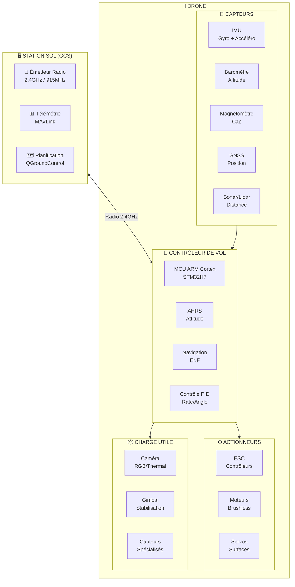

### Points Clés
- **PX4** et **ArduPilot** dominent le marché open-source
- **Pixhawk** est le standard hardware pour les contrôleurs de vol
- **MAVLink** est le protocole de communication universel
- Les drones **VTOL** combinent avantages des multirotors et ailes fixes
- **GPS multi-constellation** (GPS/GLONASS/Galileo/BeiDou) pour précision

---

## 2. Types de Drones et Architectures

### 2.1 Classification des Drones

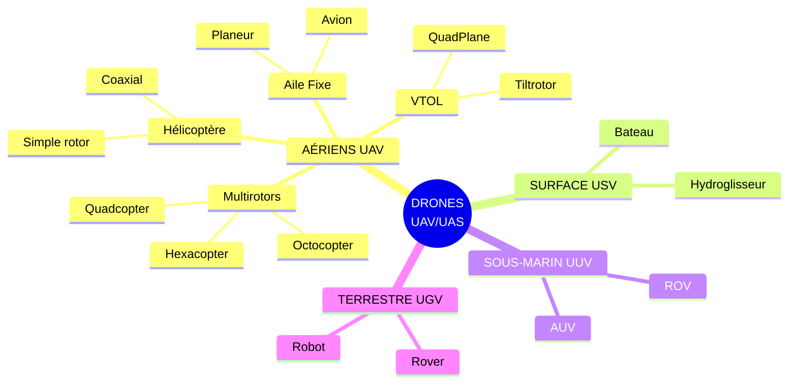

### 2.2 Comparatif des Architectures

| Type | Avantages | Inconvénients | Autonomie | Usage |
|------|-----------|---------------|-----------|-------|
| **Multirotor** | Vol stationnaire, précision, simplicité | Autonomie limitée | 15-45 min | Photo, inspection |
| **Aile Fixe** | Longue portée, efficacité | Piste requise, pas de hover | 1-3h | Cartographie, surveillance |
| **VTOL** | Polyvalent, longue portée + hover | Complexité, coût | 1-2h | Livraison, inspection |
| **Hélicoptère** | Charge utile, stabilité | Mécanique complexe | 30-60 min | Transport, agriculture |

### 2.3 Dynamique de Vol - Quadcopter (6-DOF)

**Document source**: `Autopilot Quad copter Drone.pdf`

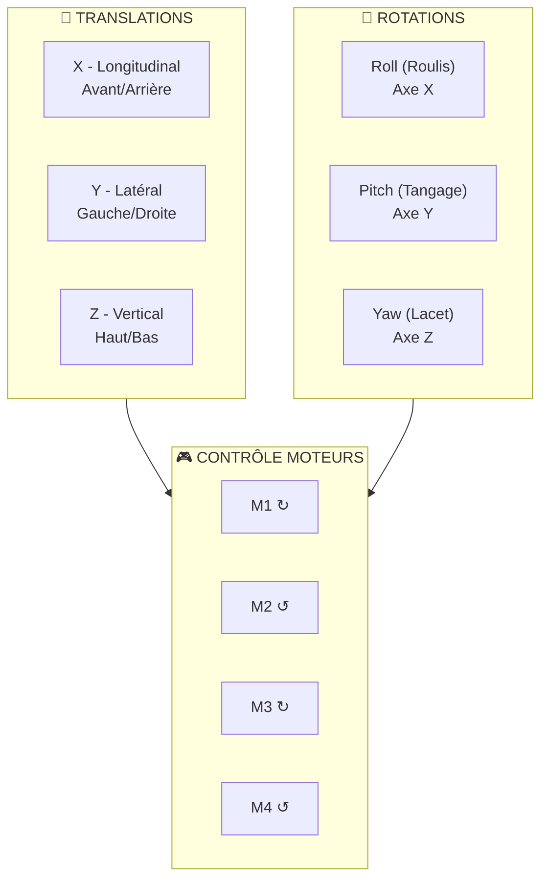

#### Mouvements de Base

| Mouvement | Action Moteurs | Effet |
|-----------|----------------|-------|
| **Throttle** | Tous +/- | Montée/Descente |
| **Roll** | M1,M4 vs M2,M3 | Inclinaison latérale |
| **Pitch** | M1,M2 vs M3,M4 | Inclinaison avant/arrière |
| **Yaw** | M1,M3 vs M2,M4 | Rotation sur place |

---

## 3. Solutions Autopilotes Analysées

### 3.1 AR.Drone Parrot

**Document source**: `Dossier-technique-AR-Drone.pdf` (175 pages)

#### 📷 Aperçu Visuel

| Page 1 - Couverture | Page 2 - Sommaire |
|:-------------------:|:-----------------:|
| 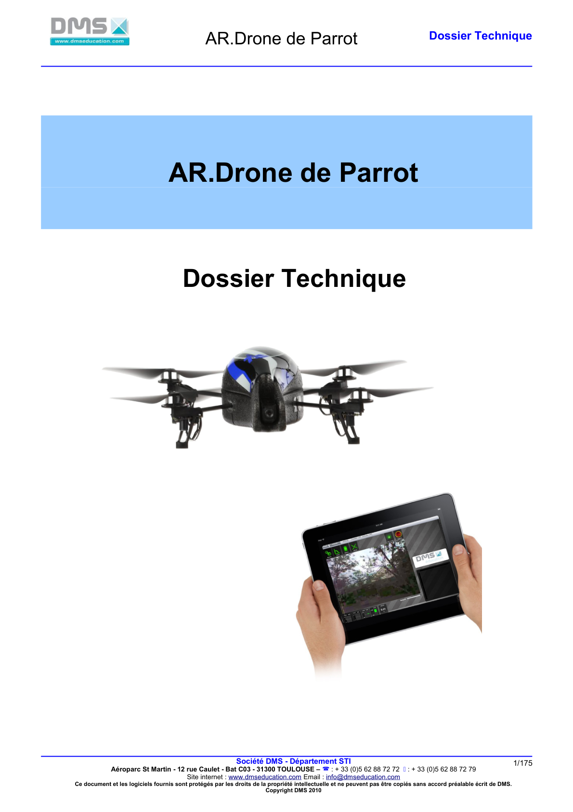 | 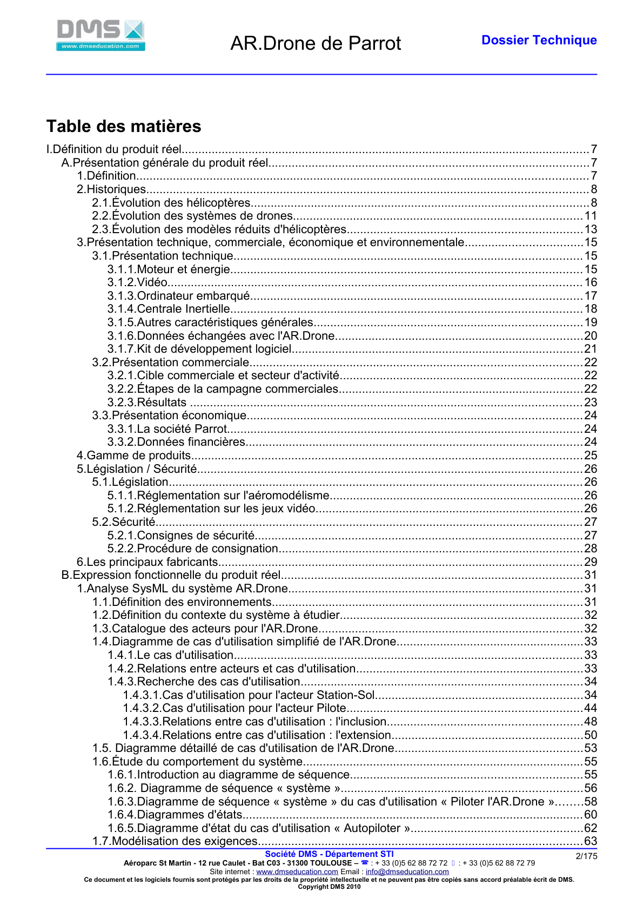 |

| Page 3 - Architecture | Page 4 - Composants |
|:---------------------:|:-------------------:|
| 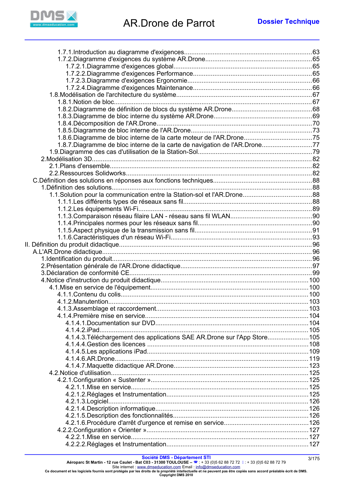 | 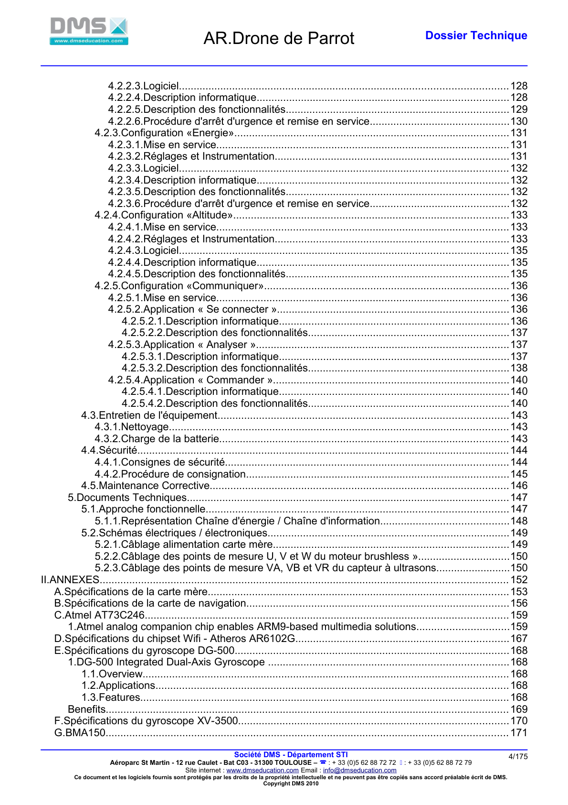 |

#### Spécifications Techniques

| Caractéristique | Valeur |
|-----------------|--------|
| **Type** | Quadricoptère |
| **Pilotage** | iPhone/iPad/Android via WiFi |
| **Processeur** | ARM9 468MHz |
| **OS** | Linux embarqué |
| **Caméras** | Frontale + Verticale |
| **Communication** | WiFi 802.11n |
| **Autonomie** | ~12 minutes |

#### Architecture Système

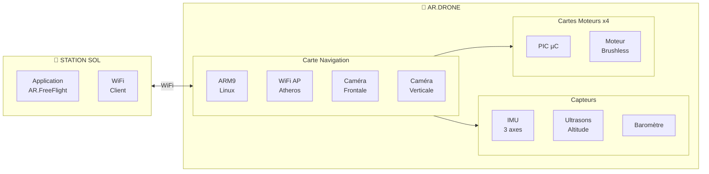

#### Fonctionnalités Autopilote

- ✅ Décollage/Atterrissage automatique
- ✅ Vol stationnaire (hover)
- ✅ Stabilisation automatique
- ✅ Retour en cas de perte WiFi
- ✅ Détection de marqueurs (réalité augmentée)
- ✅ SDK de développement disponible

---

### 3.2 Heliplane LRS (VTOL)

**Document source**: `Heliplane-LRS-Spécifications-techniques.pdf`

#### 📷 Aperçu Visuel

| Page 1 - Spécifications | Page 2 - Détails |
|:-----------------------:|:----------------:|
| 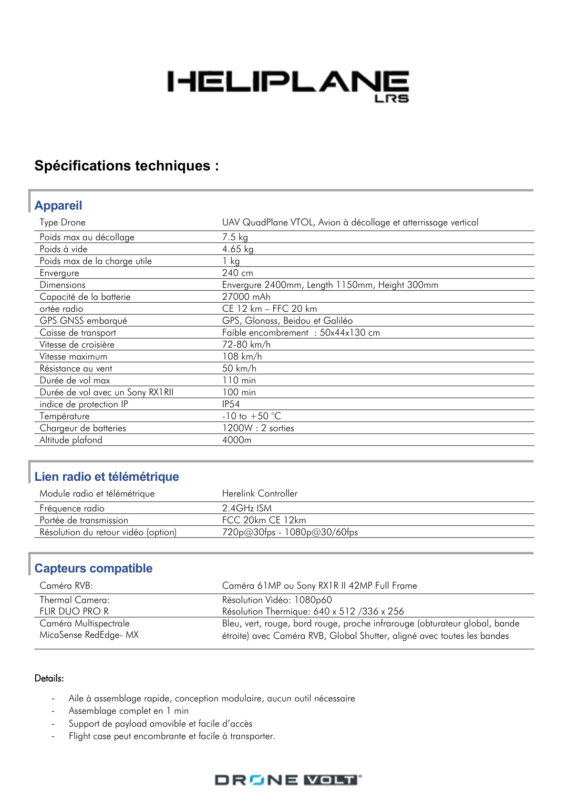 | 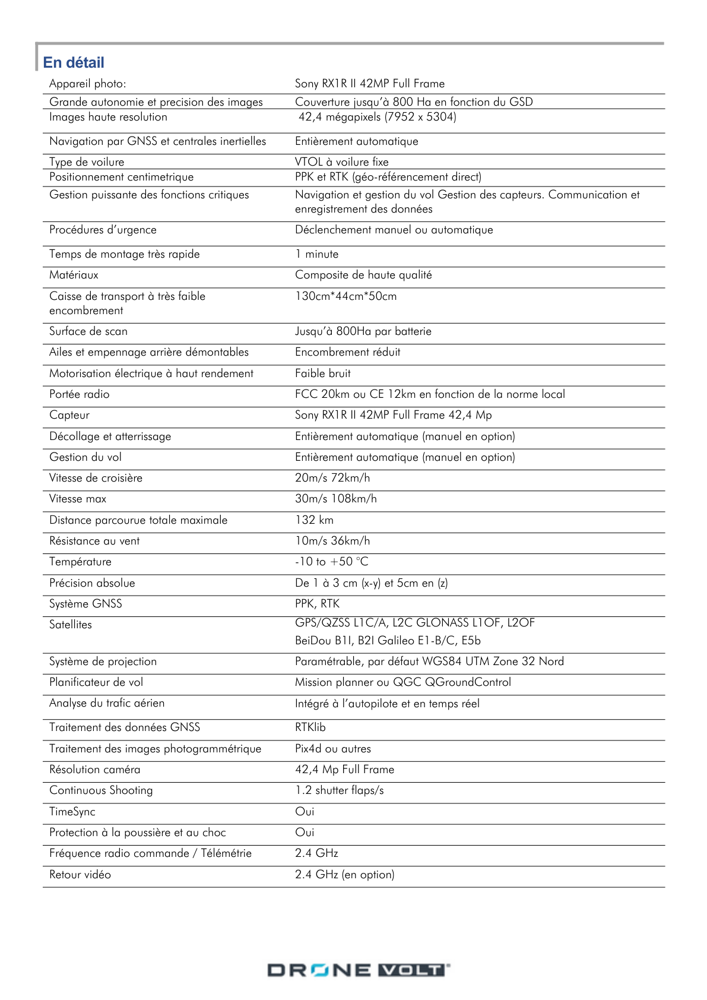 |

#### Spécifications Techniques

| Caractéristique | Valeur |
|-----------------|--------|
| **Type** | QuadPlane VTOL |
| **Poids max décollage** | 7.5 kg |
| **Poids à vide** | 4.65 kg |
| **Charge utile max** | 1 kg |
| **Envergure** | 240 cm |
| **Dimensions** | 2400 x 1150 x 300 mm |
| **Batterie** | 27000 mAh |
| **Durée de vol max** | 110 min |
| **Durée avec Sony RX1RII** | 100 min |
| **Vitesse croisière** | 72-80 km/h |
| **Vitesse max** | 108 km/h |
| **Résistance au vent** | 50 km/h |
| **Altitude plafond** | 4000 m |
| **Température** | -10°C à +50°C |
| **Indice IP** | IP54 |

#### Navigation et Communication

| Système | Spécification |
|---------|---------------|
| **GNSS** | GPS, GLONASS, BeiDou, Galileo |
| **Positionnement** | PPK et RTK (centimétrique) |
| **Précision absolue** | 1-3 cm (X-Y), 5 cm (Z) |
| **Radio** | Herelink Controller 2.4GHz |
| **Portée** | FCC 20km / CE 12km |
| **Retour vidéo** | 720p@30fps - 1080p@60fps |
| **Planificateur** | Mission Planner / QGroundControl |

#### Capteurs Compatibles

| Type | Modèle | Résolution |
|------|--------|------------|
| **RGB** | Sony RX1R II | 42.4 MP Full Frame |
| **Thermique** | FLIR DUO PRO R | 640x512 / 336x256 |
| **Multispectrale** | MicaSense RedEdge-MX | 5 bandes + RGB |

---

### 3.3 Drone Hydrographique OceanREPER V2

**Document source**: `GuideUtilisateur_OceanREPERV2.pdf`

#### 📷 Aperçu Visuel

| Page 1 - Couverture | Page 2 - Sommaire |
|:-------------------:|:-----------------:|
| 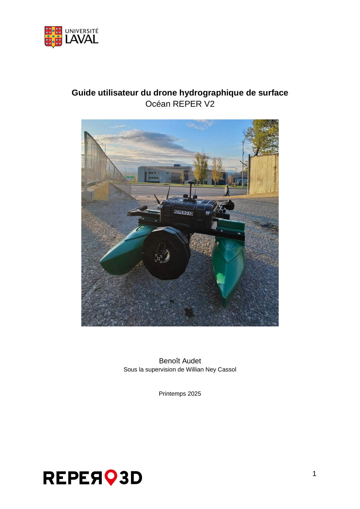 | 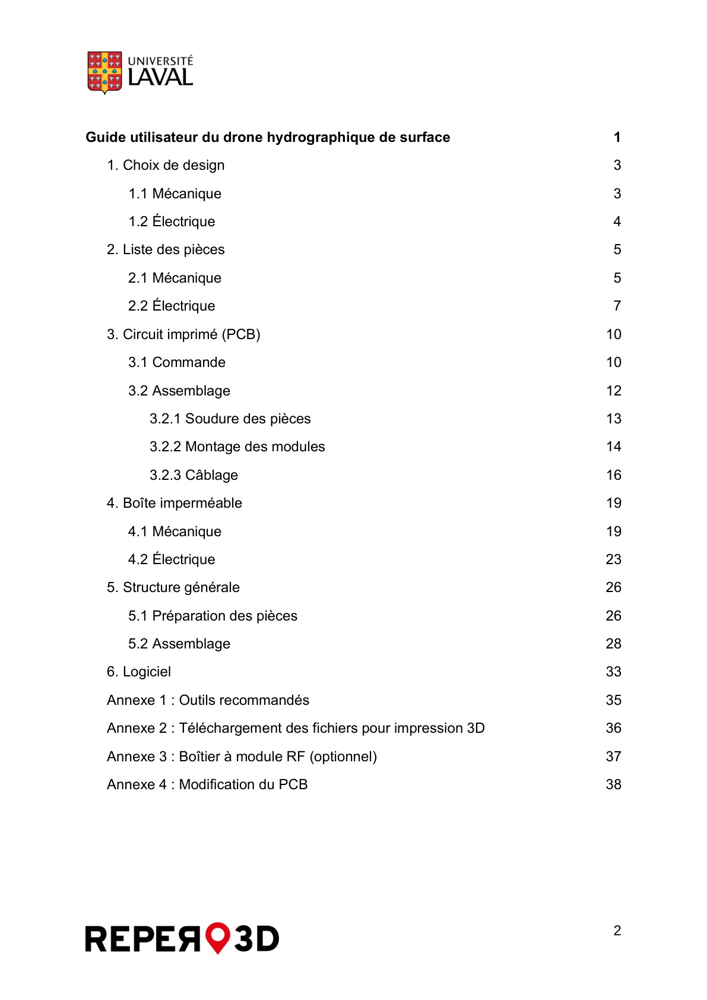 |

| Page 3 - Design | Page 4 - Électrique |
|:---------------:|:-------------------:|
| 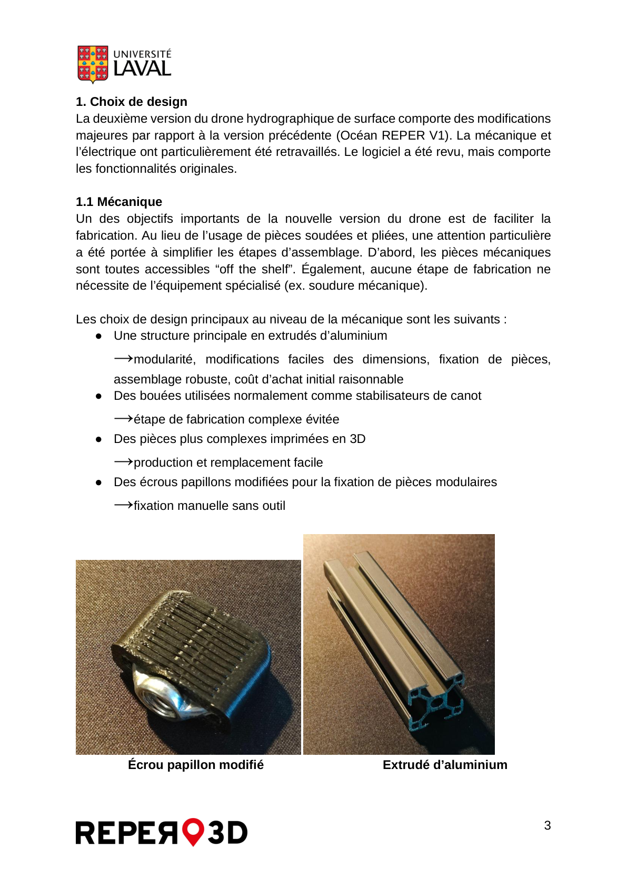 | 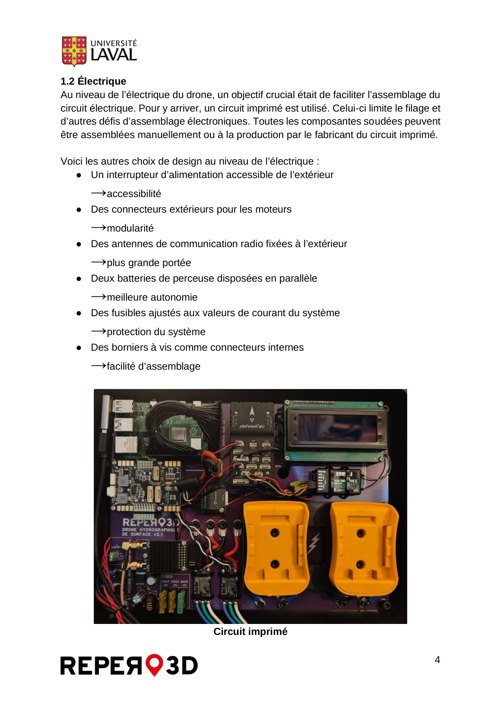 |

#### Caractéristiques

| Composant | Spécification |
|-----------|---------------|
| **Type** | USV (Drone de surface) |
| **Structure** | Extrudés aluminium 3030 |
| **Flotteurs** | Stabilisateurs de canot |
| **Autopilote** | Pixhawk 6C |
| **GPS** | M8N |
| **Télémétrie** | RFD 900x (330$) |
| **Moteurs** | Blue Robotics T200 x2 |
| **ESC** | Blue Robotics Basic ESC |
| **Batterie** | 2x DeWalt 20V 5Ah |
| **Ordinateur** | Raspberry Pi 4 (2GB) |
| **Sonar** | Blue Robotics Ping2 |
| **Radiocommande** | FlySky FS-i6x |

#### Architecture Électrique

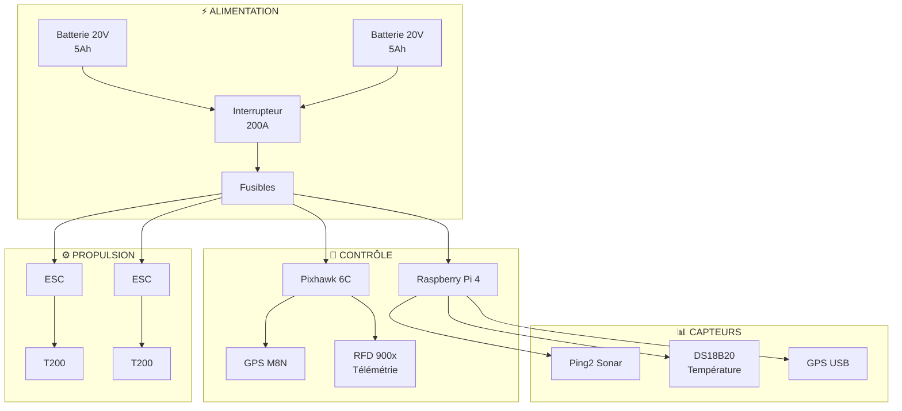

---

### 3.4 Kit Holybro X650

**Document source**: `StarDice_Drone V3.pdf`

#### 📷 Aperçu Visuel

| Page 1 - Introduction | Page 2 - Types |
|:---------------------:|:--------------:|
| 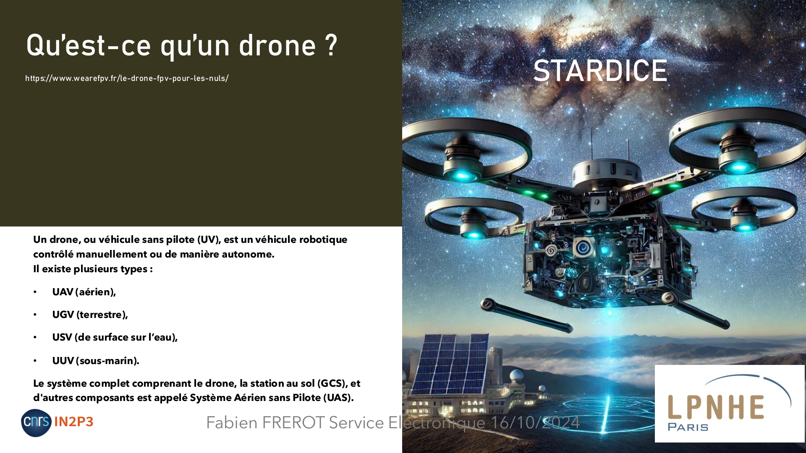 | 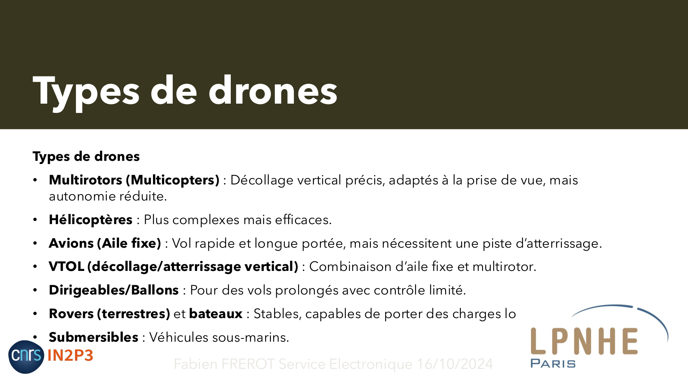 |

| Page 3 - Autopilotes | Page 4 - Composants |
|:--------------------:|:-------------------:|
| 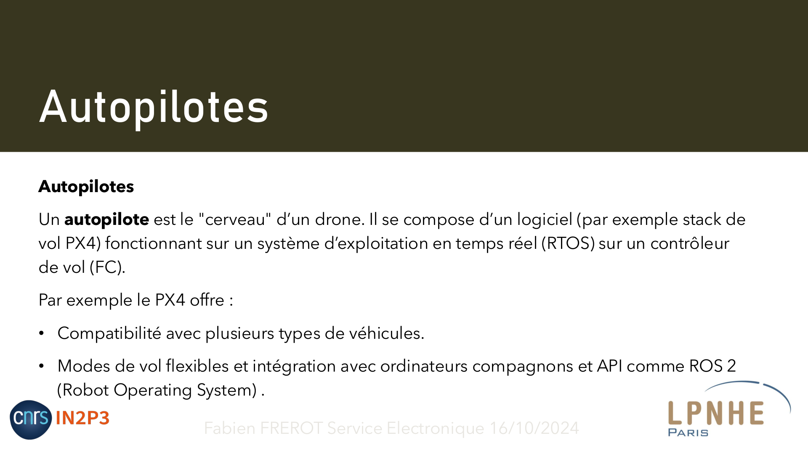 | 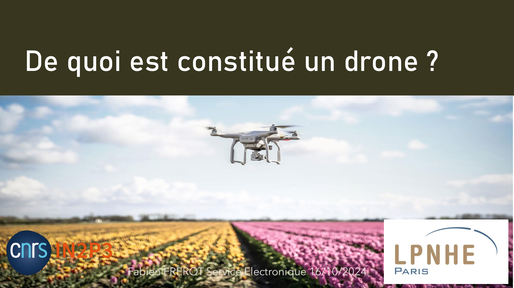 |

#### Contenu du Kit X650

| Composant | Modèle | Quantité |
|-----------|--------|----------|
| **Contrôleur de vol** | Pixhawk 6X + PM02D | 1 |
| **GPS** | Module M10 | 1 |
| **Télémétrie** | Radio V3 433/915MHz | 1 |
| **Châssis** | X650 V2 (bras pliables) | 1 |
| **Moteurs** | T-Motor MN4014 330Kv | 4 |
| **ESC** | Tekko32 F4 45A | 4 |
| **Hélices** | Gemfan 1555 carbone | 4 |
| **LED** | NeoPixel WS2812 | 4 |
| **Distribution** | PDB (XT60/XT30) | 1 |

#### Charge Utile

| Configuration | Capacité |
|---------------|----------|
| Sans batterie | 4.5 kg |
| Avec 5200mAh (750g) | 3.5 kg |
| Avec 10000mAh (1.2kg) | 3.1 kg |

---

### 3.5 UAV Navigation - Logistique

**Document source**: `whitepaper-logistic-uav-en.pdf`

#### 📷 Aperçu Visuel

| Page 1 - Couverture | Page 2 - Contexte |
|:-------------------:|:-----------------:|
| 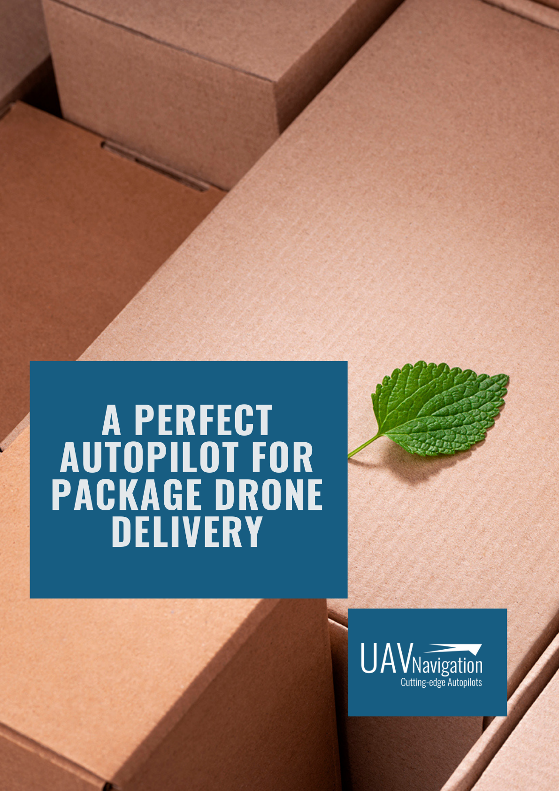 | 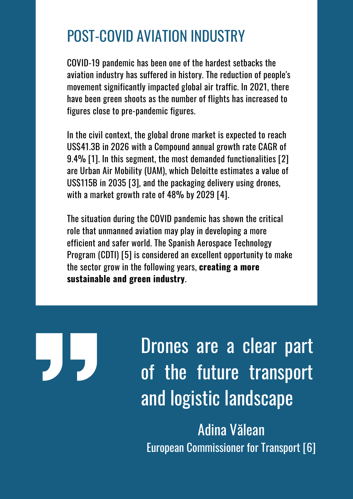 |

| Page 3 - Fonctionnalités | Page 4 - Waypoints |
|:------------------------:|:------------------:|
| 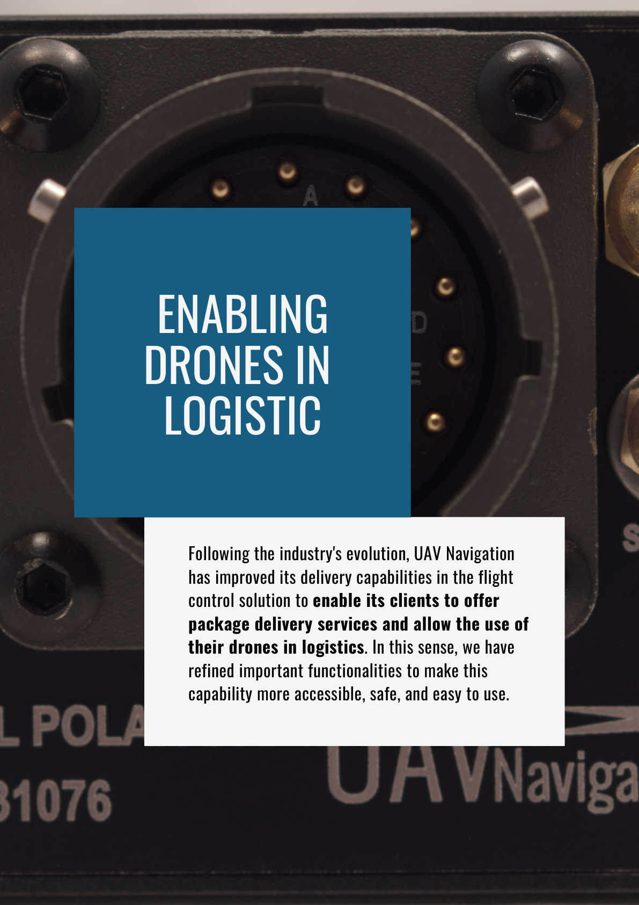 | 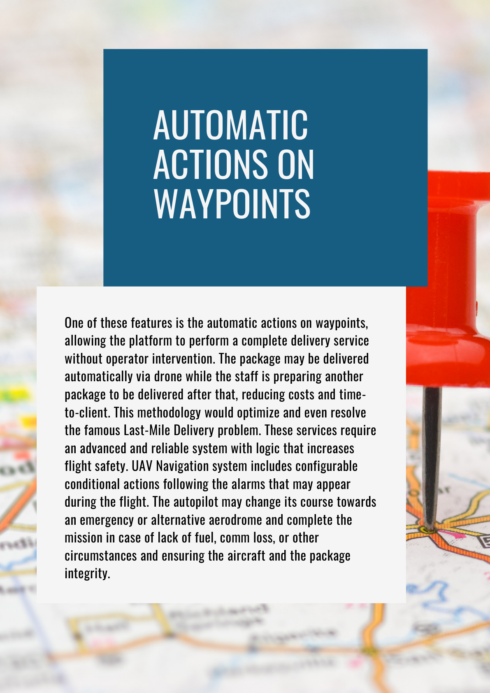 |

#### Fonctionnalités Clés pour la Livraison

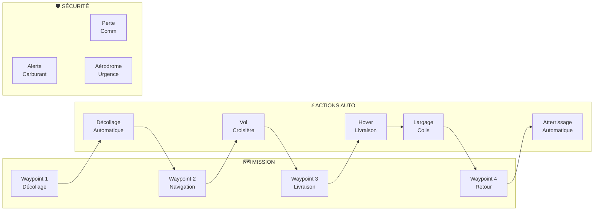

#### Technologies UAV Navigation

| Technologie | Description |
|-------------|-------------|
| **POLAR AHRS** | Estimation direction vent pour atterrissage sûr |
| **VECTOR Autopilot** | Gamme d'autopilotes professionnels |
| **VTOL Control** | Contrôle hybride aile fixe + multirotor |
| **Multi-UAV** | Opérations coordonnées multi-drones |
| **VaNeT Project** | Réseau multi-agents pour transport sécurisé |

#### Marché des Drones (Projections)

| Segment | Valeur | Année |
|---------|--------|-------|
| Marché global drones | $41.3B | 2026 |
| Urban Air Mobility (UAM) | $115B | 2035 |
| Livraison par drone | +48% CAGR | 2029 |

---

## 4. Contrôleurs de Vol (Flight Controllers)

### 4.1 Pixhawk 6X

**Document source**: `StarDice_Drone V3.pdf`

#### Spécifications Techniques

| Catégorie | Spécification |
|-----------|---------------|
| **Processeur FMU** | STM32H753 ARM Cortex-M7 480MHz |
| **Mémoire FMU** | 2MB Flash, 1MB RAM |
| **Processeur IO** | STM32F103 ARM Cortex-M3 72MHz |
| **Mémoire IO** | 64KB SRAM |

#### Capteurs Embarqués (Rev8)

| Type | Modèle |
|------|--------|
| **Accéléro/Gyro** | 3x ICM-45686 (BalancedGyro) |
| **Baromètre** | ICP20100 + BMP388 |
| **Magnétomètre** | BMM150 |

#### Interfaces

| Interface | Quantité | Description |
|-----------|----------|-------------|
| **PWM Servo** | 16 | Sorties servo |
| **Serial** | 4 | 3 avec flow control |
| **GPS** | 2 | 1 full + 1 basic |
| **I2C** | 1 | Bus capteurs |
| **CAN** | 2 | Périphériques CAN |
| **Ethernet** | 1 | 100Mbps |
| **SPI** | 1 | 2 chip select |
| **USB** | 1 | Configuration |

#### Dimensions et Poids

| Élément | Dimensions | Poids |
|---------|------------|-------|
| Module FC | 38.8 x 31.8 x 14.6 mm | 23g |
| Standard Baseboard | 52.4 x 103.4 x 16.7 mm | 51g |
| Mini Baseboard | 43.4 x 72.8 x 14.2 mm | 26.5g |

### 4.2 KK 2.1.5 (Entrée de gamme)

**Document source**: `Autopilot Quad copter Drone.pdf`

| Caractéristique | Valeur |
|-----------------|--------|
| **Dimensions** | 50.5 x 50.5 x 12 mm |
| **Poids** | 21g |
| **MCU** | ATmega644 PA |
| **IMU** | MPU6050 |
| **Auto-level** | Oui |
| **Tension** | 4.8-6.0V |
| **Firmware** | Version 1.6 |

### 4.3 Comparatif Flight Controllers

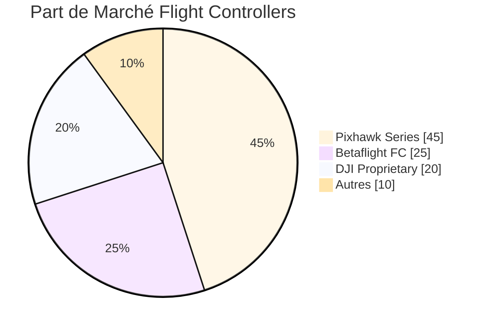

| Critère | Pixhawk 6X | KK 2.1.5 | DJI A3 |
|---------|------------|----------|--------|
| **Prix** | ~$300 | ~$30 | ~$1500 |
| **Open Source** | ✅ | ✅ | ❌ |
| **Processeur** | STM32H7 | ATmega644 | Propriétaire |
| **IMU** | 3x ICM-45686 | MPU6050 | Propriétaire |
| **GPS** | Externe | Non | Intégré |
| **Waypoints** | Illimité | Non | 99 |
| **VTOL** | ✅ | ❌ | ✅ |
| **SDK** | PX4/ArduPilot | Non | DJI SDK |

---

## 5. Systèmes de Navigation et Capteurs

### 5.1 Architecture de Navigation

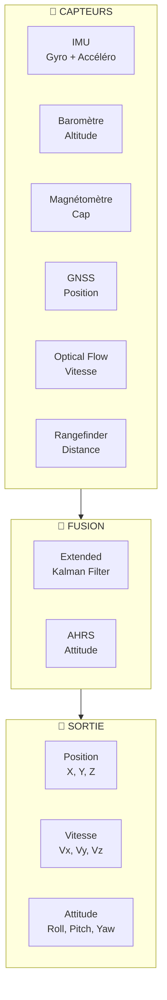

### 5.2 Capteurs Typiques

| Capteur | Fonction | Interface | Exemple |
|---------|----------|-----------|---------|
| **IMU** | Orientation | SPI/I2C | ICM-45686, MPU6050 |
| **Baromètre** | Altitude | I2C | BMP388, MS5611 |
| **Magnétomètre** | Cap | I2C | BMM150, HMC5883L |
| **GPS** | Position | UART | u-blox M8N, M10 |
| **Optical Flow** | Vitesse sol | I2C | PX4Flow, PMW3901 |
| **Lidar** | Distance | I2C/UART | TFmini, VL53L1X |
| **Sonar** | Altitude basse | Analog | HC-SR04, Ping2 |

### 5.3 GNSS Multi-Constellation

| Constellation | Région | Satellites |
|---------------|--------|------------|
| **GPS** | USA | 31 |
| **GLONASS** | Russie | 24 |
| **Galileo** | Europe | 30 |
| **BeiDou** | Chine | 35 |
| **QZSS** | Japon | 4 |

#### Précision Positionnement

| Mode | Précision Horizontale | Précision Verticale |
|------|----------------------|---------------------|
| **GPS seul** | 2-5 m | 5-10 m |
| **Multi-GNSS** | 1-2 m | 2-5 m |
| **SBAS/EGNOS** | 0.5-1 m | 1-2 m |
| **RTK** | 1-3 cm | 3-5 cm |
| **PPK** | 1-3 cm | 3-5 cm |

---

## 6. Applications et Cas d'Usage

### 6.1 Système Multi-UAV pour Inspection

**Document source**: `Presentation_Fi3E.pdf`

#### 📷 Aperçu Visuel

| Page 1 - Titre | Page 2 - Contexte |
|:--------------:|:-----------------:|
| 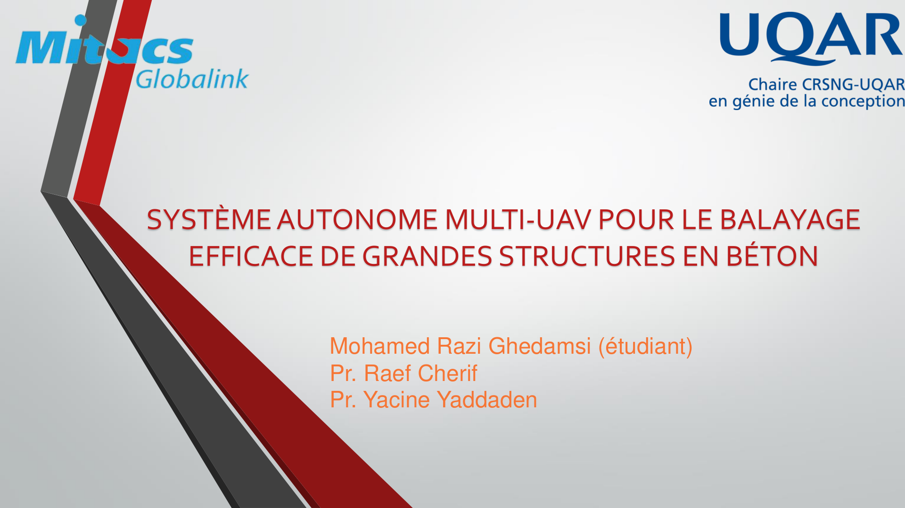 | 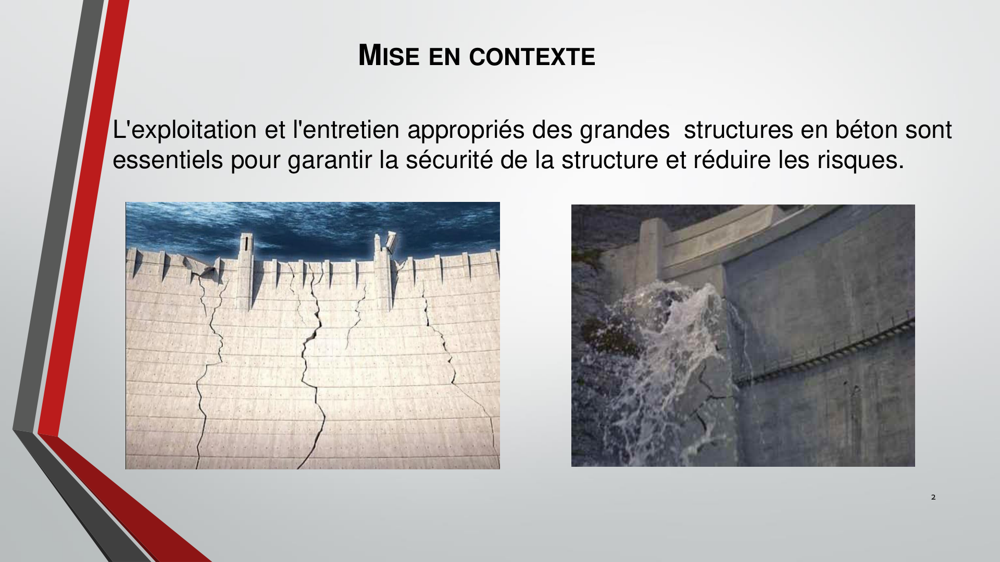 |

| Page 3 - Problématique | Page 4 - Solution |
|:----------------------:|:-----------------:|
| 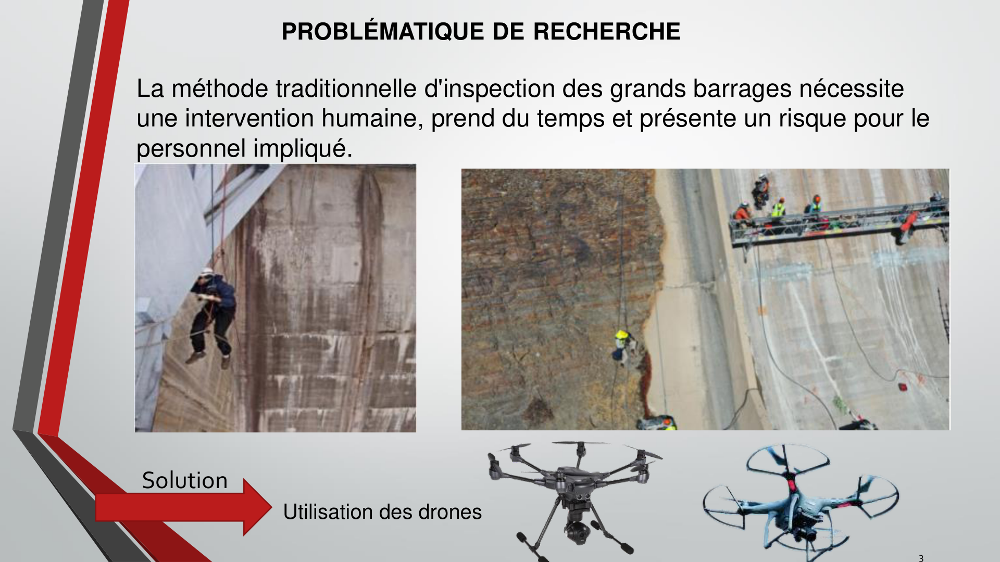 | 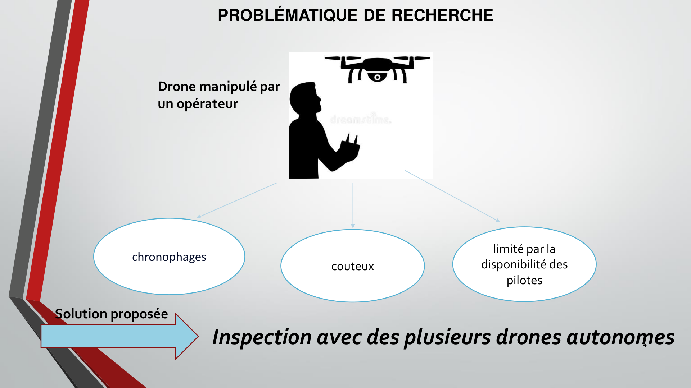 |

#### Architecture Multi-UAV

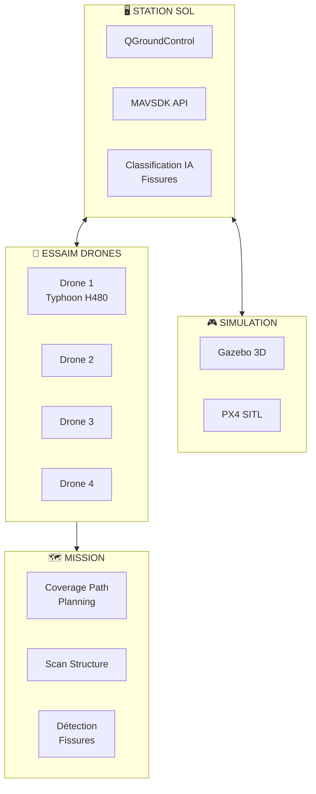

#### Résultats Comparatifs

| Configuration | Temps de Balayage | Précision |
|---------------|-------------------|-----------|
| 1 drone | 263 s | 98% |
| 4 drones | 70 s | 93% |
| **Gain** | **-73%** | **-5%** |

### 6.2 Applications par Secteur

| Secteur | Applications | Capteurs |
|---------|--------------|----------|
| **Agriculture** | Cartographie, épandage | Multispectral, RGB |
| **Inspection** | Ponts, barrages, lignes | Thermique, RGB, Lidar |
| **Livraison** | Colis, médical | GPS RTK, Lidar |
| **Sécurité** | Surveillance, recherche | Thermique, zoom |
| **Cinéma** | Prise de vue aérienne | Gimbal, 4K/8K |
| **Cartographie** | Photogrammétrie, arpentage | RGB, Lidar, RTK |
| **Hydrographie** | Bathymétrie, qualité eau | Sonar, capteurs |

---

## 7. Recherche Académique

### 7.1 Contrôle PID pour Quadcopter

**Document source**: `Autopilot Quad copter Drone.pdf`

#### Boucle de Contrôle PID

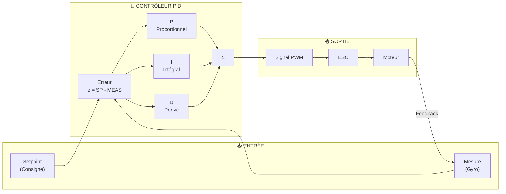

#### Paramètres PID

| Paramètre | Rôle | Effet si trop haut | Effet si trop bas |
|-----------|------|-------------------|-------------------|
| **P (Gain)** | Réponse à l'erreur | Oscillations HF | Réponse molle |
| **I (Intégral)** | Correction dérive | Rigidité, lenteur | Dérive, instabilité |
| **D (Dérivé)** | Amortissement | Vibrations, bruit | Rebonds, propwash |

### 7.2 Architecture Logicielle

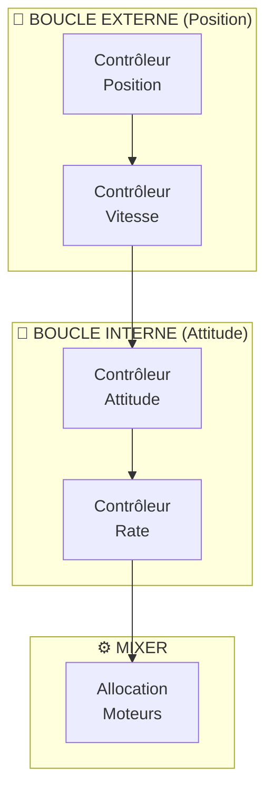

---

## 8. Tableau Comparatif Global

### 8.1 Comparatif Solutions Complètes

| Critère | AR.Drone | Heliplane LRS | OceanREPER | Holybro X650 |
|---------|----------|---------------|------------|--------------|
| **Type** | Quadcopter | VTOL QuadPlane | USV Surface | Hexacopter |
| **Usage** | Loisir/Dev | Pro Cartographie | Hydrographie | Dev/Recherche |
| **Autonomie** | 12 min | 110 min | Variable | 20-30 min |
| **Portée** | 50 m (WiFi) | 20 km | 330 m (RFD) | Variable |
| **Charge utile** | - | 1 kg | Sonar | 3-4.5 kg |
| **Autopilote** | Propriétaire | Intégré | Pixhawk 6C | Pixhawk 6X |
| **Open Source** | SDK | Non | ✅ | ✅ |
| **Prix** | ~300€ | >10000€ | ~2500€ | ~1500€ |

### 8.2 Comparatif Autopilotes Software

| Critère | PX4 | ArduPilot | DJI | Betaflight |
|---------|-----|-----------|-----|------------|
| **Open Source** | ✅ | ✅ | ❌ | ✅ |
| **Licence** | BSD | GPL | Propriétaire | GPL |
| **Véhicules** | Multi | Multi | DJI only | Multirotors |
| **VTOL** | ✅ | ✅ | ✅ | ❌ |
| **Waypoints** | ✅ | ✅ | ✅ | ❌ |
| **ROS** | ✅ | ✅ | ❌ | ❌ |
| **Simulation** | Gazebo, jMAVSim | SITL | DJI Sim | ❌ |
| **GCS** | QGroundControl | Mission Planner | DJI GO | Configurator |
| **Communauté** | Grande | Très grande | Support DJI | Grande |

### 8.3 Positionnement des Solutions

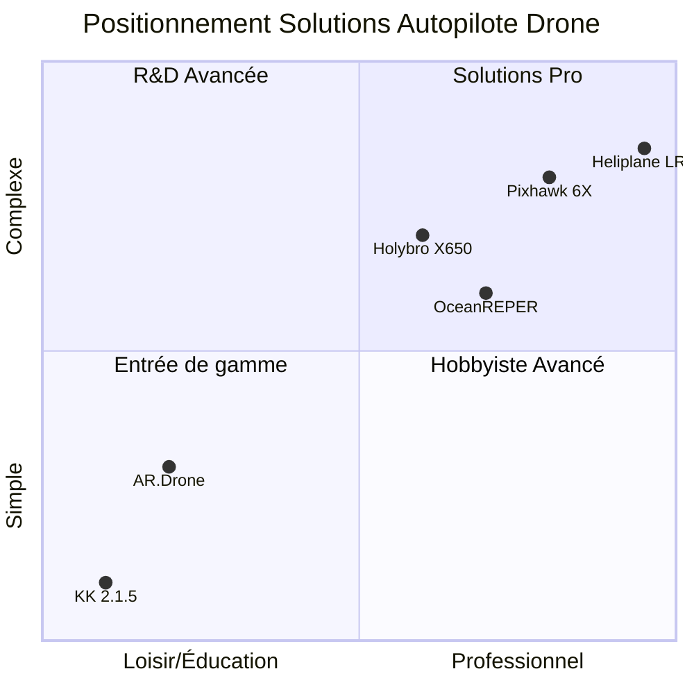

---

## 9. Recommandations

### 9.1 Choix de Solution selon Besoins

| Besoin | Solution Recommandée |
|--------|---------------------|
| **Apprentissage/Éducation** | AR.Drone, KK 2.1.5 |
| **Développement/Recherche** | Holybro X650 + Pixhawk 6X |
| **Cartographie professionnelle** | Heliplane LRS |
| **Hydrographie** | OceanREPER V2 |
| **Livraison** | VTOL + UAV Navigation |
| **Inspection multi-drone** | PX4 + MAVSDK |
| **FPV Racing** | Betaflight FC |

### 9.2 Architecture Recommandée pour Projet

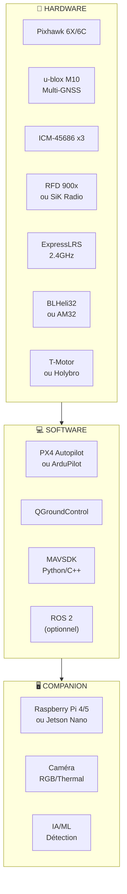

### 9.3 Roadmap de Développement

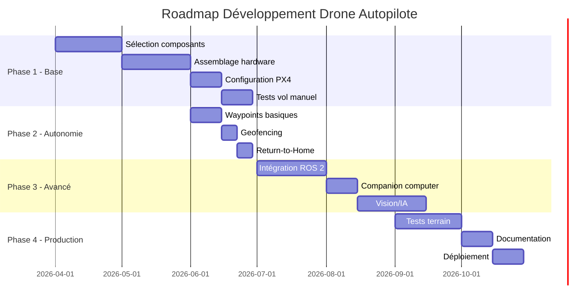

### 9.4 Points de Vigilance

1. **Réglementation**
   - Enregistrement obligatoire (>250g)
   - Formation pilote (catégories Open/Specific)
   - Zones de vol autorisées
   - Assurance RC

2. **Sécurité**
   - Failsafe configuré (RTH, Land)
   - Geofencing actif
   - Batterie LiPo (stockage, charge)
   - Pré-vol checklist

3. **Fiabilité**
   - Redondance capteurs (3x IMU)
   - GPS multi-constellation
   - Télémétrie bidirectionnelle
   - Logs de vol

---

## 10. Galerie d'Images Extraites

### 10.1 Index des Images

| Fichier | Source | Description |
|---------|--------|-------------|
| `Autopilot_Quadcopter_page_01-05.png` | Autopilot Quad copter Drone.pdf | Article scientifique quadcopter |
| `AR_Drone_page_01-07.png` | Dossier-technique-AR-Drone.pdf | Documentation technique AR.Drone |
| `OceanREPER_page_01-06.png` | GuideUtilisateur_OceanREPERV2.pdf | Guide drone hydrographique |
| `Heliplane_LRS_page_01-02.png` | Heliplane-LRS-Spécifications.pdf | Specs VTOL professionnel |
| `StarDice_Drone_page_01-05.png` | StarDice_Drone V3.pdf | Présentation composants drone |
| `Logistic_UAV_page_01-05.png` | whitepaper-logistic-uav-en.pdf | Whitepaper livraison drone |
| `Fi3E_page_01-04.png` | Presentation_Fi3E.pdf | Système multi-UAV inspection |
| `Autoplaneur_page_01.png` | Autoplaneur-poster-final.pdf | Poster projet autoplaneur |
| `Duperre_Thesis_page_01-04.png` | 2020_AlexandreDuperre.pdf | Thèse académique |
| `Kamni_Thesis_page_01-04.png` | 2023ESMA0014_kamni.pdf | Thèse ESMA |
| `Patent_EP_page_01-03.png` | EP17182759NWA1.pdf | Brevet européen |
| `Marchand_page_01-03.png` | marchandn.pdf | Document technique |
| `Patelli_Model_page_01-03.png` | patelli16model.pdf | Modélisation |

---

## Annexes

### A. Documents Sources Analysés

| # | Fichier | Type | Pages | Taille |
|---|---------|------|-------|--------|
| 1 | `Autopilot Quad copter Drone.pdf` | Article | 10 | 308 KB |
| 2 | `Dossier-technique-AR-Drone.pdf` | Documentation | 175 | 24.8 MB |
| 3 | `GuideUtilisateur_OceanREPERV2.pdf` | Guide | 40+ | 4.3 MB |
| 4 | `Heliplane-LRS-Spécifications-techniques.pdf` | Specs | 2 | 59 KB |
| 5 | `StarDice_Drone V3.pdf` | Présentation | 25 | 4.4 MB |
| 6 | `whitepaper-logistic-uav-en.pdf` | Whitepaper | 9 | 6.1 MB |
| 7 | `Presentation_Fi3E.pdf` | Présentation | 11 | 748 KB |
| 8 | `2020_AlexandreDuperre.pdf` | Thèse | 100+ | 5.7 MB |
| 9 | `2023ESMA0014_kamni.pdf` | Thèse | 150+ | 6.4 MB |
| 10 | `EP17182759NWA1.pdf` | Brevet | 22 | 585 KB |
| 11 | `tesi.pdf` | Thèse | 200+ | 14.7 MB |
| 12 | `marchandn.pdf` | Rapport | 11 | 637 KB |
| 13 | `patelli16model.pdf` | Article | 6 | 410 KB |
| 14 | `Autoplaneur-poster-final.pdf` | Poster | 1 | 527 KB |
| 15 | `1901.0063v1.pdf` | Article | 18 | 926 KB |
| 16 | `000819608.pdf` | Document | 25+ | 1.4 MB |
| 17 | `td20_pc_maelforestal_controlealtitude.pdf` | TP | 1 | 265 KB |

### B. Glossaire

| Terme | Définition |
|-------|------------|
| **AHRS** | Attitude and Heading Reference System |
| **ArduPilot** | Firmware open-source pour autopilotes |
| **BEC** | Battery Eliminator Circuit |
| **BLDC** | Brushless DC Motor |
| **CPP** | Coverage Path Planning |
| **EKF** | Extended Kalman Filter |
| **ESC** | Electronic Speed Controller |
| **FPV** | First Person View |
| **GCS** | Ground Control Station |
| **GNSS** | Global Navigation Satellite System |
| **IMU** | Inertial Measurement Unit |
| **LiPo** | Lithium Polymer (batterie) |
| **MAVLink** | Micro Air Vehicle Link (protocole) |
| **MAVSDK** | MAVLink SDK |
| **PID** | Proportional-Integral-Derivative |
| **PPK** | Post-Processing Kinematic |
| **PX4** | Firmware autopilote open-source |
| **PWM** | Pulse Width Modulation |
| **RTOS** | Real-Time Operating System |
| **RTK** | Real-Time Kinematic |
| **SITL** | Software In The Loop |
| **UAV** | Unmanned Aerial Vehicle |
| **UAS** | Unmanned Aircraft System |
| **USV** | Unmanned Surface Vehicle |
| **VTOL** | Vertical Take-Off and Landing |

### C. Ressources Externes

| Ressource | URL |
|-----------|-----|
| **PX4 Documentation** | https://docs.px4.io |
| **ArduPilot** | https://ardupilot.org |
| **QGroundControl** | https://qgroundcontrol.com |
| **Holybro** | https://holybro.com |
| **MAVSDK** | https://mavsdk.mavlink.io |
| **ROS 2** | https://docs.ros.org |
| **Gazebo** | https://gazebosim.org |

---

*Document généré automatiquement à partir de l'analyse des PDFs du dossier "Autopilote drone"*
