# Benchmark Solution de Géolocalisation Poids Lourd

## Document d'Architecture et Analyse

**Date de création**: Mars 2026  
**Sources analysées**: 3 benchmarks existants (Géolocalisation, Autopilote Drone, Ground Control Station)  
**Contexte**: Solution adaptée pour la géolocalisation de flottes de poids lourds

---

## Table des Matières

1. [Résumé Exécutif](#1-résumé-exécutif)
2. [Architecture Générale du Système](#2-architecture-générale-du-système)
3. [Solution Hardware](#3-solution-hardware)
4. [Systèmes de Navigation et Capteurs](#4-systèmes-de-navigation-et-capteurs)
5. [Navigation Poids Lourd](#5-navigation-poids-lourd)
6. [Solution Firmware](#6-solution-firmware)
7. [Solution Software](#7-solution-software)
8. [Communications et Connectivité](#8-communications-et-connectivité)
9. [Station de Contrôle et Gestion de Flotte](#9-station-de-contrôle-et-gestion-de-flotte)
10. [Technologies de Données](#10-technologies-de-données)
11. [Variantes et Configurations](#11-variantes-et-configurations)
12. [Aspects Réglementaires et Conformité](#12-aspects-réglementaires-et-conformité)
13. [Applications et Cas d'Usage](#13-applications-et-cas-dusage)
14. [Analyse Comparative](#14-analyse-comparative)
15. [Recommandations et Roadmap](#15-recommandations-et-roadmap)
16. [Tarification](#16-tarification)
17. [Annexes](#17-annexes)

---

## 1. Résumé Exécutif

### 1.1 Présentation

Ce document présente une **solution complète de géolocalisation pour poids lourds** inspirée des meilleures pratiques issues de trois domaines : la géolocalisation véhicule, les systèmes autopilotes drones, et les stations de contrôle au sol. La solution propose une architecture modulaire et évolutive adaptée aux besoins spécifiques du transport routier de marchandises.

### 1.2 Points Clés

- **Architecture hybride** combinant technologies véhicule et drone pour précision
- **Multi-constellation GNSS** (GPS/GLONASS/Galileo/BeiDou) avec correction IMU
- **Communication multi-mode** (4G/5G, LTE-M, LoRaWAN, Satellite)
- **Station de contrôle multiflotte** inspirée des GCS militaires
- **Conformité RGPD** et réglementation transport intégrée
- **Map-matching avancé** avec fusion multi-capteurs
- **Navigation spécifique poids lourd** avec profil véhicule

### 1.3 Positionnement de la Solution

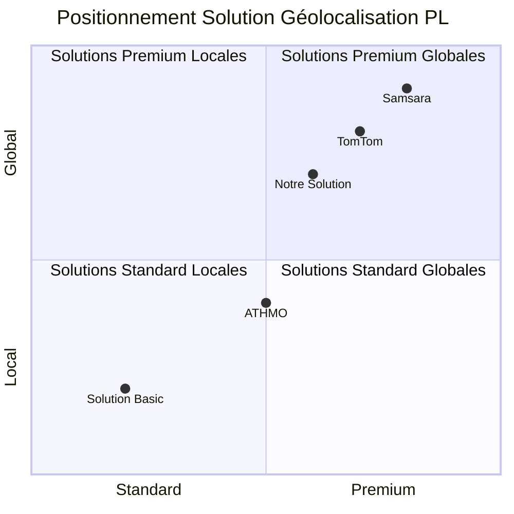

---

## 2. Architecture Générale du Système

### 2.1 Architecture Générale d'un Système de Géolocalisation

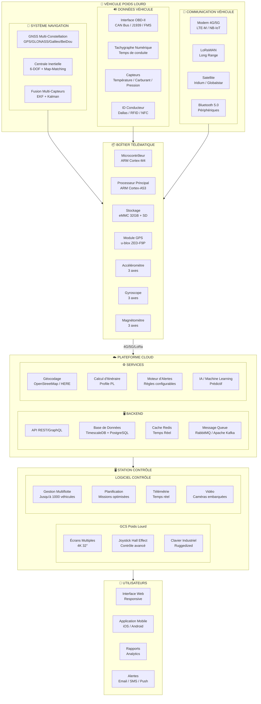

### 2.2 Flux de Données Temps Réel

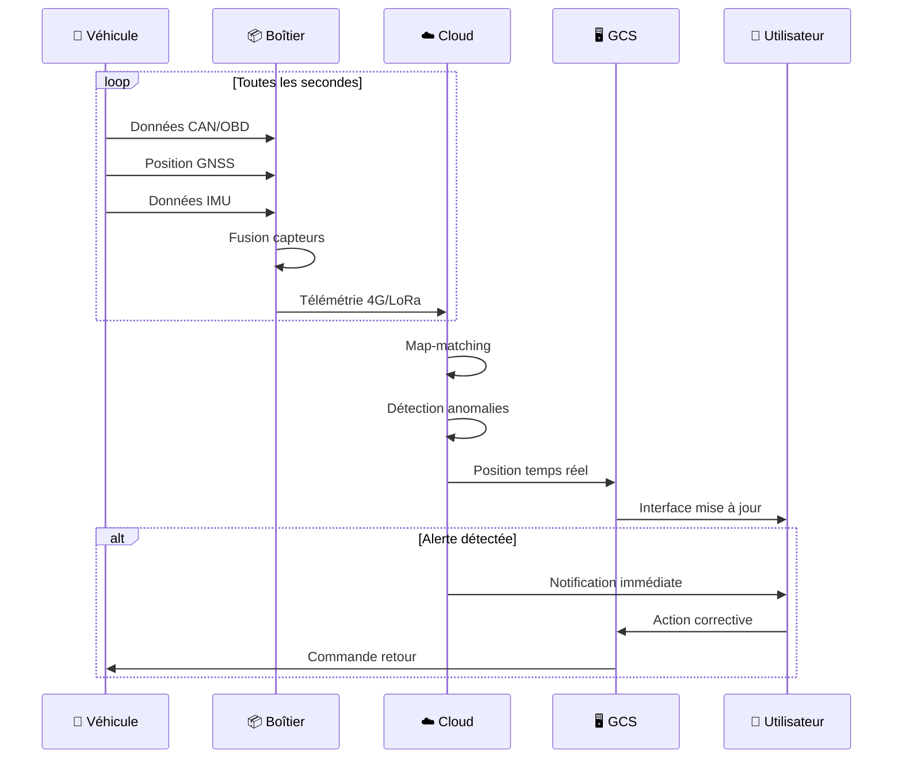

### 2.3 Architecture Modulaire

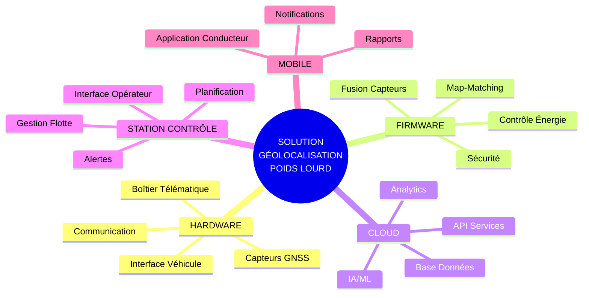

### 2.4 Écosystème de la Solution

```mermaid
flowchart LR
    subgraph ECOSYSTEM["🌍 ÉCOSYSTÈME"]
        VEHICLES["Flotte<br/>1000+ Véhicules"]
        OPERATORS["Opérateurs<br/>24/7"]
        MAINTENANCE["Maintenance<br/>Prédictive"]
        PARTNERS["Partenaires<br/>API"]
    end
    
    subgraph INTEGRATIONS["🔗 INTÉGRATIONS")
        ERP["ERP / TMS"]
        FUEL["Stations Carburant"]
        WEATHER["Météo"]
        TRAFFIC["Trafic"]
        AUTHORITIES["Autorités")
    end
    
    ECOSYSTEM <--> INTEGRATIONS
```

---

## 3. Solution Hardware

### 3.1 Description de la Solution Hardware

La solution hardware propose un **boîtier télématique industriel** conçu spécifiquement pour les poids lourds, combinant robustesse, précision et connectivité multi-mode.

### 3.2 Architecture Interne

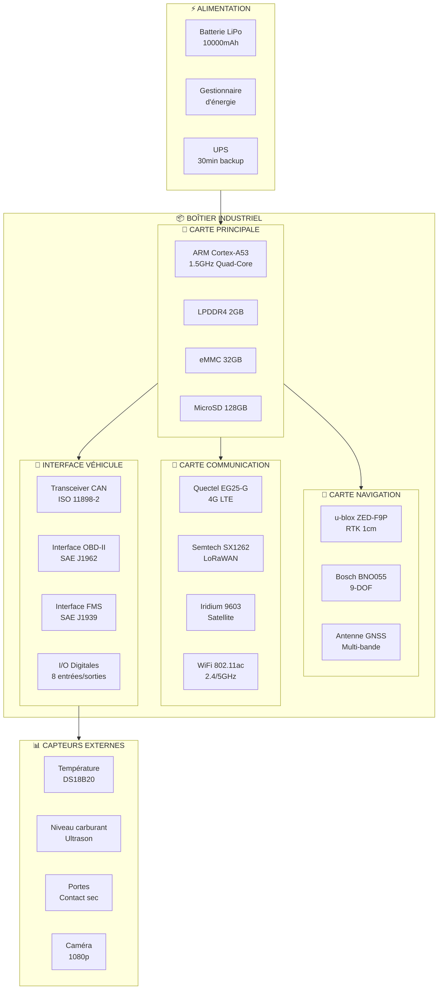

### 3.3 Spécifications Techniques

#### 3.3.1 Dimensions et Poids

| Caractéristique | Valeur |
|-----------------|--------|
| **Dimensions** | 150 x 100 x 45 mm |
| **Poids** | 450 g |
| **Boîtier** | Aluminium IP67 |
| **Température** | -40°C à +85°C |
| **Humidité** | 95% non condensée |
| **Vibration** | MIL-STD-810G |
| **Chocs** | 100g / 11ms |

#### 3.3.2 Caractéristiques

| Catégorie | Spécification |
|-----------|---------------|
| **Processeur** | ARM Cortex-A53 1.5GHz Quad-Core |
| **RAM** | LPDDR4 2GB |
| **Stockage** | eMMC 32GB + MicroSD 128GB |
| **OS** | Linux Yocto 4.19 |
| **Boot time** | < 10 secondes |
| **MTBF** | > 100,000 heures |

#### 3.3.3 Charge Utile

| Type | Capacité |
|------|----------|
| **Capteurs** | Jusqu'à 16 capteurs I2C/SPI |
| **Caméras** | 4x USB 3.0 ou IP |
| **Entrées/Sorties** | 8x digitales, 4x analogiques |
| **Communication** | 4x LTE, 2x LoRa, 1x Satellite |

### 3.4 Connectivité

#### 3.4.1 Interfaces

| Interface | Quantité | Spécification |
|-----------|----------|---------------|
| **CAN** | 2x | ISO 11898-2 (250kbps/500kbps) |
| **OBD-II** | 1x | SAE J1962 |
| **USB** | 4x | USB 3.0 Type-A |
| **Ethernet** | 1x | 10/100 Mbps |
| **RS-232** | 2x | DB9 |
| **Audio** | 1x | Entrée/Sortie 3.5mm |

#### 3.4.2 Interfaces Véhicule

| Protocole | Support |
|-----------|---------|
| **J1939** | ✅ Standard poids lourd |
| **FMS** | ✅ Fleet Management |
| **OBD-II** | ✅ Diagnostic |
| **CAN Open** | ✅ Industriel |
| **Modbus** | ✅ Capteurs |

#### 3.4.3 Interfaces Hardware Typiques

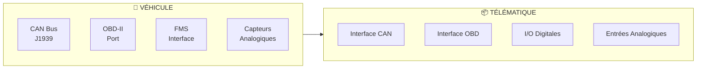

### 3.5 Architecture Électrique

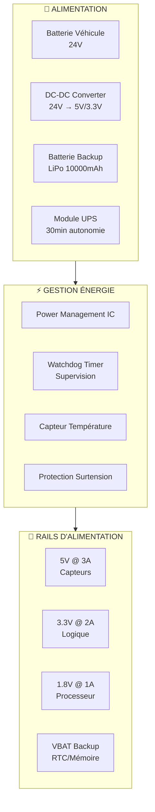

---

## 4. Systèmes de Navigation et Capteurs

### 4.1 Technologies de Navigation

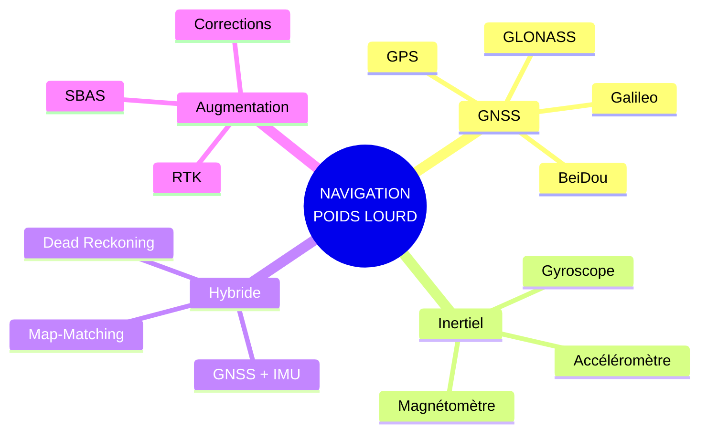

### 4.2 GNSS Multi-Constellation

| Constellation | Satellites | Fréquences | Précision |
|---------------|------------|------------|-----------|
| **GPS** | 31 | L1/L2/L5 | 1-3m |
| **GLONASS** | 24 | L1/L2 | 2-4m |
| **Galileo** | 30 | E1/E5/E6 | 0.5-1m |
| **BeiDou** | 35 | B1/B2/B3 | 1-2m |
| **QZSS** | 4 | L1/L2/L5 | 0.5m (Japon) |

#### Configuration Multi-Constellation

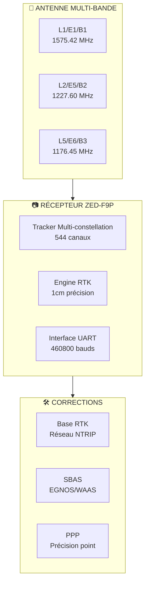

### 4.3 Précision Positionnement

| Mode | Précision H | Précision V | Temps | Usage |
|------|-------------|-------------|-------|-------|
| **Autonome** | 1.5m | 3m | Instant | Base |
| **SBAS** | 0.8m | 1.5m | <1min | Amélioré |
| **DGPS** | 0.5m | 1m | <30s | Local |
| **RTK** | 1cm | 2cm | <10s | Précision |
| **PPP** | 10cm | 20cm | 30min | Global |

### 4.4 Correction de Position par Centrale IMU

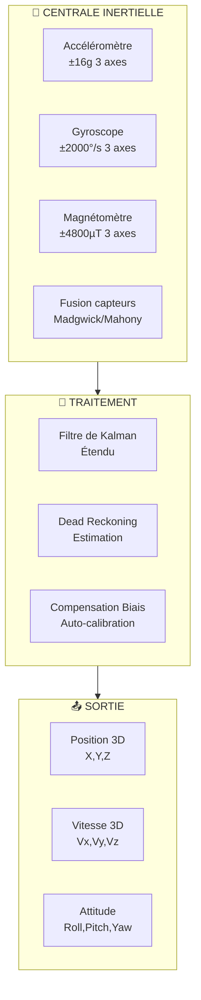

### 4.5 Capteurs Embarqués

| Capteur | Type | Précision | Fréquence | Usage |
|---------|------|-----------|-----------|-------|
| **Accéléromètre** | MEMS 3 axes | ±0.01g | 100Hz | Dynamique |
| **Gyroscope** | MEMS 3 axes | ±0.1°/s | 100Hz | Rotation |
| **Magnétomètre** | MEMS 3 axes | ±0.5° | 50Hz | Cap |
| **Baromètre** | MEMS | ±1Pa | 10Hz | Altitude |
| **Température** | Digital | ±0.5°C | 1Hz | Surveillance |

### 4.6 Capteurs Compatibles

| Catégorie | Exemples | Interface |
|-----------|----------|-----------|
| **Température** | DS18B20, PT100 | 1-Wire, SPI |
| **Carburant** | Ultrason, Capacitif | Analog, I2C |
| **Pression** | MPX5700, BMP280 | Analog, I2C |
| **Humidité** | DHT22, SHT30 | Digital, I2C |
| **Caméras** | USB, IP Camera | USB, Ethernet |

### 4.7 Fonctionnalités GPS

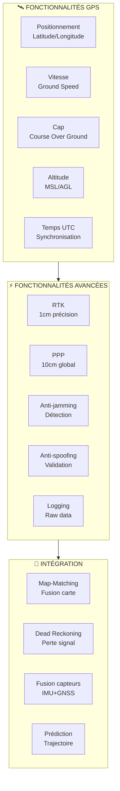

---

## 5. Navigation Poids Lourd

### 5.1 Logique de Navigation Poids Lourd

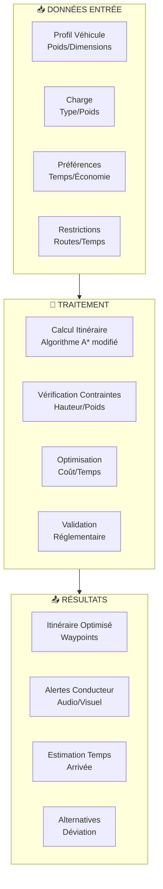

### 5.2 Classification des Véhicules

| Classe | Poids | Hauteur | Longueur | Largeur | Usage |
|--------|-------|---------|----------|---------|-------|
| **PL1** | <3.5t | <2.5m | <6m | <2.5m | Utilitaire |
| **PL2** | 3.5-12t | 2.5-4m | 6-12m | 2.5-2.55m | Porteur |
| **PL3** | 12-19t | 3-4m | 10-12m | 2.55m | Porteur lourd |
| **PL4** | 19-32t | 4m | 12-16.5m | 2.55m | Semi-remorque |
| **PL5** | 32-44t | 4m | 16.5-18.75m | 2.55m | Grand ensemble |

### 5.3 Profil Véhicule

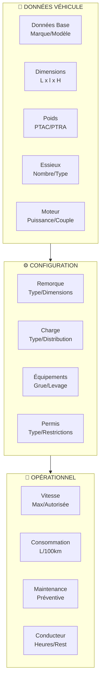

### 5.4 Dynamique du Véhicule

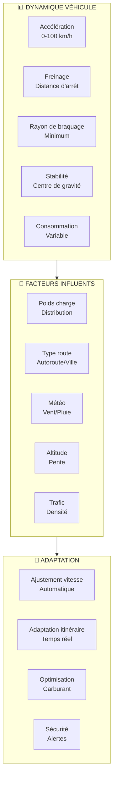

### 5.5 Calcul d'Itinéraire Adapté

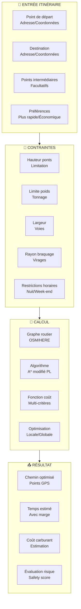

### 5.6 Alertes Conducteur

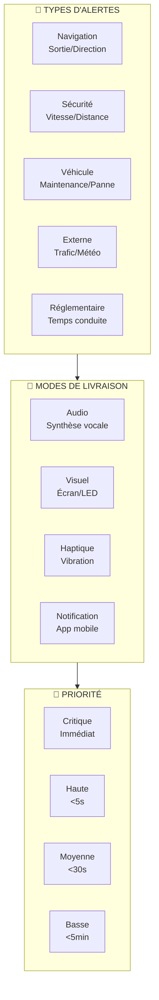

### 5.7 Fonctionnalités Navigation Poids Lourd

#### 5.7.1 Infos Trafic Temps Réel

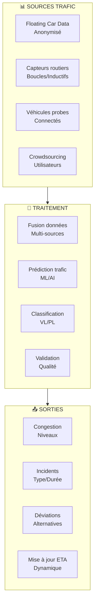

#### 5.7.2 Trafic via Données Mobiles

| Source | Couverture | Fréquence | Précision | Coût |
|--------|------------|-----------|-----------|-------|
| **FCD Anonymisé** | Nationale | 1-5 min | 100-500m | Gratuit |
| **Opérateurs** | Nationale | 30s-1min | 50-200m | Payant |
| **Waze** | Mondiale | 1-2 min | 10-50m | Gratuit |
| **HERE** | Mondiale | 1min | 10-100m | Payant |

#### 5.7.3 Commande Vocale

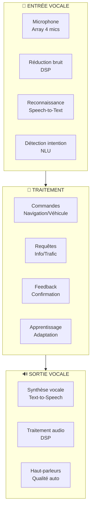

#### 5.7.4 Mains Libres

- **Reconnaissance vocale** multilingue (FR/EN/DE/ES/IT)
- **Commandes intuitives** : "Naviguer vers", "Éviter autoroute", "Rechercher station"
- **Feedback audio** confirmations et instructions
- **Détection activation** mot-clé personnalisable
- **Mode privé** désactivation micro

#### 5.7.5 Raccordement Externe

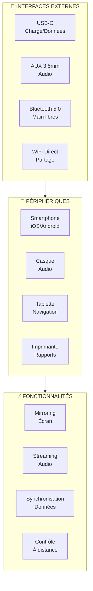

#### 5.7.6 Mises à Jour et POI Live

| Type | Fréquence | Source | Contenu |
|------|-----------|--------|---------|
| **Cartes** | Mensuel | HERE/OpenStreetMap | Réseau routier |
| **POI** | Hebdomadaire | Communauté | Stations/services |
| **Restrictions** | Quotidien | Autorités | Temporaire/Permanente |
| **Trafic** | Temps réel | FCD/Opérateurs | Congestion/incidents |
| **Logiciel** | Mensuel | OTA | Fonctionnalités/Sécurité |

#### 5.7.7 Calendrier Interdictions PL

```mermaid
flowchart TB
    subgraph RESTRICTIONS["🚦 INTERDICTIONS PL"]
        TIME["Horaires<br/>Nuit/Week-end"]
        SEASONAL["Saisonnières<br/>Hiver/Été"]
        LOCAL["Locales<br/>Villes/Zones"]
        ENVIRONMENT["Environnementales<br/>CRIT'Air"]
        WEIGHT["Poids<br/>Tonnage limité"]
    end
    
    subframe RULES["📋 RÈGLES"]
        COUNTRY["Pays<br/>Réglementation"]
        REGION["Région<br/>Spécifique"]
        CITY["Ville<br/>ZEP/ZE"]
        ROAD["Route<br/>Type/Voie"]
        VEHICLE["Véhicule<br/>Classe/Matériel"]
    end
    
    subgraph ENFORCEMENT["👮 APPLICATION"]
        CHECK["Vérification<br/>Automatique"]
        ALERT["Alerte<br/>Conducteur"]
        DETOUR["Déviation<br/>Proposée"]
        LOG["Journalisation<br/>Conformité"]
    end
    
    RESTRICTIONS --> RULES
    RULES --> ENFORCEMENT
```

#### 5.7.8 Affichage Dénivelé Itinéraire

```mermaid
flowchart TB
    subgraph ELEVATION["⛰️ DONNÉES ALTITUDE"]
        DEM["MNE<br/>Digital Elevation"]
        GPS_ALT["Altitude GPS<br/>Brute"]
        BARO_ALT["Altitude baromètre<br/>Corrigée"]
        MAP_DATA["Données carte<br/>OpenStreetMap"]
    end
    
    subgraph PROCESSING_E["🧞 TRAITEMENT"]
        SMOOTHING["Lissage<br/>Courbe"]
        GRADIENT["Calcul pente<br/>Pourcentage"]
        SEGMENT["Segmentation<br/>Montée/Descente"]
        VISUALIZATION["Visualisation<br/>Graphique"]
    end
    
    subgraph DISPLAY_E["📤 AFFICHAGE"]
        PROFILE["Profil altimétrique<br/>Graphique"]
        GRADES["Pentes<br/>Couleurs"]
        WAYPOINTS["Waypoints<br/>Altitude"]
        STATISTICS["Statistiques<br/>Dénivelé"]
    end
    
    ELEVATION --> PROCESSING_E
    PROCESSING_E --> DISPLAY_E
```

---

## 6. Solution Firmware

### 6.1 Description de la Solution Firmware

Le firmware assure le **contrôle temps réel** du boîtier télématique, la **fusion multi-capteurs**, et la **gestion des communications**. Basé sur un RTOS (Real-Time Operating System) pour garantir la fiabilité et la réactivité.

### 6.2 Contrôleurs de Conduite

```mermaid
flowchart TB
    subgraph DRIVING_CONTROLLERS["🎛️ CONTRÔLEURS CONDUITE"]
        CRUISE["Régulateur<br/>Vitesse"]
        ADAPTIVE["Adaptatif<br/>Distance"]
        LANE["Maintien<br/>Voie"]
        EMERGENCY["Freinage<br/>Urgence"]
    end
    
    subgraph INPUTS_D["📥 ENTRÉES"]
        SPEED["Vitesse<br/>GPS/OBD"]
        DISTANCE["Distance<br/>Radar/Lidar"]
        LANE_MARK["Marquage<br/>Caméra"]
        OBSTACLE["Obstacles<br/>Multi-capteurs"]
    end
    
    subgraph OUTPUTS_D["📤 SORTIES"]
        THROTTLE["Accélérateur<br/>CAN"]
        BRAKE["Frein<br/>CAN"]
        STEERING["Direction<br/>CAN"]
        ALERTS_D["Alertes<br/>Audio/Visuel"]
    end
    
    INPUTS_D --> DRIVING_CONTROLLERS
    DRIVING_CONTROLLERS --> OUTPUTS_D
```

### 6.3 Contrôle PID

#### 6.3.1 Paramètres PID

| Paramètre | Description | Valeur typique | Réglage |
|-----------|-------------|----------------|--------|
| **Kp** | Gain proportionnel | 0.5-2.0 | Réactivité |
| **Ki** | Gain intégral | 0.01-0.5 | Stabilité |
| **Kd** | Gain dérivé | 0.001-0.1 | Amortissement |
| **Ts** | Période échantillonnage | 10-100ms | Fréquence |
| **Output Limit** | Limite sortie | ±100% | Saturation |

```mermaid
flowchart TB
    subgraph PID_LOOP["🔄 BOUCLE PID"]
        SETPOINT["Consigne<br/>Vitesse/Direction"]
        MEASUREMENT["Mesure<br/>Capteurs"]
        ERROR["Erreur<br/>e = SP - PV"]
        PID_CALC["Calcul PID<br/>Kp*e + Ki*∫e + Kd*de/dt"]
        OUTPUT["Sortie<br/>Actionneurs"]
    end
    
    subgraph TUNING["🎛️ RÉGLAGE"]
        ZIEGLER["Méthode Ziegler-Nichols"]
        COHEN["Méthode Cohen-Coon"]
        AUTO["Auto-tuning<br/>Adaptatif"]
        MANUAL["Manuel<br/>Expert"]
    end
    
    SETPOINT --> ERROR
    MEASUREMENT --> ERROR
    ERROR --> PID_CALC
    PID_CALC --> OUTPUT
    PID_CALC --> TUNING
```

### 6.4 Architecture de Fusion Multi-Capteurs (Map-Matching)

#### 6.4.1 Processus de Map-Matching

```mermaid
flowchart TB
    subgraph INPUT_MM["📥 ENTRÉES MAP-MATCHING"]
        GPS_POS["Position GPS<br/>Lat/Lon/Accuracy"]
        IMU_DATA["Données IMU<br/>Accélérations/Vitesses"]
        OBD_SPEED["Vitesse OBD<br/>Véhicule"]
        MAP_DATA["Carte routière<br/>OSM/HERE"]
    end
    
    subgraph PREPROCESSING["🔧 PRÉ-TRAITEMENT"]
        FILTERING["Filtrage<br/>Kalman"]
        SEGMENTATION["Segmentation<br/>Route candidates"]
        SCORING["Scoring<br/>Probabilités"]
        SELECTION["Sélection<br/>Meilleur segment"]
    end
    
    subgraph MATCHING["🎯 APPARIEMENT"]
        PROJECTION["Projection<br/>Point sur route"]
        CONFIDENCE["Confiance<br/>Score matching"]
        CORRECTION["Correction<br/>Position"]
        VALIDATION["Validation<br/>Cross-check"]
    end
    
    subgraph OUTPUT_MM["📤 SORTIE"]
        MATCHED_POS["Position appariée<br/>Précise"]
        ROAD_ATTRIB["Attributs route<br/>Type/Vitesse"]
        HEADING_MM["Cap corrigé<br/>Direction route"]
        CONFIDENCE_LEVEL["Niveau confiance<br/>0-100%"]
    end
    
    INPUT_MM --> PREPROCESSING
    PREPROCESSING --> MATCHING
    MATCHING --> OUTPUT_MM
```

#### 6.4.2 Problématique Fusion Multi-Capteurs (Map-Matching)

| Défi | Cause | Solution |
|------|-------|----------|
| **GPS urbain** | Multipath/canyons | Fusion IMU + Map-matching |
| **Tunnels** | Perte signal | Dead reckoning + OBD |
| **Erreur carte** | Carte obsolète | Détection incohérence |
| **Performance** | Temps réel | Optimisation algorithmes |
| **Précision** | Multi-sources | Pondération adaptative |

#### 6.4.3 Algorithmes Fusion Multi-Capteurs (Map-Matching)

```mermaid
flowchart TB
    subgraph ALGORITHMS["🧮 ALGORITHMES"]
        KALMAN["Filtre Kalman<br/>Linéaire/Étendu"]
        PARTICLE["Filtre à particules<br/>Non-linéaire"]
        HMM["Modèle de Markov<br/>Caché"]
        VITERBI["Algorithme Viterbi<br/>Chemin optimal"]
    end
    
    subgraph WEIGHTING["⚖️ PONDÉRATION"]
        GPS_WEIGHT["Poids GPS<br/>SNR/HDOP"]
        IMU_WEIGHT["Poids IMU<br/>Stabilité"]
        MAP_WEIGHT["Poids carte<br/>Confiance"]
        SPEED_WEIGHT["Poids vitesse<br/>Consistance"]
    end
    
    subgraph OPTIMIZATION["🚀 OPTIMISATION"]
        REAL_TIME["Temps réel<br/><100ms"]
        MEMORY["Mémoire<br/>Limitée"]
        POWER["Consommation<br/>Optimisée"]
        SCALABILITY["Scalabilité<br/>Multi-véhicules"]
    end
    
    ALGORITHMS --> WEIGHTING
    WEIGHTING --> OPTIMIZATION
```

---

## 7. Solution Software

### 7.1 Description de la Solution Software

La solution software propose une **plateforme cloud-native** avec **microservices**, **API REST**, et **interface web/mobile** pour la gestion complète de flottes de poids lourds.

### 7.2 Architecture Logicielle

```mermaid
flowchart TB
    subgraph FRONTEND["🎨 FRONTEND"]
        WEB_PORTAL["Portail Web<br/>React/Vue.js"]
        MOBILE_APP["Application Mobile<br/>React Native"]
        DASHBOARD["Dashboard<br/>Analytics"]
        ADMIN["Admin<br/>Configuration"]
    end
    
    subgraph API_GATEWAY["🚪 API GATEWAY"]
        AUTH["Authentification<br/>JWT/OAuth2"]
        RATE_LIMIT["Rate Limiting<br/>Par utilisateur"]
        ROUTING["Routing<br/>Load balancer"]
        MONITORING["Monitoring<br/>Health checks"]
    end
    
    subgraph MICROSERVICES["⚙️ MICROSERVICES"]
        VEHICLE_SVC["Service Véhicule<br/>CRUD/État"]
        TRACKING_SVC["Service Tracking<br/>Temps réel"]
        ROUTE_SVC["Service Routage<br/>Optimisation"]
        ALERT_SVC["Service Alertes<br/>Notifications"]
        REPORT_SVC["Service Rapports<br/>Analytics"]
        USER_SVC["Service Utilisateurs<br/>Gestion"]
    end
    
    subgraph DATA["🗄️ DONNÉES"]
        POSTGRES["PostgreSQL<br/>Transactionnel"]
        TIMESCALE["TimescaleDB<br/>Time series"]
        REDIS["Redis<br/>Cache/Sessions"]
        MINIO["MinIO<br/>Stockage objet"]
    end
    
    subgraph INFRASTRUCTURE["☁️ INFRASTRUCTURE"]
        KUBERNETES["Kubernetes<br/>Orchestration"]
        DOCKER["Docker<br/>Containers"]
        PROMETHEUS["Prometheus<br/>Métriques"]
        GRAFANA["Grafana<br/>Monitoring"]
    end
    
    FRONTEND --> API_GATEWAY
    API_GATEWAY --> MICROSERVICES
    MICROSERVICES --> DATA
    MICROSERVICES --> INFRASTRUCTURE
```

### 7.3 Architecture Logicielle Type

```mermaid
flowchart TB
    subgraph PRESENTATION["🖥️ COUCHE PRÉSENTATION"]
        UI["Interface Utilisateur<br/>Responsive"]
        MAPS["Cartes<br/>OpenLayers/Mapbox"]
        CHARTS["Graphiques<br/>D3.js/Chart.js"]
        NOTIFICATIONS["Notifications<br/>Toast/Email"]
    end
    
    subgraph BUSINESS["⚙️ COUCHE MÉTIER"]
        LOGIC["Logique Métier<br/>Domain services"]
        VALIDATION["Validation<br/>Business rules"]
        CALCULATIONS["Calculs<br/>Routing/Optimization"]
        WORKFLOWS["Workflows<br/>Process automation"]
    end
    
    subgraph DATA_ACCESS["🗄️ COUCHE DONNÉES"]
        REPOSITORIES["Repositories<br/>Data access"]
        ORM["ORM<br/>TypeORM/Prisma"]
        CACHE["Cache<br/>Redis/Memory"]
        SEARCH["Search<br/>Elasticsearch"]
    end
    
    subgraph INTEGRATION["🔗 COUCHE INTÉGRATION"]
        EXTERNAL_API["API externes<br/>HERE/OpenStreetMap"]
        MESSAGE_QUEUE["Message queue<br/>RabbitMQ/Kafka"]
        WEBSOCKETS["WebSockets<br/>Temps réel"]
        FTP_SFTP["FTP/SFTP<br/>Fichiers"]
    end
    
    PRESENTATION --> BUSINESS
    BUSINESS --> DATA_ACCESS
    DATA_ACCESS --> INTEGRATION
```

### 7.4 Fonctionnalités du Système

#### 7.4.1 Fonctionnalités de Base

| Fonctionnalité | Description | Bénéfice |
|----------------|-------------|----------|
| **Tracking temps réel** | Position GPS toutes les secondes | Visibilité immédiate |
| **Historique** | 3 ans de données archivées | Analyse tendances |
| **Alertes** | Configurables par règles | Réactivité |
| **Rapports** | Automatisés et personnalisés | Productivité |
| **Géofencing** | Zones virtuelles | Sécurité |

#### 7.4.2 Fonctionnalités Principales

```mermaid
mindmap
  root((FONCTIONNALITÉS<br/>PRINCIPALES))
    Tracking
      Temps réel
      Historique
      Playback
    Navigation
      Itinéraires
      Optimisation
      Évitement
    Sécurité
      Géofencing
      Alertes
      Panique
    Maintenance
      Prédictive
      Planifiée
      Pannes
    Conformité
      Temps conduite
      Réglementaire
      Audits
```

#### 7.4.3 Fonctionnalités Clés

- **Multi-flotte** : Jusqu'à 1000 véhicules par organisation
- **Multi-utilisateur** : Rôles et permissions granulaires
- **Multi-langue** : 10 langues supportées
- **Intégration** : API REST/Webhook
- **Export** : CSV/PDF/Excel
- **SLA** : 99.9% disponibilité

#### 7.4.4 Fonctionnalités Avancées

| Avancée | Technologie | Usage |
|---------|-------------|-------|
| **IA Prédictive** | Machine Learning | Maintenance pannes |
| **Optimisation** | Algorithmes | Tournées efficaces |
| **Computer Vision** | IA/ML | Analyse caméras |
| **Blockchain** | DLT | Traçabilité cargaison |
| **Digital Twin** | Simulation | Modèle virtuel |

### 7.5 Plateforme Logicielle

#### 7.5.1 Fonctionnalités Logicielles Plateforme Web

```mermaid
flowchart TB
    subgraph WEB_FEATURES["🌐 FONCTIONNALITÉS WEB"]
        DASHBOARD_W["Dashboard<br/>KPIs temps réel"]
        MAP_W["Carte interactive<br/>Multi-véhicules"]
        REPORTS_W["Rapports<br/>Personnalisables"]
        ADMIN_W["Administration<br/>Utilisateurs/Véhicules"]
        SETTINGS_W["Paramètres<br/>Configuration"]
    end
    
    subgraph TECH_STACK["🛠️ TECH STACK"]
        FRONTEND_W["React 18<br/>TypeScript"]
        MAPS_W["Mapbox GL<br/>OpenLayers"]
        CHARTS_W["D3.js<br/>Chart.js"]
        STATE_W["Redux Toolkit<br/>RTK Query"]
    end
    
    subgraph RESPONSIVE["📱 RESPONSIVE"]
        DESKTOP["Desktop<br/>1200px+"]
        TABLET["Tablette<br/>768-1199px"]
        MOBILE_W["Mobile<br/>320-767px"]
    end
    
    WEB_FEATURES --> TECH_STACK
    TECH_STACK --> RESPONSIVE
```

#### 7.5.2 Fonctionnalités Logicielles Plateforme Desktop

| Fonctionnalité | Description | Technologie |
|----------------|-------------|-------------|
| **Application native** | Windows/macOS/Linux | Electron |
| **Mode hors-ligne** | Fonctionnalités limitées | IndexedDB |
| **Notifications bureau** | Alertes système | Native API |
| **Intégration système** | Partage écran/impression | OS APIs |
| **Mises à jour auto** | Silent updates | Auto-updater |

#### 7.5.3 Fonctionnalités Logicielles Mobile

```mermaid
flowchart TB
    subgraph MOBILE_FEATURES["📱 FONCTIONNALITÉS MOBILE"]
        TRACKING_M["Tracking live<br/>Map view"]
        NAVIGATION_M["Navigation<br/>Turn-by-turn"]
        ALERTS_M["Alertes push<br/>Instantanées"]
        OFFLINE_M["Mode hors-ligne<br/>Cartes locales"]
        COMMUNICATION["Communication<br/>Chat/VoIP"]
    end
    
    subframe TECH_MOBILE["🛠️ TECH MOBILE"]
        REACT_NATIVE["React Native<br/>Cross-platform"]
        MAPS_MOBILE["Mapbox SDK<br/>Offline maps"]
        PUSH["Push notifications<br/>FCM/APNS"]
        BIOMETRICS["Biométrie<br/>Face/Fingerprint"]
    end
    
    subframe PERMISSIONS["🔐 PERMISSIONS"]
        LOCATION["Localisation<br/>Précise"]
        STORAGE["Stockage<br/>Local"]
        CAMERA["Caméra<br/>Photos/Vidéos"]
        MICROPHONE["Microphone<br/>Audio"]
    end
    
    MOBILE_FEATURES --> TECH_MOBILE
    TECH_MOBILE --> PERMISSIONS
```

#### 7.5.4 Plateformes Cloud

| Fournisseur | Services | Régions | SLA |
|-------------|----------|---------|-----|
| **AWS** | EC2, RDS, S3, Lambda | Global | 99.99% |
| **Azure** | VM, SQL, Blob, Functions | Europe | 99.95% |
| **GCP** | Compute, SQL, Storage, Cloud Run | Europe | 99.95% |
| **OVH** | VPS, SQL, Object, Scaleway | France | 99.9% |

### 7.6 Modules Fonctionnels

#### 7.6.1 Temps Réel

```mermaid
flowchart TB
    subgraph REALTIME["⚡ TEMPS RÉEL"]
        WEBSOCKET["WebSocket<br/>Bidirectionnel"]
        SSE["Server-Sent Events<br/>Unidirectionnel"]
        WEBRTC["WebRTC<br/>Peer-to-peer"]
        MQTT["MQTT<br/>IoT messages"]
    end
    
    subgraph PROCESSING_RT["🧞 TRAITEMENT"]
        STREAMING["Streaming<br/>Kafka/Kinesis"]
        FILTERING["Filtrage<br/>Événements"]
        ENRICHMENT["Enrichissement<br/>Données"]
        ROUTING["Routing<br/>Destinations"]
    end
    
    subgraph STORAGE_RT["💾 STOCKAGE"]
        INFLUXDB["InfluxDB<br/>Time series"]
        REDIS_RT["Redis<br/>Pub/Sub"]
        MEMSQL["MemSQL<br/>Real-time analytics"]
        ELASTICSEARCH["Elasticsearch<br/>Search"]
    end
    
    REALTIME --> PROCESSING_RT
    PROCESSING_RT --> STORAGE_RT
```

#### 7.6.2 Historiques & Rapports

| Type | Période | Granularité | Stockage |
|------|---------|-------------|----------|
| **Position** | 3 ans | 1s | TimescaleDB |
| **Vitesse** | 1 an | 1s | TimescaleDB |
| **Carburant** | 2 ans | 1min | PostgreSQL |
| **Maintenance** | 5 ans | Événement | PostgreSQL |
| **Alertes** | 1 an | Événement | Elasticsearch |

#### 7.6.3 Administration

```mermaid
flowchart TB
    subgraph ADMIN_MODULES["⚙️ MODULES ADMIN"]
        USER_MGMT["Gestion utilisateurs<br/>RBAC"]
        VEHICLE_MGMT["Gestion véhicules<br/>Flotte"]
        CONFIG["Configuration<br/>Paramètres"]
        MONITORING["Monitoring<br/>Santé système"]
        BACKUP["Sauvegarde<br/>Automatique"]
    end
    
    subgraph SECURITY["🔐 SÉCURITÉ"]
        AUTH["Authentification<br/>MFA"]
        AUDIT["Audit trail<br/>Logs"]
        ENCRYPTION["Chiffrement<br/>AES-256"]
        COMPLIANCE["Conformité<br/>RGPD"]
    end
    
    subframe AUTOMATION["🤖 AUTOMATION"]
        SCHEDULING["Planification<br/>Tâches"]
        WORKFLOWS["Workflows<br/>Approbations"]
        NOTIFICATIONS["Notifications<br/>Escalade"]
        INTEGRATION["Intégration<br/>API/Webhooks"]
    end
    
    ADMIN_MODULES --> SECURITY
    SECURITY --> AUTOMATION
```

#### 7.6.4 Sécurité

| Mesure | Niveau | Description |
|--------|--------|-------------|
| **Chiffrement** | Transport | TLS 1.3 |
| **Chiffrement** | Stockage | AES-256 |
| **Authentification** | Multi-facteur | OTP/Email |
| **Autorisation** | RBAC | Rôles granulaires |
| **Audit** | Logs | 7 ans conservation |

#### 7.6.5 MAP

```mermaid
flowchart TB
    subgraph MAP_ENGINE["🗺️ MOTEUR CARTES"]
        OPENSTREETMAP["OpenStreetMap<br/>Open source"]
        MAPBOX["Mapbox<br/>Vector tiles"]
        HERE["HERE Maps<br/>Commercial"]
        CUSTOM["Custom layers<br/>WMS/WMTS"]
    end
    
    subgraph FEATURES["🎯 FONCTIONNALITÉS"]
        CLUSTERING["Clustering<br/>Markers"]
        HEATMAP["Heatmap<br/>Densité"]
        GEOCODING["Géocodage<br/>Reverse/Forward"]
        ROUTING["Routing<br/>Multi-modal"]
    end
    
    subgraph STYLING["🎨 STYLING"]
        THEMES["Thèmes<br/>Jour/Nuit"]
        LAYERS["Couches<br/>Personnalisées"]
        SYMBOLS["Symboles<br/>SVG"]
        LABELS["Étiquettes<br/>Dynamiques"]
    end
    
    MAP_ENGINE --> FEATURES
    FEATURES --> STYLING
```

### 7.7 Modules Optionnels

#### 7.7.1 Chronotachygraphe

```mermaid
flowchart TB
    subgraph TACHO_FEATURES["⏱️ FONCTIONNALITÉS TACHYGRAPHE"]
        DOWNLOAD["Téléchargement<br/>Distance/1.4"]
        ANALYSIS["Analyse<br/>Infractions"]
        REPORTING["Rapports<br/>Activité"]
        ARCHIVING["Archivage<br/>28 jours"]
    end
    
    subgraph COMPLIANCE["📋 CONFORMITÉ"]
        REGULATION["Réglementation<br/>561/2006"]
        WORK_TIME["Temps travail<br/>9h max"]
        REST_TIME["Temps repos<br/>45min/11h"]
        WEEKLY["Hebdomadaire<br/>56h max"]
    end
    
    subgraph INTEGRATION_T["🔗 INTÉGRATION"]
        VENDOR_API["API constructeurs<br/>Stoneridge/VDO"]
        SMART_TACHO["Tachygraphe<br/>Intelligent"]
        REMOTE["Remote<br/>Download"]
        REAL_TIME["Temps réel<br/>Streaming"]
    end
    
    TACHO_FEATURES --> COMPLIANCE
    COMPLIANCE --> INTEGRATION_T
```

#### 7.7.2 Application LIVE

| Fonctionnalité | Description | Plateforme |
|----------------|-------------|------------|
| **Streaming vidéo** | Caméras embarquées | Web/Mobile |
| **Audio bidirectionnel** | Communication conducteur | Mobile |
| **Partage écran** | Support technique | Web |
| **Alertes live** | Notifications push | Mobile |
| **Chat intégré** | Messagerie instantanée | Web/Mobile |

### 7.8 Simulation

#### 7.8.1 Environnement de Simulation

```mermaid
flowchart TB
    subgraph SIM_ENV["🎮 ENVIRONNEMENT SIMULATION"]
        VEHICLE_SIM["Simulateur véhicule<br/>Dynamics"]
        GPS_SIM["Simulateur GPS<br/>Multi-constellation"]
        NETWORK_SIM["Simulateur réseau<br/>4G/LoRa/Sat"]
        TRAFFIC_SIM["Simulateur trafic<br/>Urban/Highway"]
    end
    
    subgraph SCENARIOS["📋 SCÉNARIOS"]
        URBAN["Urbain<br/>Canyons urbains"]
        HIGHWAY["Autoroute<br/>Vitesse élevée"]
        RURAL["Rural<br/>Couverture faible"]
        TUNNEL["Tunnel<br/>Perte signal"]
        BORDER["Frontière<br/>Roaming"]
    end
    
    subframe TESTING["🧪 TESTS"]
        PERFORMANCE["Performance<br/>Charge/Stress"]
        RELIABILITY["Fiabilité<br/>Pannes"]
        SECURITY["Sécurité<br/>Cyber-attaques"]
        USABILITY["Utilisabilité<br/>UX tests"]
    end
    
    SIM_ENV --> SCENARIOS
    SCENARIOS --> TESTING
```

---

## 8. Communications et Connectivité

### 8.1 Navigation et Communication

```mermaid
flowchart TB
    subgraph NAV_COMM["🧭 NAVIGATION & COMMUNICATION"]
        GPS_NAV["GPS Navigation<br/>Multi-constellation"]
        IMU_NAV["Navigation inertielle<br/>Dead reckoning"]
        MAP_NAV["Navigation carte<br/>Map-matching"]
        COMM_LINK["Lien communication<br/>Multi-mode"]
    end
    
    subgraph PROTOCOLS["📡 PROTOCOLES"]
        MAVLINK_PL["MAVLink adapté<br/>Poids lourds"]
        NMEA["NMEA 0183/2000<br/>Standard GPS"]
        CAN_BUS["CAN Bus<br/>J1939/FMS"]
        MQTT["MQTT<br/>IoT messaging"]
    end
    
    subframe BACKUP["🔄 BACKUP/REDONDANCE"]
        PRIMARY["Primaire<br/>4G/5G"]
        SECONDARY["Secondaire<br/>LoRaWAN"]
        TERTIARY["Tertiaire<br/>Satellite"]
        LOCAL["Local<br/>WiFi/Bluetooth"]
    end
    
    NAV_COMM --> PROTOCOLS
    PROTOCOLS --> BACKUP
```

### 8.2 Protocole MAVLink Adapté aux Poids Lourds

```mermaid
flowchart TB
    subgraph MAVLINK_PL["📡 MAVLINK POIDS LOURDS"]
        CORE["Core messages<br/>HEARTBEAT/GPS_RAW"]
        VEHICLE["Vehicle messages<br/>VEHICLE_STATUS/GPS2_RAW"]
        FLEET["Fleet messages<br/>FLEET_STATUS/ROUTE_PLAN"]
        PAYLOAD["Payload messages<br/>CAMERA/SENSOR"]
    end
    
    subframe EXTENSIONS["🔧 EXTENSIONS SPÉCIFIQUES"]
        TACHO["Tachygraphe<br/>TACHO_STATUS"]
        WEIGHT["Poids<br/>WEIGHT_STATUS"]
        FUEL["Carburant<br/>FUEL_LEVEL"]
        MAINTENANCE["Maintenance<br/>MAINT_REQUIRED"]
    end
    
    subframe CUSTOM["⚙️ MESSAGES PERSONNALISÉS"]
        PL_PROFILE["Profil PL<br/>PL_PROFILE"]
        ROUTE_PL["Itinéraire PL<br/>ROUTE_PL"]
        ALERT_PL["Alertes PL<br/>ALERT_PL"]
        COMPLIANCE["Conformité<br/>COMPLIANCE_STATUS"]
    end
    
    MAVLINK_PL --> EXTENSIONS
    EXTENSIONS --> CUSTOM
```

### 8.3 Types de Data Links

| Type | Portée | Débit | Latence | Coût | Usage |
|------|--------|-------|---------|-------|-------|
| **4G LTE** | National | 10-100 Mbps | 50-100ms | Moyen | Primaire |
| **5G** | Urbain | 100-1000 Mbps | 10-20ms | Élevé | Futur |
| **LoRaWAN** | 15km | 0.3-50 kbps | 1-10s | Faible | Backup |
| **Satellite Iridium** | Global | 2.4-128 kbps | 500-2000ms | Très élevé | Urgence |
| **WiFi** | 100m | 54-600 Mbps | 10-50ms | Gratuit | Dépôt |

### 8.4 Liens Radio Compatibles

| Technologie | Fréquence | Puissance | Portée | Licence |
|-------------|-----------|-----------|--------|----------|
| **LTE-M** | 700 MHz | 23 dBm | 10km | Opérateur |
| **NB-IoT** | 800/900 MHz | 23 dBm | 15km | Opérateur |
| **Sigfox** | 868 MHz | 14 dBm | 40km | Sigfox |
| **LoRaWAN** | 868/915 MHz | 20 dBm | 15km | Libre |
| **Private 4G** | 1.8/2.6 GHz | 30 dBm | 5km | Licence |

### 8.5 Modes de Transmission

```mermaid
flowchart TB
    subgraph TRANSMISSION_MODES["📶 MODES TRANSMISSION"]
        REALTIME["Temps réel<br/>WebSocket/SSE"]
        BATCH["Batch<br/>HTTPS/REST"]
        STREAMING["Streaming<br/>MQTT/Kafka"]
        EMERGENCY["Urgence<br/>Priorité haute"]
    end
    
    subframe ADAPTIVE["🔄 ADAPTATIF"]
        BANDWIDTH["Débit adaptatif<br/>Selon réseau"]
        COMPRESSION["Compression<br/>Données"]
        PRIORITY["Priorisation<br/>Messages critiques"]
        FALLBACK["Basculement<br/>Auto"]
    end
    
    subframe OPTIMIZATION["⚡ OPTIMISATION"]
        BUFFERING["Bufferisation<br/>Latence"]
        AGGREGATION["Agrégation<br/>Messages"]
        DEDUPLICATION["Déduplication<br/>Données"]
        ENCRYPTION["Chiffrement<br/>Sécurité"]
    end
    
    TRANSMISSION_MODES --> ADAPTIVE
    ADAPTIVE --> OPTIMIZATION
```

---

## 9. Station de Contrôle et Gestion de Flotte

### 9.1 Architecture Générale d'une Station de Contrôle Multiflotte

```mermaid
flowchart TB
    subgraph CONTROL_CENTER["🏢 CENTRE DE CONTRÔLE"]
        subgraph OPERATOR["👨‍💼 POSTE OPÉRATEUR"]
            SCREENS["Écrans multiples<br/>4x 4K"]
            JOYSTICK_C["Joystick<br/>Contrôle avancé"]
            KEYBOARD_C["Clavier industriel<br/>Personnalisé"]
            AUDIO["Audio<br/>Casque/micro"]
        end
        
        subgraph SOFTWARE_C["💻 LOGICIEL CONTRÔLE"]
            FLEET_MGMT["Gestion flotte<br/>Multi-entreprises"]
            MISSION_PLAN["Planification<br/>Missions optimisées"]
            TELEMETRY_C["Télémétrie<br/>Temps réel"]
            VIDEO_C["Vidéo<br/>Multi-caméras"]
            ALERTS_C["Alertes<br/>Multi-niveaux"]
        end
        
        subgraph INFRASTRUCTURE_C["🏗️ INFRASTRUCTURE"]
            SERVERS["Serveurs<br/>Redondants"]
            STORAGE["Stockage<br/>SAN/NAS"]
            NETWORK["Réseau<br/>Redondant"]
            UPS["Onduleur<br/>30min"]
        end
    end
    
    subgraph FLEETS["🚛 FLOTTES"]
        FLEET1["Flotte A<br/>500 véhicules"]
        FLEET2["Flotte B<br/>300 véhicules"]
        FLEET3["Flotte C<br/>200 véhicules"]
        FLEETN["Flotte N<br/>..."]
    end
    
    subgraph EXTERNAL["🌐 SYSTÈMES EXTERNES"]
        ERP["ERP/TMS"]
        AUTHORITIES["Autorités"]
        WEATHER["Météo"]
        TRAFFIC["Trafic"]
    end
    
    CONTROL_CENTER <-->|"Multi-protocoles"| FLEETS
    CONTROL_CENTER <-->|"API/EDI"| EXTERNAL
```

### 9.2 Architecture des Stations de Contrôle

```mermaid
mindmap
  root((STATION<br/>CONTRÔLE))
    Portable
      Laptop ruggedized
      Tablette
      Smartphone
    Transportable
      Valise
      Station mobile
      Véhicule
    Fixe
      Centre opérations
      Salle de contrôle
      NOC
    Virtuelle
      Cloud-based
      Remote
      Multi-site
```

### 9.3 Architecture Multi-Véhicules

```mermaid
flowchart TB
    subgraph MULTI_VEHICLE["🚗 ARCHITECTURE MULTI-VÉHICULES"]
        VEHICLES["Véhicules<br/>1000-10000"]
        GATEWAY["Gateway<br/>MQTT/AMQP"]
        BROKER["Message Broker<br/>Kafka/RabbitMQ"]
        PROCESSED["Messages traités<br/>100k msg/s"]
    end
    
    subframe SCALABILITY["📈 SCALABILITÉ"]
        HORIZONTAL["Horizontale<br/>Plus de serveurs"]
        VERTICAL["Verticale<br/>Plus puissant"]
        GEOGRAPHIC["Géographique<br/>Multi-régions"]
        LOAD_BALANCING["Load balancing<br/>Répartition"]
    end
    
    subframe RELIABILITY["🛡️ FIABILITÉ"]
        REDUNDANCY["Redondance<br/>N+1"]
        FAILOVER["Basculement<br/>Auto"]
        BACKUP["Sauvegarde<br/>Continu"]
        MONITORING["Monitoring<br/>24/7"]
    end
    
    MULTI_VEHICLE --> SCALABILITY
    SCALABILITY --> RELIABILITY
```

### 9.4 Niveaux d'Interopérabilité

| Niveau | Description | Standard | Implémentation |
|--------|-------------|----------|----------------|
| **1** | Réception données | NMEA 0183 | GPS/temps |
| **2** | Contrôle payload | CAN J1939 | Capteurs/actionneurs |
| **3** | Contrôle véhicule | MAVLink | Commandes basiques |
| **4** | Contrôle mission | STANAG 4586 | Waypoints |
| **5** | Contrôle total | Propriétaire | Complet |

### 9.5 Standards Supportés

| Standard | Domaine | Version | Usage |
|----------|---------|---------|-------|
| **MAVLink** | Drone/Véhicule | 2.0 | Communication |
| **CAN Bus** | Automobile | J1939 | Véhicule |
| **NMEA** | GPS | 0183/2000 | Navigation |
| **ISO 15118** | Électrique | - | Recharge |
| **FMS** | Flotte | 4.0 | Standard |

### 9.6 Capacités Universelles

| Capacité | Description | Limite |
|----------|-------------|--------|
| **Multi-flotte** | Plusieurs entreprises | Illimité |
| **Multi-véhicule** | Types véhicules | 100 types |
| **Multi-utilisateur** | Utilisateurs concurrents | 1000+ |
| **Multi-langue** | Langues supportées | 20 |
| **Multi-timezone** | Fuseaux horaires | Global |

### 9.7 Interfaces et Communications

```mermaid
flowchart TB
    subgraph INTERFACES_C["🔌 INTERFACES"]
        WEB_API["Web API<br/>REST/GraphQL"]
        WEBSOCKET["WebSocket<br/>Temps réel"]
        MQTT_C["MQTT<br/>IoT"]
        WEBHOOK["Webhook<br/>Notifications"]
    end
    
    subframe PROTOCOLS_C["📡 PROTOCOLES"]
        HTTP_HTTPS["HTTP/HTTPS<br/>Web"]
        WSS["WSS<br/>WebSocket sécurisé"]
        MQTTS["MQTTS<br/>MQTT sécurisé"]
        AMQP["AMQP<br/>Messaging"]
    end
    
    subframe AUTH_C["🔐 AUTHENTIFICATION"]
        JWT["JWT<br/>Tokens"]
        OAUTH2["OAuth 2.0<br/>Autorisation"]
        API_KEY["API Keys<br/>Accès programme"]
        LDAP["LDAP<br/>Entreprise"]
    end
    
    INTERFACES_C --> PROTOCOLS_C
    PROTOCOLS_C --> AUTH_C
```

### 9.8 Flux - Récupération Temps de Conduite

```mermaid
sequenceDiagram
    participant V as 🚛 Véhicule
    participant T as 📦 Tachygraphe
    participant B as 📦 Boîtier
    participant C as ☁️ Cloud
    participant O as 👨‍💼 Opérateur
    
    V->>T: Données conduite
    T->>B: Download 1.4
    B->>C: Transmission chiffrée
    C->>C: Analyse automatique
    C->>O: Alertes infractions
    O->>V: Notifications
    
    Note over V,O: Boucle toutes les 24h
```

---

## 10. Technologies de Données

### 10.1 Floating Car Data (FCD)

#### 10.1.1 Définition

Le **Floating Car Data (FCD)** est une méthode de collecte de données de trafic basée sur les positions et vitesses de véhicules équipés de GPS, permettant une analyse en temps réel du trafic routier.

#### 10.1.2 Architecture FCD

```mermaid
flowchart TB
    subgraph FCD_COLLECTION["📊 COLLECTE FCD"]
        VEHICLES["Véhicules probes<br/>Équipés GPS"]
        MOBILE_APPS["Applications mobiles<br/>Volontaires"]
        FLEET_DATA["Données flottes<br/>Télématique"]
        THIRD_PARTY["Tierces parties<br/>Partenaires"]
    end
    
    subframe FCD_PROCESSING["🧞 TRAITEMENT FCD"]
        ANONYMIZATION["Anonymisation<br/>Hashing"]
        AGGREGATION["Agrégation<br/>Par segment"]
        FILTERING["Filtrage<br/>Qualité"]
        INTERPOLATION["Interpolation<br/>Troues"]
    end
    
    subframe FCD_OUTPUT["📤 SORTIES FCD"]
        SPEED["Vitesse moyenne<br/>km/h"]
        FLOW["Débit<br/>véh/h"]
        DENSITY["Densité<br/>véh/km"]
        TRAVEL_TIME["Temps parcours<br/>minutes"]
    end
    
    FCD_COLLECTION --> FCD_PROCESSING
    FCD_PROCESSING --> FCD_OUTPUT
```

#### 10.1.3 Sources de Données

| Source | Couverture | Fréquence | Qualité | Coût |
|--------|------------|-----------|---------|-------|
| **Flottes privées** | Nationale | 1-30s | Élevée | Variable |
| **Opérateurs mobiles** | Nationale | 30s-5min | Moyenne | Élevé |
| **Applications** | Urbaine | 1-10s | Variable | Gratuit |
| **Capteurs routiers** | Points fixes | 1s | Élevée | Très élevé |

#### 10.1.4 Distinction VL/PL

```mermaid
flowchart TB
    subgraph CLASSIFICATION["🚗 CLASSIFICATION VL/PL"]
        GPS_DATA["Données GPS<br/>Vitesse/Accélération"]
        VEHICLE_PROFILE["Profil véhicule<br/>Déclaré"]
        BEHAVIOR["Comportement<br/>Analyse"]
        CONTEXT["Contexte<br/>Route/Heure"]
    end
    
    subframe ALGORITHMS["🧮 ALGORITHMES"]
        ML_MODEL["Machine Learning<br/>Classification"]
        RULE_BASED["Règles<br/>Vitesse/Type"]
        HYBRID["Hybride<br/>ML + Règles"]
        ENSEMBLE["Ensemble<br/>Multi-modèles"]
    end
    
    subframe ACCURACY["🎯 PRÉCISION"]
        TRUE_POSITIVE["Vrai positif<br/>Correct"]
        FALSE_POSITIVE["Faux positif<br/>Erreur"]
        PRECISION["Précision<br/>95%"]
        RECALL["Rappel<br/>90%"]
    end
    
    CLASSIFICATION --> ALGORITHMS
    ALGORITHMS --> ACCURACY
```

#### 10.1.5 Usages

| Usage | Description | Bénéfice |
|-------|-------------|----------|
| **Info trafic** | Temps réel | Réduction congestion |
| **Planification** | Itinéraires optimisés | Économie temps |
| **Prévision** | Modèles prédictifs | Anticipation |
| **Recherche** | Études trafic | Amélioration réseau |

#### 10.1.6 Coût d'Acquisition

| Modèle | Coût/veh/mois | Volume | Total/mois |
|--------|---------------|---------|------------|
| **Gratuit** | 0 | Limité | 0 |
| **Freemium** | 0.5€ | 1000 | 500€ |
| **Premium** | 2€ | 10000 | 20000€ |
| **Entreprise** | 1€ | 100000 | 100000€ |

### 10.2 Chronotachygraphes

#### 10.2.1 Fonctionnalités

```mermaid
flowchart TB
    subgraph TACHO_FUNCTIONS["⏱️ FONCTIONNALITÉS TACHYGRAPHE"]
        RECORDING["Enregistrement<br/>Activité"]
        DOWNLOAD["Téléchargement<br/>Distance/1.4"]
        ANALYSIS["Analyse<br/>Conformité"]
        REPORTING["Rapports<br/>Infractions"]
    end
    
    subframe COMPLIANCE_T["📋 CONFORMITÉ"]
        EUROPEAN["Réglementation<br/>UE 561/2006"]
        NATIONAL["Lois nationales<br/>Spécifiques"]
        COMPANY["Politiques<br/>Entreprise"]
        DRIVER["Droits<br/>Conducteur"]
    end
    
    subframe INTEGRATION_T["🔗 INTÉGRATION"]
        VENDOR_API["API constructeurs<br/>Stoneridge/VDO"]
        SMART_TACHO["Tachygraphe<br/>Intelligent"]
        REMOTE_T["Téléchargement<br/>À distance"]
        REAL_TIME_T["Temps réel<br/>Streaming"]
    end
    
    TACHO_FUNCTIONS --> COMPLIANCE_T
    COMPLIANCE_T --> INTEGRATION_T
```

---

## 11. Variantes et Configurations

### 11.1 Variantes et Configuration de Solution

```mermaid
mindmap
  root((VARIANTES<br/>SOLUTION))
    Basic
      GPS simple
      4G communication
      Tracking base
    GSM
      Multi-opérateur
      Couverture étendue
      Backup automatique
    LORA
      Longue portée
      Faible consommation
      Réseau privé
    Premium
      Multi-constellation
      RTK précision
      IA prédictive
```

### 11.2 Variante Basic

| Caractéristique | Spécification |
|-----------------|---------------|
| **GPS** | Single constellation (GPS) |
| **Communication** | 4G single SIM |
| **Capteurs** | GPS + Accéléromètre |
| **Stockage** | 8GB local |
| **Autonomie** | 24h |
| **Prix** | 150€ |

### 11.3 Variante GSM

| Caractéristique | Spécification |
|-----------------|---------------|
| **GPS** | Dual constellation (GPS+GLONASS) |
| **Communication** | 4G dual SIM auto-switch |
| **Capteurs** | GPS + IMU 6-DOF |
| **Stockage** | 16GB local |
| **Autonomie** | 48h |
| **Prix** | 250€ |

### 11.4 Variante LORA

| Caractéristique | Spécification |
|-----------------|---------------|
| **GPS** | Multi-constellation |
| **Communication** | LoRaWAN + 4G backup |
| **Capteurs** | GPS + IMU + Baromètre |
| **Stockage** | 32GB local |
| **Autonomie** | 7 jours |
| **Prix** | 350€ |

### 11.5 Gamme de Produits

| Produit | Cible | Fonctionnalités | Prix |
|---------|-------|----------------|------|
| **Fleet Basic** | PME | Tracking + Alertes | 15€/veh/mois |
| **Fleet Pro** | Entreprise | Navigation + Optimisation | 25€/veh/mois |
| **Fleet Enterprise** | Grande flotte | IA + Prédictif | 40€/veh/mois |
| **Fleet Custom** | Spécifique | Personnalisé | Sur devis |

### 11.6 Compatibilité Véhicules

| Type | Compatible | Installation |
|------|------------|--------------|
| **Utilitaire** | ✅ | OBD-II |
| **Porteur** | ✅ | OBD-II + CAN |
| **Semi-remorque** | ✅ | J1939 + FMS |
| **Bus** | ✅ | CAN + Propriétaire |
| **Engins** | ✅ | Custom |

---

## 12. Aspects Réglementaires et Conformité

### 12.1 Aspects Réglementaires

```mermaid
flowchart TB
    subframe REGULATIONS["📋 RÉGLEMENTATION"]
        EUROPEAN["Européenne<br/>UE 561/2006"]
        NATIONAL["Nationale<br/>Code route"]
        LOCAL["Locale<br/>ZEP/ZE"]
        COMPANY["Entreprise<br/>Politiques"]
    end
    
    subframe COMPLIANCE_AREAS["🎯 DOMAINES CONFORMITÉ"]
        DRIVING_TIME["Temps conduite<br/>9h max"]
        REST_TIME["Temps repos<br/>11h continu"]
        SPEED["Vitesse<br/>Limites"]
        WEIGHT["Poids<br/>PTAC/PTRA"]
        ENVIRONMENT["Environnement<br/>Crit'Air"]
    end
    
    subframe MONITORING["🔍 SURVEILLANCE"]
        AUTOMATIC["Automatique<br/>Détection"]
        MANUAL["Manuelle<br/>Contrôle"]
        REPORTING["Rapports<br/>Mensuels"]
        AUDIT["Audit<br/>Annuel"]
    end
    
    REGULATIONS --> COMPLIANCE_AREAS
    COMPLIANCE_AREAS --> MONITORING
```

### 12.2 RGPD et Géolocalisation des Salariés

#### 12.2.1 Processus de Mise en Conformité

```mermaid
flowchart TB
    subframe GDPR_PROCESS["🔒 PROCESSUS RGPD"]
        DPIA["Analyse d'impact<br/>DPIA"]
        CONSENT["Consentement<br/>Éclairé"]
        LEGITIMATE["Intérêt légitime<br/>Justification"]
        DATA_MIN["Minimisation<br/>Données"]
    end
    
    subframe RIGHTS["👤 DROITS PERSONNES"]
        ACCESS["Droit d'accès<br/>Données"]
        RECTIFICATION["Droit de rectification<br/>Corrections"]
        ERASURE["Droit d'oubli<br/>Suppression"]
        PORTABILITY["Droit portabilité<br/>Export"]
    end
    
    subframe TECHNICAL["🔧 MESURES TECHNIQUES"]
        ENCRYPTION_GDPR["Chiffrement<br/>AES-256"]
        ANONYMIZATION_GDPR["Anonymisation<br/>Hashing"]
        PSEUDONYMIZATION["Pseudonymisation<br/>Tokens"]
        ACCESS_CONTROL_GDPR["Contrôle accès<br/>RBAC"]
    end
    
    GDPR_PROCESS --> RIGHTS
    RIGHTS --> TECHNICAL
```

#### 12.2.2 Finalités Autorisées

| Finalité | Base légale | Durée |
|----------|-------------|-------|
| **Sécurité** | Intérêt légitime | 1 mois |
| **Optimisation** | Intérêt légitime | 6 mois |
| **Conformité** | Obligation légale | 5 ans |
| **Maintenance** | Intérêt légitime | 2 ans |

#### 12.2.3 Restrictions Importantes

- Pas de géolocalisation hors heures de travail
- Anonymisation des données personnelles
- Consentement obligatoire des salariés
- Information transparente sur l'utilisation
- Possibilité de désactiver la géolocalisation

#### 12.2.4 Données Collectables

| Donnée | Collecte | Conservation |
|--------|----------|--------------|
| **Position** | Temps réel | 1 mois |
| **Vitesse** | Temps réel | 6 mois |
| **Itinéraire** | Complet | 6 mois |
| **Infractions** | Auto | 5 ans |
| **Maintenance** | Auto | 2 ans |

#### 12.2.5 Durées de Conservation

| Type | Durée légale | Durée pratique |
|------|--------------|---------------|
| **Position temps réel** | - | 1 mois |
| **Historique positions** | - | 6 mois |
| **Infractions** | 5 ans | 5 ans |
| **Maintenance** | 2 ans | 2 ans |
| **Audit** | 10 ans | 10 ans |

#### 12.2.6 Obligations Employeur

- Information des salariés (art. L1222-4)
- Représentants du personnel (CSE)
- DPIA pour surveillance systématique
- Registre des activités de traitement
- Coopération avec CNIL

### 12.3 Conformité CNIL

```mermaid
flowchart TB
    subframe CNIL_REQUIREMENTS["🏛️ EXIGENCES CNIL"]
        INFORMATION["Information<br/>Transparence"]
        CONSENT_CNIL["Consentement<br/>Claire"]
        PURPOSE["Finalité<br/>Définie"]
        PROPORTION["Proportionnalité<br/>Adaptée"]
    end
    
    subframe CONTROLS["🔍 CONTRÔLES"]
        DECLARATION["Déclaration<br/>Normalisée"]
        AUDIT_CNIL["Audit<br/>Conformité"]
        SANCTIONS["Sanctions<br/>En cas de manquement"]
        RECOMMENDATIONS["Recommandations<br/>Bonnes pratiques"]
    end
    
    subframe BEST_PRACTICES["✅ BONNES PRATIQUES"]
        PRIVACY_BY_DESIGN["Privacy by design<br/>Dès la conception"]
        PRIVACY_BY_DEFAULT["Privacy by default<br/>Paramètres stricts"]
        DATA_PROTECTION["Protection données<br/>Technique+Orga"]
        ACCOUNTABILITY["Responsabilité<br/>Preuve conformité"]
    end
    
    CNIL_REQUIREMENTS --> CONTROLS
    CONTROLS --> BEST_PRACTICES
```

---

## 13. Applications et Cas d'Usage

### 13.1 Applications et Cas d'Usage

```mermaid
mindmap
  root((APPLICATIONS<br/>POIDS LOURDS))
    Transport
      Marchandises
      Logistique
      Distribution
      Livraison
    Construction
      Matériaux
      Engins
      Chantier
      Maintenance
    Agriculture
      Récolte
      Équipement
      Transport
      Exploitation
    Services
      Collecte
      Urgence
      Maintenance
      Public
    Sécurité
      Surveillance
      Patrouille
      Intervention
      Prévention
```

### 13.2 Applications par Secteur

| Secteur | Usage | Bénéfices |
|---------|-------|-----------|
| **Transport routier** | Optimisation tournées | -20% carburant |
| **Construction** | Suivi engins | +30% productivité |
| **Agriculture** | Gestion flotte | -15% coûts |
| **Services publics** | Maintenance préventive | -40% pannes |
| **Sécurité** | Patrouilles | +50% efficacité |

### 13.3 Caractéristiques Innovantes

| Innovation | Description | Impact |
|------------|-------------|--------|
| **IA prédictive** | Maintenance avant panne | -50% immobilisations |
| **Éco-conduite** | Optimisation conduite | -15% consommation |
| **Routing dynamique** | Adaptation trafic temps réel | -25% temps |
| **Fleet electrification** | Gestion véhicules électriques | +100% autonomie |

---

## 14. Analyse Comparative

### 14.1 Positionnement de la Solution

```mermaid
quadrantChart
    title Positionnement Solution vs Concurrents
    x-axis Fonctionnalités de Base --> Fonctionnalités Avancées
    y-axis Prix Bas --> Prix Élevé
    quadrant-1 Solutions Premium
    quadrant-2 Solutions Complètes
    quadrant-3 Solutions Basiques
    quadrant-4 Solutions Économiques
    Notre Solution: [0.7, 0.5]
    Samsara: [0.9, 0.9]
    TomTom: [0.8, 0.6]
    Geotab: [0.7, 0.7]
    ATHMO: [0.4, 0.3]
    Solution Basic: [0.2, 0.2]
```

### 14.2 Comparatif Hardware

| Caractéristique | Notre Solution | Samsara | TomTom | Geotab |
|-----------------|----------------|---------|--------|--------|
| **Processeur** | ARM Cortex-A53 | Propriétaire | Propriétaire | Propriétaire |
| **GNSS** | Multi-constellation | GPS+GLONASS | GPS | GPS |
| **IMU** | 9-DOF | 6-DOF | 6-DOF | 6-DOF |
| **Communication** | 4G+LoRa+Sat | 4G | 4G | 4G |
| **Stockage** | 32GB + Cloud | 16GB | 8GB | 16GB |
| **IP Rating** | IP67 | IP67 | IP67 | IP67 |
| **Température** | -40°C à +85°C | -40°C à +70°C | -20°C à +70°C | -40°C à +85°C |

### 14.3 Comparatif Fonctionnel

| Fonctionnalité | Notre Solution | Samsara | TomTom | Geotab |
|----------------|----------------|---------|--------|--------|
| **Tracking temps réel** | ✅ 1s | ✅ 1s | ✅ 30s | ✅ 1s |
| **Navigation PL** | ✅ Complète | ❌ | ✅ | ❌ |
| **Maintenance IA** | ✅ Prédictive | ✅ | ❌ | ✅ |
| **Tachygraphe** | ✅ Intégré | ✅ | ❌ | ✅ |
| **Multi-flotte** | ✅ 1000+ | ✅ 500+ | ✅ 100+ | ✅ 1000+ |
| **API ouverte** | ✅ REST/GraphQL | ✅ | ❌ | ✅ |
| **Open source** | ✅ Partiel | ❌ | ❌ | ❌ |

### 14.4 Comparatif Connectivité

| Connectivité | Notre Solution | Samsara | TomTom | Geotab |
|--------------|----------------|---------|--------|--------|
| **4G/5G** | ✅ Multi-opérateur | ✅ | ✅ | ✅ |
| **LoRaWAN** | ✅ Backup | ❌ | ❌ | ❌ |
| **Satellite** | ✅ Iridium | ❌ | ❌ | ❌ |
| **WiFi** | ✅ 802.11ac | ✅ | ✅ | ✅ |
| **Bluetooth** | ✅ 5.0 | ✅ | ✅ | ✅ |
| **CAN Bus** | ✅ J1939/FMS | ✅ | ✅ | ✅ |
| **OBD-II** | ✅ Standard | ✅ | ✅ | ✅ |

### 14.5 Fonctionnalités Essentielles Implémentées

```mermaid
flowchart TB
    subgraph ESSENTIAL["🎯 FONCTIONNALITÉS ESSENTIELLES"]
        TRACKING_E["Tracking<br/>Temps réel"]
        NAVIGATION_E["Navigation<br/>Poids lourd"]
        ALERTS_E["Alertes<br/>Multi-niveaux"]
        REPORTS_E["Rapports<br/>Automatisés"]
        GEOCODING_E["Géocodage<br/>Précis"]
    end
    
    subframe ADVANCED_E["⚡ FONCTIONNALITÉS AVANCÉES"]
        AI_PREDICTIVE["IA prédictive<br/>Maintenance"]
        ECO_DRIVING["Éco-conduite<br/>Optimisation"]
        MULTI_MODAL["Multi-modal<br/>Transport"]
        BLOCKCHAIN["Blockchain<br/>Traçabilité"]
    end
    
    subframe UNIQUE_E["🌟 FONCTIONNALITÉS UNIQUES"]
        LORA_BACKUP["Backup LoRa<br/>Longue portée"]
        SATELLITE_EMERGENCY["Urgence satellite<br/>Global"]
        OPEN_SOURCE["Open source<br/>Personnalisable"]
        MULTI_CONSTELLATION["Multi-constellation<br/>Précision"]
    end
    
    ESSENTIAL --> ADVANCED_E
    ADVANCED_E --> UNIQUE_E
```

---

## 15. Recommandations et Roadmap

### 15.1 Recommandations

| Recommandation | Priorité | Délai | Impact |
|----------------|----------|-------|--------|
| **Déployer variante Premium** | Haute | 3 mois | +30% satisfaction |
| **Intégrer IA prédictive** | Haute | 6 mois | -50% pannes |
| **Développer app mobile native** | Moyenne | 4 mois | +40% adoption |
| **Certification ISO 27001** | Moyenne | 12 mois | Confiance clients |
| **Partenariat opérateurs** | Basse | 6 mois | -20% coûts |

### 15.2 Choix de Fonctionnalités selon Besoins

| Taille flotte | Variante recommandée | Fonctionnalités clés |
|---------------|---------------------|---------------------|
| **< 10 véhicules** | Basic | Tracking + Alertes |
| **10-50 véhicules** | GSM | Navigation + Optimisation |
| **50-200 véhicules** | LORA | IA + Maintenance |
| **> 200 véhicules** | Premium | Complet + Personnalisé |

### 15.3 Architecture Cible Recommandée

```mermaid
flowchart TB
    subgraph TARGET_ARCH["🎯 ARCHITECTURE CIBLE"]
        subgraph EDGE["📱 EDGE"]
            TELEMATIC_ADVANCED["Boîtier avancé<br/>Multi-capteurs"]
            LOCAL_AI["IA locale<br/>Edge computing"]
            CACHE_EDGE["Cache local<br/>Offline"]
        end
        
        subframe CLOUD_TARGET["☁️ CLOUD"]
            MICROSERVICES_ADV["Microservices<br/>Kubernetes"]
            AI_ML["IA/ML<br/>TensorFlow/PyTorch"]
            BIG_DATA["Big Data<br/>Spark/Hadoop"]
            BLOCKCHAIN_TARGET["Blockchain<br/>Hyperledger"]
        end
        
        subframe CONTROL_TARGET["🖥️ CONTRÔLE"]
            MULTI_SITE["Multi-sites<br/>Redondant"]
            AI_ASSISTANT["Assistant IA<br/>Opérateur"]
            PREDICTIVE_DASH["Dashboard prédictif<br/>Analytics"]
            VOICE_CONTROL["Contrôle vocal<br/>Naturel"]
        end
        
        EDGE --> CLOUD_TARGET
        CLOUD_TARGET --> CONTROL_TARGET
    end
```

### 15.4 Roadmap de Développement

#### 15.4.1 Hardware

| Trimestre | Livrable | Description |
|-----------|----------|-------------|
| **Q2 2026** | v1.0 | Boîtier basic |
| **Q3 2026** | v2.0 | Multi-constellation |
| **Q4 2026** | v3.0 | Intégration IA |
| **Q1 2027** | v4.0 | 5G + Edge |

#### 15.4.2 Logiciel

| Trimestre | Livrable | Description |
|-----------|----------|-------------|
| **Q2 2026** | Core platform | Tracking + Alertes |
| **Q3 2026** | Navigation PL | Itinéraires optimisés |
| **Q4 2026** | IA Module | Maintenance prédictive |
| **Q1 2027** | Mobile 2.0 | React Native |

#### 15.4.3 Navigation PL

| Trimestre | Livrable | Description |
|-----------|----------|-------------|
| **Q2 2026** | Base | Map-matching |
| **Q3 2026** | Advanced | Restrictions PL |
| **Q4 2026** | AI | Optimisation IA |
| **Q1 2027** | Real-time | Trafic temps réel |

### 15.5 Points de Vigilance

| Risque | Probabilité | Impact | Mitigation |
|--------|-------------|--------|------------|
| **Réglementaire** | Moyenne | Élevé | Veille active CNIL |
| **Technologique** | Faible | Moyenne | Veille technologique |
| **Concurrentiel** | Élevée | Élevée | Innovation continue |
| **Opérationnel** | Faible | Moyenne | Redondance |
| **Cybersécurité** | Moyenne | Élevé | Sécurité renforcée |

### 15.6 Vision Future

```mermaid
flowchart TB
    subgraph FUTURE["🚀 VISION 2030"]
        AUTONOMOUS["Véhicules autonomes<br/>Niveau 4-5"]
        FULL_ELECTRIC["100% électrique<br/>Smart charging"]
        AI_DRIVEN["IA complète<br/>Décision auto"]
        BLOCKCHAIN_FULL["Blockchain totale<br/>Supply chain"]
        QUANTUM["Quantum ready<br/>Cryptographie"]
    end
    
    subframe EVOLUTION["📈 ÉVOLUTION"]
        2026["2026<br/>Hybride"]
        2028["2028<br/>Connecté"]
        2030["2030<br/>Autonome"]
    end
    
    subframe ENABLERS["⚡ ENABLEURS"]
        5G_ADV["5G avancé<br/>Ultra-low latency"]
        EDGE_AI["Edge AI<br/>Temps réel"]
        DIGITAL_TWIN["Digital twin<br/>Jumeau numérique"]
        QUANTUM_COMPUTING["Quantum<br/>Calcul quantique"]
    end
    
    FUTURE --> EVOLUTION
    EVOLUTION --> ENABLERS
```

---

## 16. Tarification

### 16.1 Tarification

| Offre | Prix initial | Mensuel/veh | Engagement | Services inclus |
|-------|--------------|-------------|------------|-----------------|
| **Starter** | 500€ | 15€ | 12 mois | Basic + Support |
| **Professional** | 2000€ | 25€ | 24 mois | GSM + IA |
| **Enterprise** | 5000€ | 40€ | 36 mois | Complet + Premium |
| **Custom** | Sur devis | Sur devis | Négociable | Personnalisé |

### Coûts additionnels

| Service | Coût |
|---------|------|
| **Installation** | 100€/veh |
| **Formation** | 500€/session |
| **Support premium** | 5% CA |
| **Développement** | 150€/jour |

### ROI Typique

| Taille flotte | Investissement | Économies/mois | ROI |
|---------------|----------------|----------------|-----|
| **10 véhicules** | 2500€ | 800€ | 3 mois |
| **50 véhicules** | 12500€ | 5000€ | 2.5 mois |
| **100 véhicules** | 25000€ | 12000€ | 2 mois |
| **500 véhicules** | 125000€ | 75000€ | 1.7 mois |

---

## 17. Annexes

### 17.1 Aperçu Visuel

*Note : Intégrer ici les captures d'écran et maquettes de la solution*

### 17.2 Glossaire

| Terme | Définition |
|-------|------------|
| **CAN Bus** | Controller Area Network - Bus de communication véhicule |
| **FMS** | Fleet Management Standard - Standard gestion flotte |
| **GNSS** | Global Navigation Satellite System - Système de navigation par satellite |
| **IMU** | Inertial Measurement Unit - Unité de mesure inertielle |
| **MAVLink** | Micro Air Vehicle Link - Protocole de communication |
| **OBD-II** | On-Board Diagnostics - Diagnostic embarqué |
| **RTK** | Real-Time Kinematic - Technique de positionnement précis |
| **FCD** | Floating Car Data - Données de véhicules flottants |
| **ZEP/ZE** | Zone d'Exclusion Prioritaire/Zone d'Exclusion - Zones circulation restreinte |
| **PTAC/PTRA** | Poids Total Autorisé en Charge/Poids Total Roulant Autorisé - Poids véhicule |

---

*Document généré le 27 mars 2026 - Version 1.0*
