# Benchmark des Solutions Ground Control Station (GCS)

## Document d'Analyse Comparative

**Date de création**: Mars 2026  
**Sources analysées**: 19 documents PDF du dossier "Ground control station/Documentation"  
**Images extraites**: 45+ captures des documents sources (dossier `extracted_images/`)

---

## Table des Matières

1. [Résumé Exécutif](#1-résumé-exécutif)
2. [Architecture des Stations de Contrôle](#2-architecture-des-stations-de-contrôle)
3. [Solutions Commerciales Analysées](#3-solutions-commerciales-analysées)
4. [Solutions Militaires et Défense](#4-solutions-militaires-et-défense)
5. [Logiciels GCS](#5-logiciels-gcs)
6. [Interfaces et Communications](#6-interfaces-et-communications)
7. [Recherche Académique](#7-recherche-académique)
8. [Tableau Comparatif Global](#8-tableau-comparatif-global)
9. [Recommandations](#9-recommandations)
10. [Galerie d'Images Extraites](#10-galerie-dimages-extraites)

---

## 1. Résumé Exécutif

Ce benchmark analyse **19 documents** couvrant les technologies de stations de contrôle au sol pour drones, incluant :
- **6 solutions commerciales** (T50, Asseco AGCS, ASISGUARD, Honeywell, Textron UGCS, AU GCS)
- **3 articles académiques** (GCS pour manipulateurs aériens, simulation sUAS)
- **4 datasheets techniques** (spécifications hardware)
- **6 documents de recherche** (architecture, protocoles, standards)

### 📊 Architecture Générale d'une Station de Contrôle au Sol

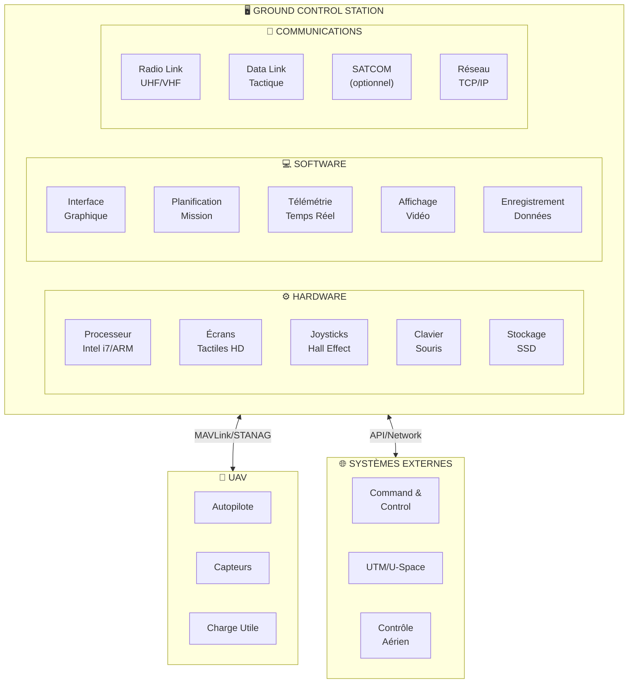

### Points Clés
- **STANAG 4586** est le standard NATO pour l'interopérabilité GCS
- **MAVLink** est le protocole dominant pour les drones civils
- Les GCS modernes supportent le contrôle **multi-UAV** (M:N)
- Tendance vers les **opérations BVLOS** (Beyond Visual Line of Sight)
- Intégration croissante avec **UTM/U-Space** pour la gestion du trafic

---

## 2. Architecture des Stations de Contrôle

### 2.1 Types de GCS

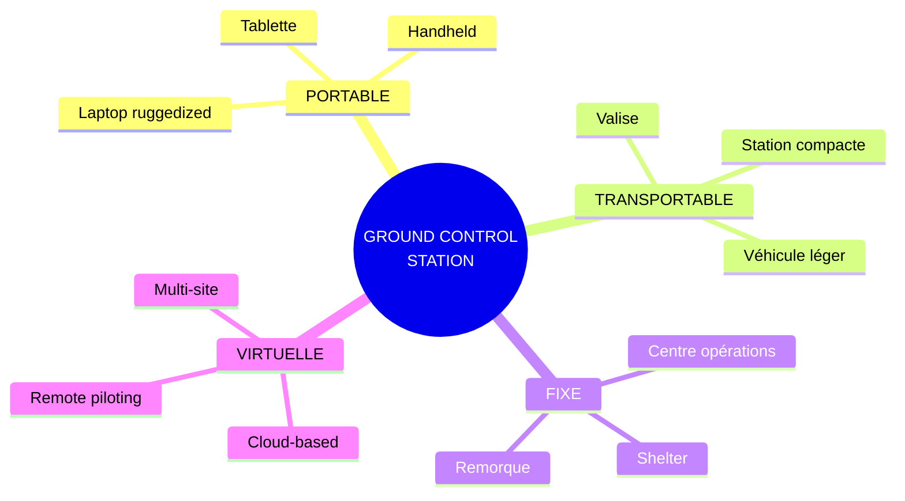

### 2.2 Comparatif des Form Factors

| Type | Poids | Mobilité | Écrans | Autonomie | Usage |
|------|-------|----------|--------|-----------|-------|
| **Handheld** | <2 kg | Très haute | 1 (7-10") | 2-4h | Micro-drones |
| **Portable** | 2-5 kg | Haute | 1-2 (10-15") | 2-4h | Mini-drones |
| **Transportable** | 10-30 kg | Moyenne | 2 (15-17") | 4-8h | Tactiques |
| **Véhicule** | >50 kg | Faible | 2-4 (17"+) | Continue | MALE/HALE |
| **Fixe** | N/A | Aucune | Multiple | Continue | Centres ops |

### 2.3 Architecture Logicielle

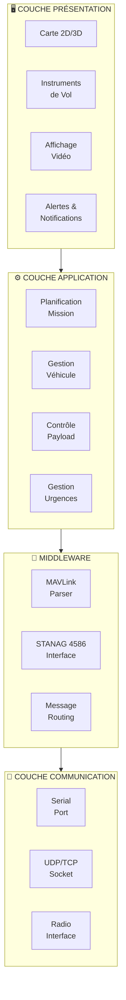

---

## 3. Solutions Commerciales Analysées

### 3.1 Chinowing T50 GCS

**Document source**: `T50 GCS Specification.pdf`

#### 📷 Aperçu Visuel

| Page 1 - Couverture | Page 2 - Catalogue |
|:-------------------:|:------------------:|
| 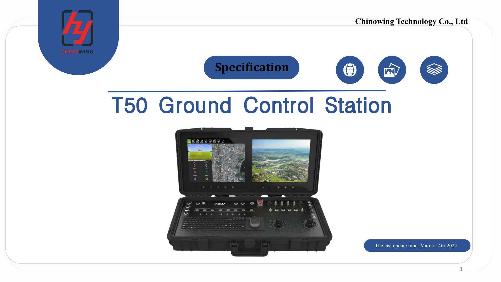 | 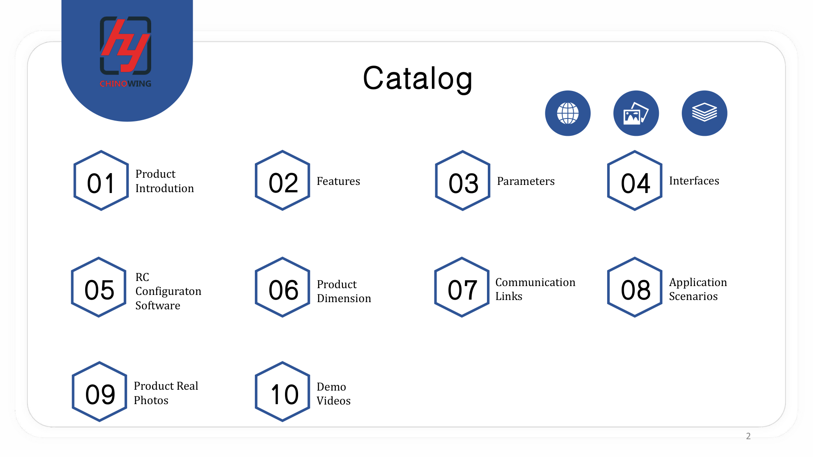 |

| Page 3 - Introduction | Page 4 - Features |
|:---------------------:|:-----------------:|
| 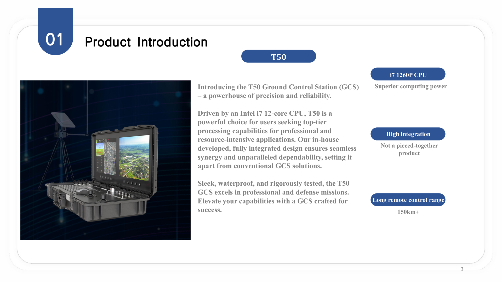 | 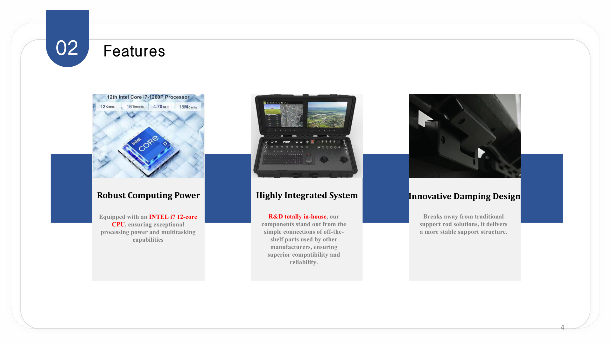 |

#### Spécifications Techniques

| Caractéristique | Valeur |
|-----------------|--------|
| **CPU** | Intel i7 1260P (12 cœurs) |
| **RAM** | 32 GB (standard) |
| **Stockage** | 1 TB SSD |
| **Écrans** | 2x 17" 1280x1024 1000 NIT |
| **Tactile** | 10 points capacitif |
| **OS** | Windows 11 / Linux |
| **Poids** | 20 kg (avec batterie 2.8 kg) |
| **Dimensions** | 85x42.5x16 cm |
| **Batterie** | 25.2V / 30000mAh Li-ion |
| **Autonomie** | 5h (pleine charge) |
| **Température** | -20°C à +60°C |
| **IP** | IP53 (ouvert) / IP65 (fermé) |

#### 🔧 Architecture T50

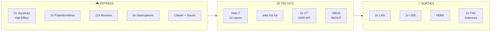

#### Liens Radio Compatibles

| Modèle | Type | Portée | Fréquence | Bande Passante | Topologie |
|--------|------|--------|-----------|----------------|-----------|
| **V21** | Vidéo+Télémétrie+RC | 15 km | 806-826MHz / 1427-1467MHz / 2.4GHz | 20 Mbps | Star (16) |
| **V31** | Vidéo+Télémétrie+RC | 20-150 km | 806-826MHz / 1427-1467MHz | 20 Mbps | Star (16) |
| **VX10** | Vidéo 4K | 20 km | 566-678MHz / 1420-1530MHz | 100 Mbps | Star (64) |
| **VM21** | Mesh Vidéo | 10 km | 806-826MHz / 1427-1467MHz / 2.4GHz | 20 Mbps | Mesh (16) |
| **M1** | Mesh 4K | 20 km | 566-678MHz / 1420-1530MHz | 100 Mbps | Mesh (32) |

---

### 3.2 Asseco AGCS

**Document source**: `Asseco_AGCS_A4_EN.pdf`

#### 📷 Aperçu Visuel

| Page 1 - Couverture | Page 2 - Fonctionnalités |
|:-------------------:|:------------------------:|
| 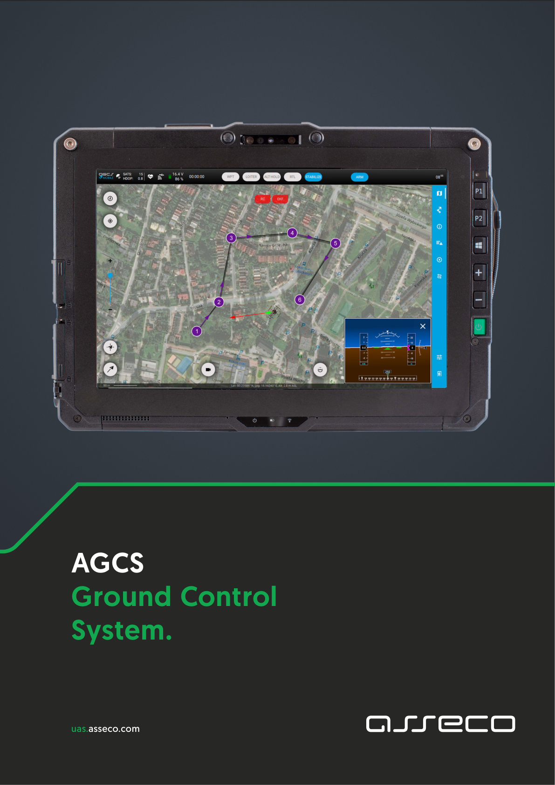 | 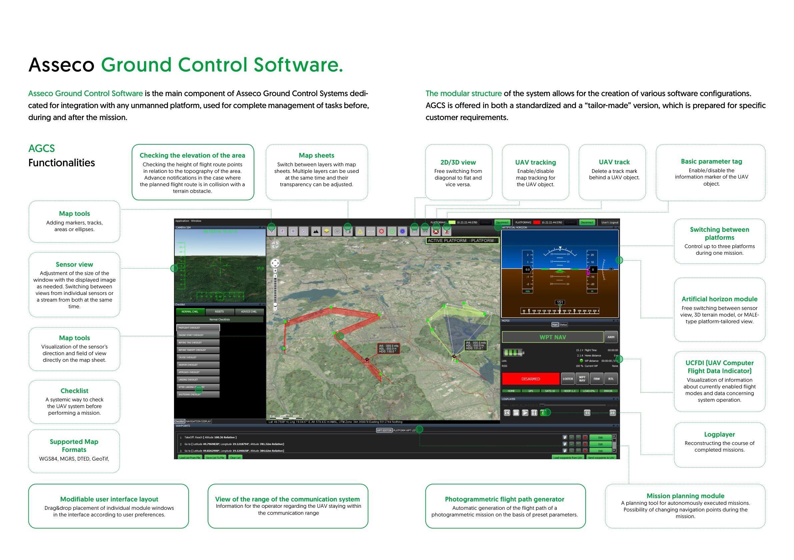 |

| Page 3 - Extensions | Page 4 - Offre |
|:-------------------:|:--------------:|
| 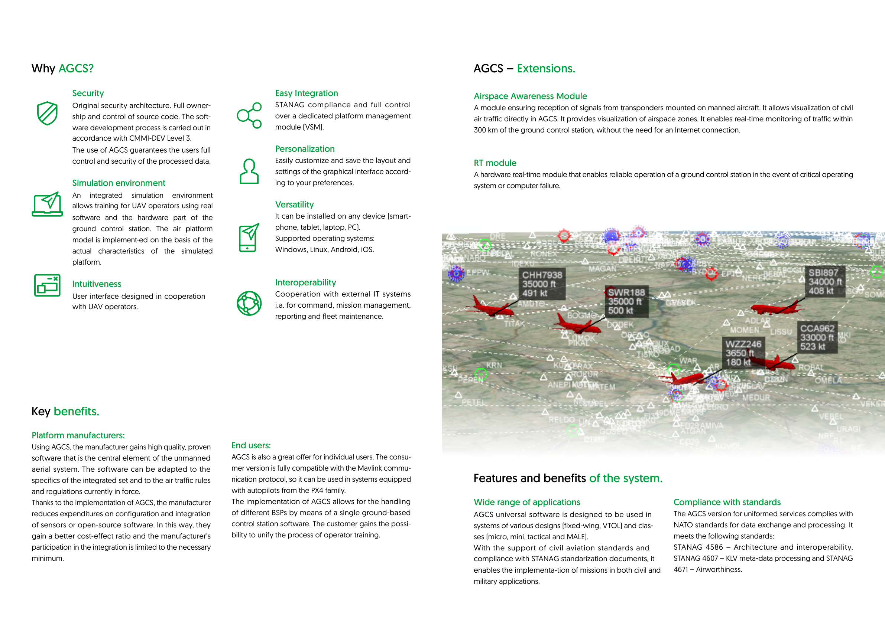 | 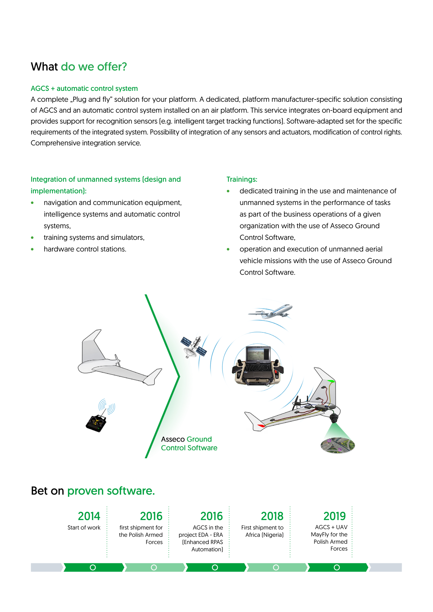 |

#### Fonctionnalités Principales

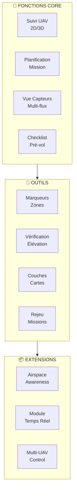

#### Caractéristiques Clés

| Fonctionnalité | Description |
|----------------|-------------|
| **Multi-plateforme** | Windows, Linux, Android, iOS |
| **Multi-UAV** | Jusqu'à 3 plateformes simultanées |
| **Formats cartes** | WGS84, MGRS, DTED, GeoTiff |
| **Conformité** | STANAG 4586, 4607, 4671 |
| **Simulation** | Environnement intégré |
| **Interopérabilité** | Compatible MAVLink (PX4) |

#### Standards Supportés

| Standard | Description |
|----------|-------------|
| **STANAG 4586** | Architecture et interopérabilité |
| **STANAG 4607** | Traitement métadonnées KLV |
| **STANAG 4671** | Navigabilité aérienne |
| **CMMI-DEV Level 3** | Processus développement |

---

### 3.3 ASISGUARD GCS Family

**Document source**: `Drone-Ground-Control-Station-GCS.pdf`

#### 📷 Aperçu Visuel

| Page 1 - Présentation | Page 2 - AG-D-GCS-2251 |
|:---------------------:|:----------------------:|
| 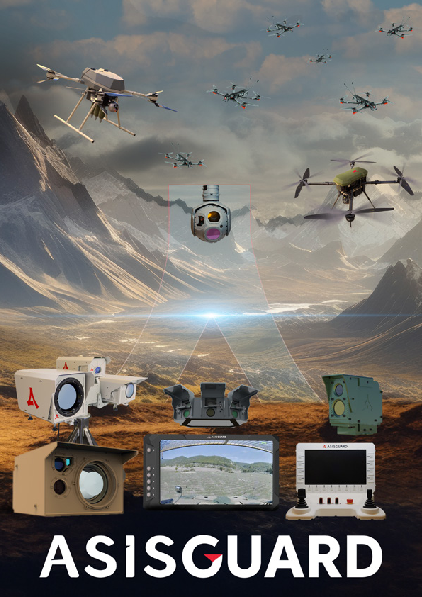 | 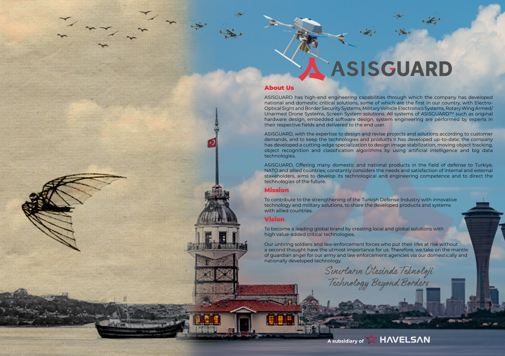 |

| Page 3 - AG-H-GCS-1050 | Page 4 - AG-H-GCS-1051 |
|:----------------------:|:----------------------:|
| 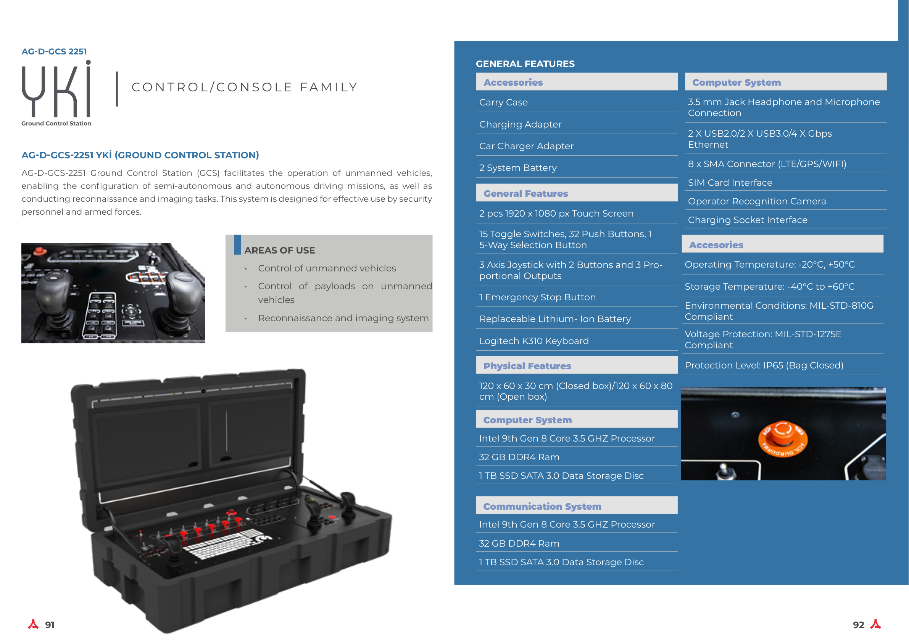 | 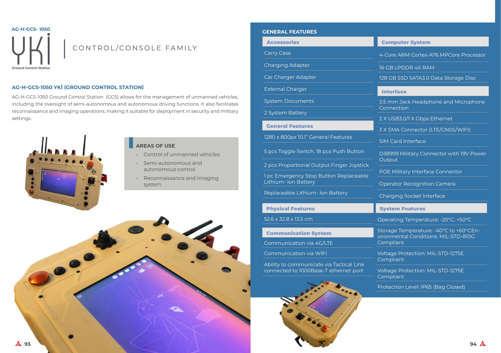 |

#### Gamme de Produits

##### AG-D-GCS-2251 (Desktop)

| Caractéristique | Valeur |
|-----------------|--------|
| **Type** | Station transportable |
| **CPU** | Intel 9th Gen 8 Core 3.5 GHz |
| **RAM** | 32 GB DDR4 |
| **Stockage** | 1 TB SSD SATA 3.0 |
| **Écrans** | 2x 1920x1080 tactiles |
| **Contrôles** | 15 toggles, 32 boutons, joystick 3 axes |
| **Dimensions** | 120x60x30 cm (fermé) / 120x60x80 cm (ouvert) |
| **Température** | -20°C à +50°C |
| **Standards** | MIL-STD-810G, MIL-STD-1275E |
| **IP** | IP65 (fermé) |

##### AG-H-GCS-1050 (Handheld)

| Caractéristique | Valeur |
|-----------------|--------|
| **Type** | Station portable |
| **CPU** | ARM Cortex-A76 4-Core |
| **RAM** | 16 GB LPDDR4X |
| **Stockage** | 128 GB SSD |
| **Écran** | 10.1" 1280x800 |
| **Contrôles** | 5 toggles, 18 boutons, joystick |
| **Dimensions** | 52.6x32.8x13.5 cm |
| **Communication** | 4G/LTE, WiFi, Ethernet 1000Base-T |
| **Standards** | MIL-STD-810G, MIL-STD-1275E |

##### AG-H-GCS-1051 (Tablet)

| Caractéristique | Valeur |
|-----------------|--------|
| **Type** | Tablette durcie |
| **CPU** | Intel Core i5-10310U |
| **RAM** | 16 GB |
| **Stockage** | 512 GB SSD |
| **Écran** | 10.1" 1920x1200 1000 NIT |
| **OS** | Windows 11 |
| **Poids** | < 4.5 kg |
| **Dimensions** | 450x250x10 mm |
| **Température** | -10°C à +50°C |

---

### 3.4 Honeywell GCS

**Document source**: `hon-aero-ground-control-station-drone-operations.pdf`

#### 📷 Aperçu Visuel

| Page 1 - Couverture | Page 2 - Features |
|:-------------------:|:-----------------:|
|  | 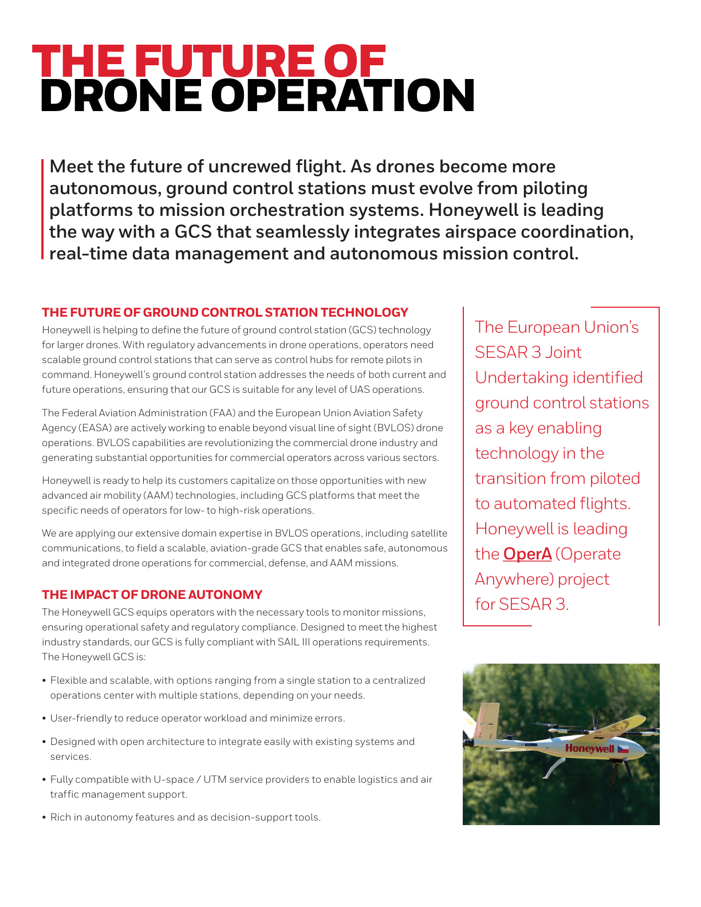 |

#### Vision Future des GCS

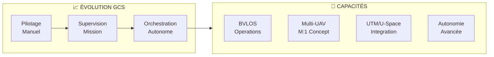

#### Caractéristiques Clés

| Fonctionnalité | Description |
|----------------|-------------|
| **Scalabilité** | Station unique à centre d'opérations multi-stations |
| **Conformité** | SAIL III operations |
| **Architecture** | Ouverte, intégration facile |
| **UTM** | Compatible U-space / UTM providers |
| **Autonomie** | Outils d'aide à la décision |
| **Projet** | OperA (SESAR 3) |

---

### 3.5 Textron UGCS (Universal GCS)

**Document source**: `TS US UGCS Universal Ground Control Station Datasheet 2up.pdf`

#### 📷 Aperçu Visuel

| Page 1 - Présentation | Page 2 - Capacités |
|:---------------------:|:------------------:|
|  | 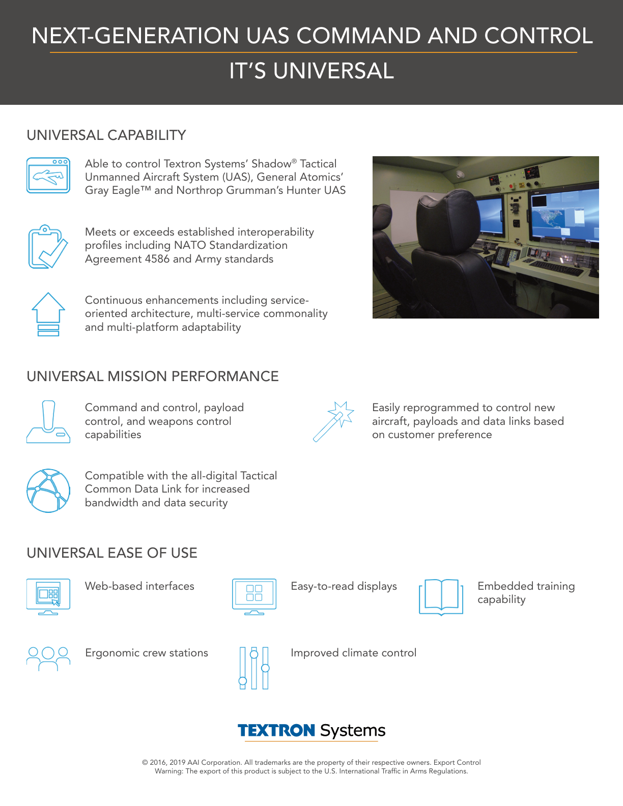 |

#### Capacités Universelles

| Catégorie | Caractéristique |
|-----------|-----------------|
| **Plateformes** | Shadow, Gray Eagle, Hunter UAS |
| **Standards** | NATO STANAG 4586, Army standards |
| **Évolutivité** | SOA, multi-service, multi-platform |
| **Contrôle** | C2, payload, weapons |
| **Data Link** | Tactical Common Data Link (TCDL) |
| **Formation** | Embedded training capability |
| **Déploiement** | 350+ unités sur le terrain |

---

### 3.6 AU Generic GCS

**Document source**: `generic_control_station_gcs.pdf`

#### 📷 Aperçu Visuel

| Page 1 - Features | Page 2 - Contact |
|:-----------------:|:----------------:|
| 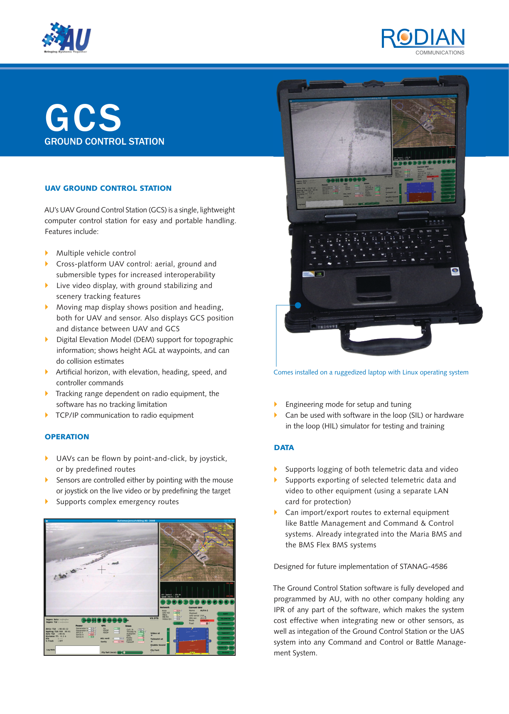 | 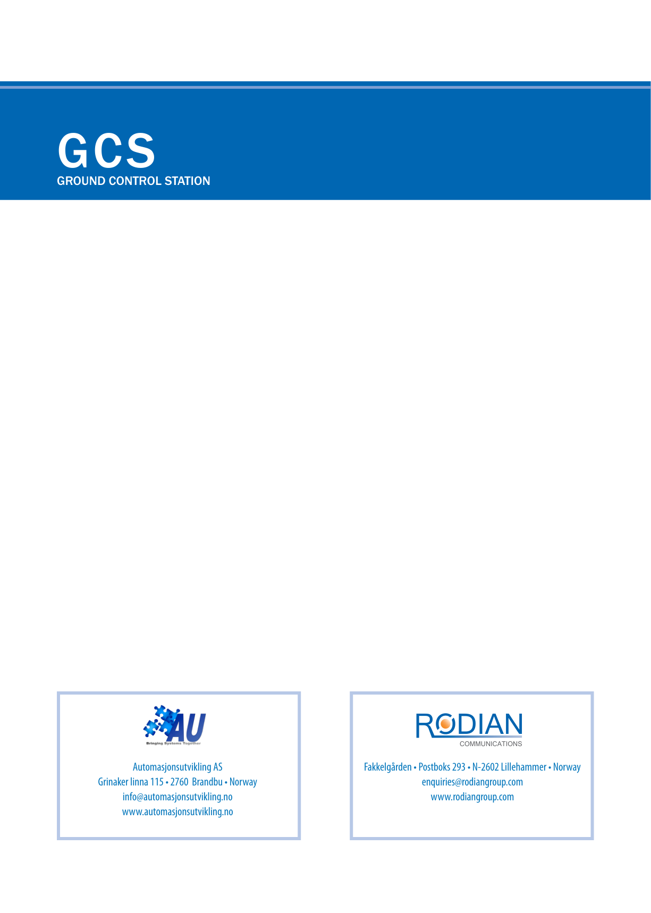 |

#### Fonctionnalités

| Catégorie | Caractéristique |
|-----------|-----------------|
| **Multi-véhicule** | Aérien, terrestre, sous-marin |
| **Vidéo** | Live display, stabilisation, tracking |
| **Carte** | Moving map, DEM support, collision estimates |
| **Instruments** | Horizon artificiel, heading, speed |
| **Contrôle** | Point-and-click, joystick, routes prédéfinies |
| **Données** | Logging télémétrie et vidéo |
| **Intégration** | Maria BMS, BMS Flex |
| **Standard** | STANAG-4586 ready |
| **OS** | Linux (laptop ruggedized) |

---

## 4. Solutions Militaires et Défense

### 4.1 Comparatif Standards Militaires

| Standard | Domaine | Description |
|----------|---------|-------------|
| **STANAG 4586** | Interopérabilité | Architecture GCS-UAV |
| **STANAG 4607** | Données | Format GMTI/KLV |
| **STANAG 4671** | Navigabilité | Certification UAV |
| **MIL-STD-810G** | Environnement | Tests climatiques/mécaniques |
| **MIL-STD-1275E** | Électrique | Protection tension véhicule |
| **MIL-STD-461G** | EMC | Compatibilité électromagnétique |

### 4.2 Niveaux d'Interopérabilité STANAG 4586

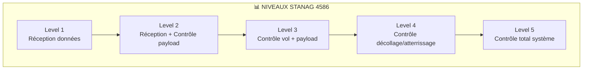

---

## 5. Logiciels GCS

### 5.1 Solutions Open Source

| Logiciel | Licence | Plateformes | Protocole | Véhicules |
|----------|---------|-------------|-----------|-----------|
| **QGroundControl** | Apache 2.0 | Windows, Mac, Linux, Android, iOS | MAVLink | PX4, ArduPilot |
| **Mission Planner** | GPL | Windows | MAVLink | ArduPilot |
| **MAVProxy** | GPL | Linux, Mac | MAVLink | ArduPilot, PX4 |
| **APM Planner 2** | GPL | Windows, Mac, Linux | MAVLink | ArduPilot |

### 5.2 Solutions Commerciales

| Logiciel | Fabricant | Protocole | Spécialité |
|----------|-----------|-----------|------------|
| **AGCS** | Asseco | MAVLink, STANAG | Militaire/Civil |
| **UgCS** | SPH Engineering | MAVLink | Photogrammétrie |
| **Pix4Dcapture** | Pix4D | DJI, MAVLink | Cartographie |
| **DJI Pilot** | DJI | Propriétaire | Drones DJI |
| **Litchi** | VC Technology | DJI | Waypoints avancés |

### 5.3 Architecture Logicielle Type

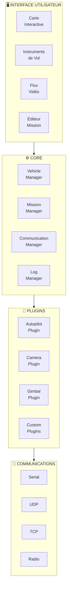

---

## 6. Interfaces et Communications

### 6.1 Protocole MAVLink

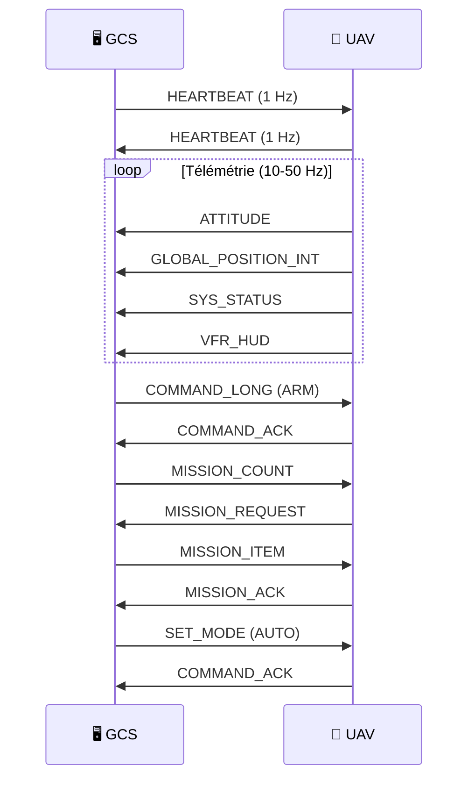

### 6.2 Types de Data Links

| Type | Portée | Bande | Latence | Usage |
|------|--------|-------|---------|-------|
| **WiFi** | 1-5 km | 2.4/5 GHz | <50 ms | Courte portée |
| **RC Link** | 5-20 km | 900 MHz / 2.4 GHz | <20 ms | Contrôle manuel |
| **LTE/4G** | Illimitée | Cellulaire | 50-200 ms | BVLOS urbain |
| **UHF Radio** | 20-100 km | 400-470 MHz | <100 ms | Tactique |
| **SATCOM** | Global | Ku/Ka band | 500-2000 ms | MALE/HALE |
| **Mesh** | Variable | Multi-freq | Variable | Multi-UAV |

### 6.3 Interfaces Hardware Typiques

| Interface | Usage | Connecteur |
|-----------|-------|------------|
| **USB** | Périphériques, stockage | Type-A, Type-C |
| **Ethernet** | Réseau, vidéo IP | RJ45, M12 |
| **HDMI** | Écrans externes | Standard, Mini |
| **Serial** | Autopilote, capteurs | DB9, JST |
| **SBUS** | RC, servos | 3-pin |
| **CAN** | Bus véhicule | D-Sub, M12 |
| **TNC/SMA** | Antennes radio | Coaxial |

---

## 7. Recherche Académique

### 7.1 GCS pour Manipulateurs Aériens

**Document source**: `Design-Development-and-Validation-of-a-Ground-Control-Station-for-Aerial-Manipulators.pdf`

#### 📷 Aperçu Visuel

| Page 1 - Abstract | Page 2 - Features |
|:-----------------:|:-----------------:|
| 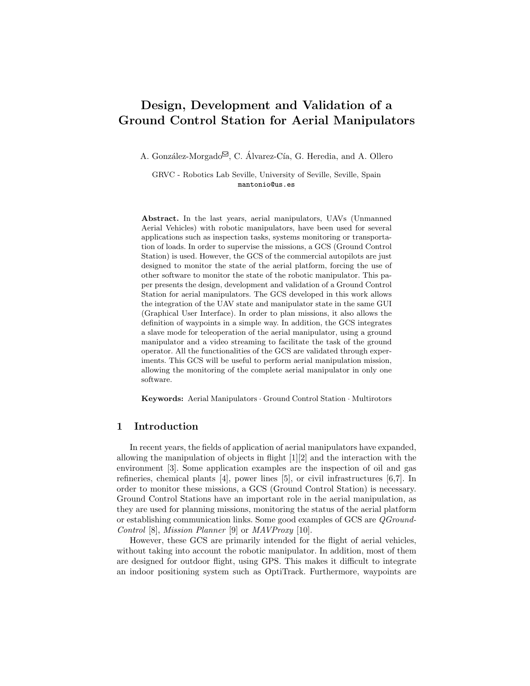 | 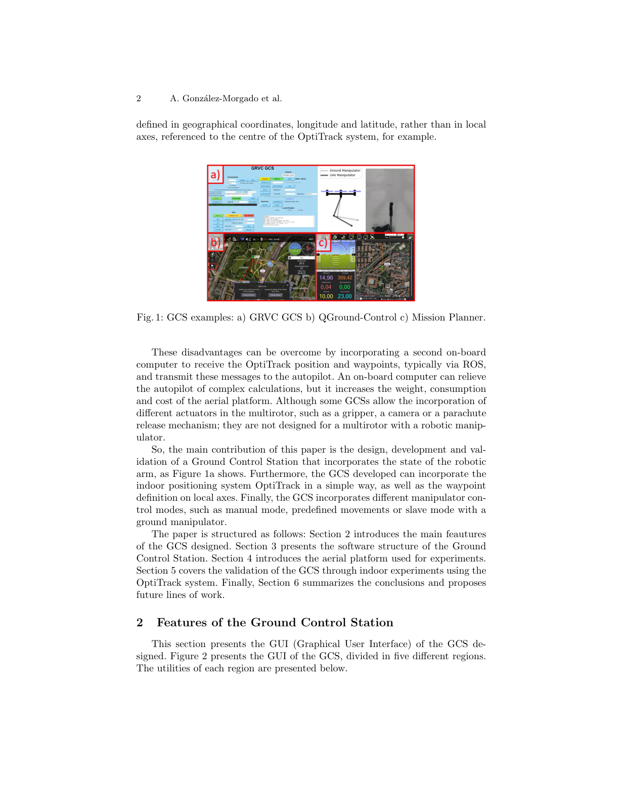 |

#### Architecture GRVC GCS

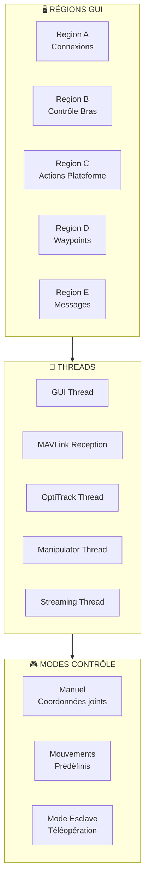

#### Caractéristiques Innovantes

| Fonctionnalité | Description |
|----------------|-------------|
| **Intégration** | UAV + Manipulateur dans même GUI |
| **OptiTrack** | Positionnement indoor intégré |
| **Waypoints** | Définition en axes locaux |
| **Téléopération** | Mode esclave avec bras maître |
| **Streaming** | Vidéo temps réel |
| **Développement** | Python + Tkinter + PyMAVLink |

---

### 7.2 Simulation sUAS

**Document source**: `sUAS_Sim_Final.pdf`

#### 📷 Aperçu Visuel

| Page 1 - Couverture | Page 2 - Architecture |
|:-------------------:|:---------------------:|
| 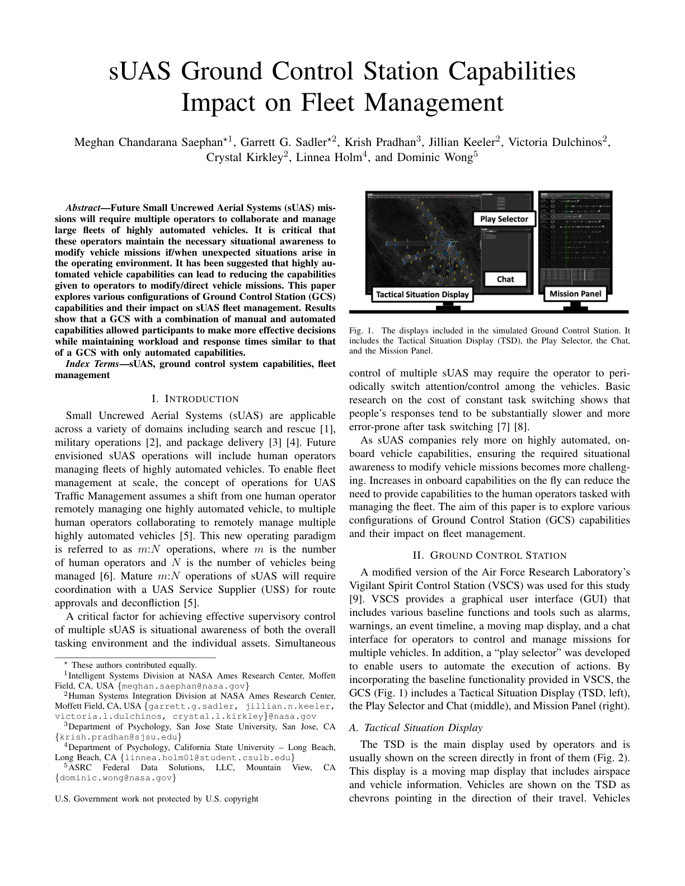 | 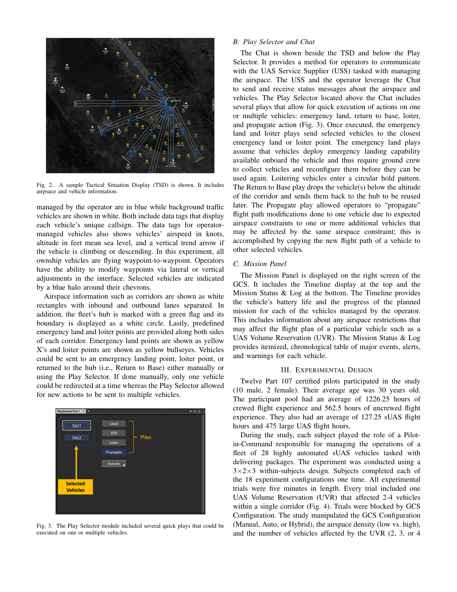 |

#### Environnement de Simulation

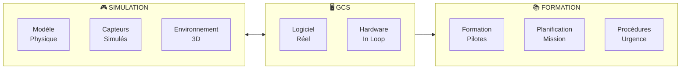

---

## 8. Tableau Comparatif Global

### 8.1 Comparatif Hardware

| Critère | T50 | ASISGUARD 2251 | ASISGUARD 1051 | Textron UGCS |
|---------|-----|----------------|----------------|--------------|
| **Type** | Transportable | Transportable | Tablette | Véhicule |
| **CPU** | i7 12-core | i9 8-core | i5 | Propriétaire |
| **RAM** | 32 GB | 32 GB | 16 GB | N/A |
| **Écrans** | 2x 17" | 2x FHD | 1x 10.1" | Multiple |
| **Poids** | 20 kg | ~25 kg | <4.5 kg | >100 kg |
| **IP** | IP53/65 | IP65 | N/A | MIL-SPEC |
| **Température** | -20/+60°C | -20/+50°C | -10/+50°C | MIL-SPEC |
| **Autonomie** | 5h | Variable | 2h+ | Continue |
| **Portée radio** | 150 km | Variable | Variable | >100 km |

### 8.2 Comparatif Logiciel

| Critère | AGCS | QGroundControl | Mission Planner | UgCS |
|---------|------|----------------|-----------------|------|
| **Licence** | Commercial | Open Source | Open Source | Commercial |
| **OS** | Multi | Multi | Windows | Multi |
| **Multi-UAV** | ✅ (3) | ✅ | ✅ | ✅ |
| **STANAG** | ✅ | ❌ | ❌ | ❌ |
| **MAVLink** | ✅ | ✅ | ✅ | ✅ |
| **Simulation** | ✅ | ✅ | ✅ | ✅ |
| **Photogrammétrie** | ❌ | Basique | Basique | ✅ |
| **3D Terrain** | ✅ | ✅ | ✅ | ✅ |

### 8.3 Positionnement des Solutions

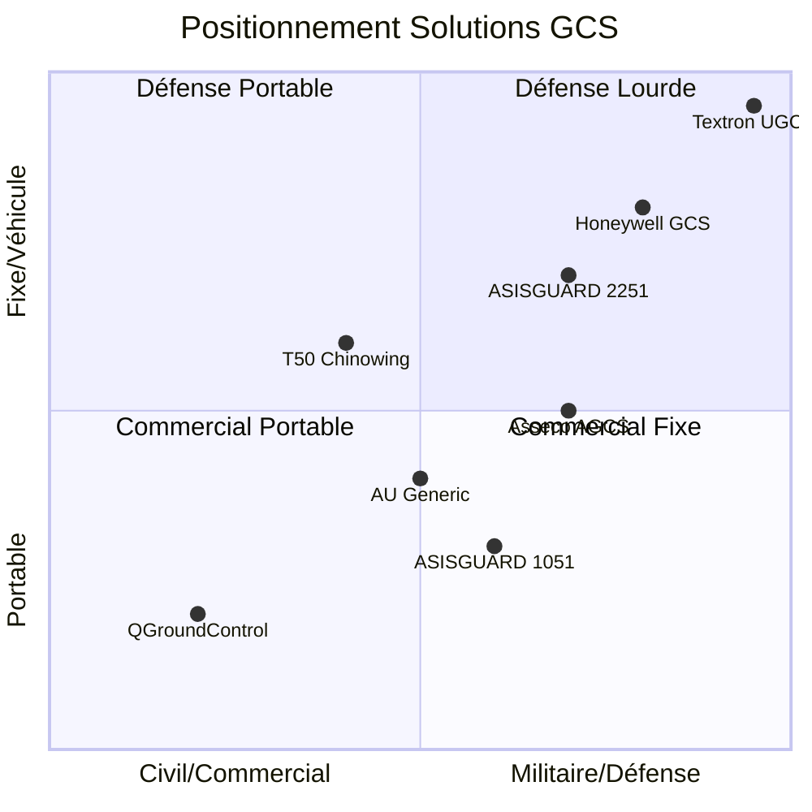

---

## 9. Recommandations

### 9.1 Choix de Solution selon Besoins

| Besoin | Solution Recommandée |
|--------|---------------------|
| **Développement/Recherche** | QGroundControl + Laptop |
| **Opérations commerciales** | T50 ou ASISGUARD 1051 |
| **Photogrammétrie** | UgCS + Station portable |
| **Militaire/Défense** | Asseco AGCS ou Textron UGCS |
| **Multi-UAV avancé** | Honeywell GCS |
| **Budget limité** | Mission Planner + RC |

### 9.2 Architecture Recommandée pour Projet

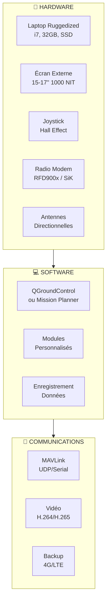

### 9.3 Roadmap de Développement GCS

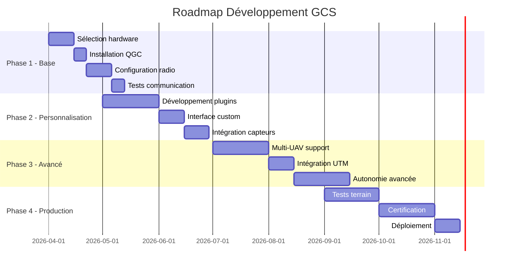

### 9.4 Points de Vigilance

1. **Réglementation**
   - Conformité EASA/FAA pour BVLOS
   - Certification pilote à distance
   - Enregistrement opérateur

2. **Sécurité**
   - Chiffrement communications
   - Authentification opérateur
   - Failsafe configurés

3. **Fiabilité**
   - Redondance liens radio
   - Backup 4G/LTE
   - Alimentation secours

4. **Ergonomie**
   - Formation opérateurs
   - Interface intuitive
   - Alertes claires

---

## 10. Galerie d'Images Extraites

### 10.1 Index des Images

| Fichier | Source | Description |
|---------|--------|-------------|
| `Asseco_AGCS_page_01-05.png` | Asseco_AGCS_A4_EN.pdf | Brochure AGCS |
| `T50_GCS_page_01-06.png` | T50 GCS Specification.pdf | Specs T50 |
| `UGCS_Universal_page_01-02.png` | TS US UGCS Datasheet.pdf | Textron UGCS |
| `Drone_GCS_page_01-04.png` | Drone-Ground-Control-Station-GCS.pdf | ASISGUARD |
| `FC_GCS_page_01-04.png` | Flight_controller_and_GCS.pdf | FC & GCS |
| `Generic_GCS_page_01-02.png` | generic_control_station_gcs.pdf | AU GCS |
| `Honeywell_GCS_page_01-03.png` | hon-aero-ground-control-station.pdf | Honeywell |
| `Aerial_Manipulator_GCS_page_01-04.png` | Design-Development-GCS.pdf | GRVC GCS |
| `GCS_A1_page_01-02.png` | GCS.A-1.pdf | Documentation |
| `Scientific_GCS_page_01-04.png` | 1-s2.0-S2590123024007539-main.pdf | Article scientifique |
| `Research_GCS_page_01-04.png` | 126020094.pdf | Recherche |
| `sUAS_Sim_page_01-04.png` | sUAS_Sim_Final.pdf | Simulation |
| `Airinov_page_01-03.png` | mjlefevre-Airinov.pdf | Airinov |

---

## Annexes

### A. Documents Sources Analysés

| # | Fichier | Type | Pages | Taille |
|---|---------|------|-------|--------|
| 1 | `Asseco_AGCS_A4_EN.pdf` | Brochure | 5 | 11.1 MB |
| 2 | `T50 GCS Specification.pdf` | Specs | 17 | 6.9 MB |
| 3 | `Drone-Ground-Control-Station-GCS.pdf` | Catalogue | 6 | 1.2 MB |
| 4 | `hon-aero-ground-control-station.pdf` | Brochure | 3 | 2.6 MB |
| 5 | `TS US UGCS Datasheet.pdf` | Datasheet | 2 | 1.3 MB |
| 6 | `generic_control_station_gcs.pdf` | Datasheet | 2 | 2.4 MB |
| 7 | `Design-Development-GCS.pdf` | Article | 12 | 2.5 MB |
| 8 | `Flight_controller_and_GCS.pdf` | Présentation | 14 | 1.2 MB |
| 9 | `sUAS_Sim_Final.pdf` | Rapport | 6 | 11.1 MB |
| 10 | `1-s2.0-S2590123024007539-main.pdf` | Article | 16 | 9.7 MB |
| 11 | `126020094.pdf` | Thèse | 19 | 7.1 MB |
| 12 | `GCS.A-1.pdf` | Documentation | 2 | 719 KB |
| 13 | `mjlefevre-Airinov.pdf` | Article | 7 | 1.9 MB |
| 14 | `CT2014_GPS_art18.pdf` | Article | 9 | 749 KB |
| 15 | `2013-1-04-Imre_Makkay.pdf` | Article | 7 | 749 KB |
| 16 | `92055.pdf` | Document | 2 | 116 KB |
| 17 | `61fd7e7b742af1644002939.pdf` | Document | 2 | 2.6 MB |
| 18 | `layout-1710-Paramita.pdf` | Article | 14 | 1.6 MB |
| 19 | `18-VasilePRISACARIU.pdf` | Article | 10 | 730 KB |

### B. Glossaire

| Terme | Définition |
|-------|------------|
| **BVLOS** | Beyond Visual Line of Sight |
| **C2** | Command and Control |
| **GCS** | Ground Control Station |
| **GMTI** | Ground Moving Target Indicator |
| **HALE** | High Altitude Long Endurance |
| **HIL** | Hardware In the Loop |
| **KLV** | Key-Length-Value (metadata) |
| **MALE** | Medium Altitude Long Endurance |
| **MAVLink** | Micro Air Vehicle Link |
| **RPIC** | Remote Pilot In Command |
| **SAIL** | Specific Assurance and Integrity Level |
| **SATCOM** | Satellite Communication |
| **SBUS** | Serial Bus (RC protocol) |
| **SIL** | Software In the Loop |
| **SOA** | Service-Oriented Architecture |
| **STANAG** | NATO Standardization Agreement |
| **sUAS** | Small Unmanned Aircraft System |
| **TCDL** | Tactical Common Data Link |
| **UAS** | Unmanned Aircraft System |
| **UAV** | Unmanned Aerial Vehicle |
| **UTM** | UAS Traffic Management |
| **VTOL** | Vertical Take-Off and Landing |

### C. Ressources Externes

| Ressource | URL |
|-----------|-----|
| **QGroundControl** | https://qgroundcontrol.com |
| **Mission Planner** | https://ardupilot.org/planner |
| **MAVLink** | https://mavlink.io |
| **PX4** | https://px4.io |
| **ArduPilot** | https://ardupilot.org |
| **STANAG 4586** | NATO Standardization Office |
| **EASA Drones** | https://www.easa.europa.eu/drones |

---

*Document généré automatiquement à partir de l'analyse des PDFs du dossier "Ground control station/Documentation"*
