# Benchmark des Solutions de Géolocalisation pour Poids Lourds

## Document d'Analyse Comparative

**Date de création**: Mars 2026  
**Sources analysées**: 10 documents PDF du dossier "Localisation poid lourd"  
**Images extraites**: 29 captures des documents sources (dossier `extracted_images/`)

---

## Table des Matières

1. [Résumé Exécutif](#1-résumé-exécutif)
2. [Solutions Hardware Analysées](#2-solutions-hardware-analysées)
3. [Solutions Logicielles](#3-solutions-logicielles)
4. [Aspects Réglementaires](#4-aspects-réglementaires)
5. [Technologies de Données FCD](#5-technologies-de-données-fcd)
6. [Recherche Académique](#6-recherche-académique)
7. [Tableau Comparatif Global](#7-tableau-comparatif-global)
8. [Recommandations](#8-recommandations)
9. [Galerie d'Images Extraites](#9-galerie-dimages-extraites)

---

## 1. Résumé Exécutif

Ce benchmark analyse **10 documents** couvrant les solutions de géolocalisation pour flottes de poids lourds, incluant :
- **3 solutions hardware commerciales** (Samsara VG34, TomTom LINK 510, ATHMO Positel)
- **1 GPS de navigation poids lourd** (Becker Transit 7SL)
- **2 documents réglementaires** (CNIL/APDP, chronotachygraphes)
- **2 documents techniques** (FCD, livre blanc gestion de flotte)
- **1 thèse académique** (localisation dynamique sur carte)

### Points Clés
- Les solutions modernes combinent **GPS multi-constellation** (GPS/GLONASS/Galileo/Beidou)
- Communication via **4G LTE** avec fallback 3G/2G
- Intégration **OBD-II/CAN Bus** pour données véhicule
- Conformité **RGPD** obligatoire pour la géolocalisation des salariés
- Tendance vers la **maintenance prédictive** et l'**éco-conduite**

### 📊 Architecture Générale d'un Système de Géolocalisation

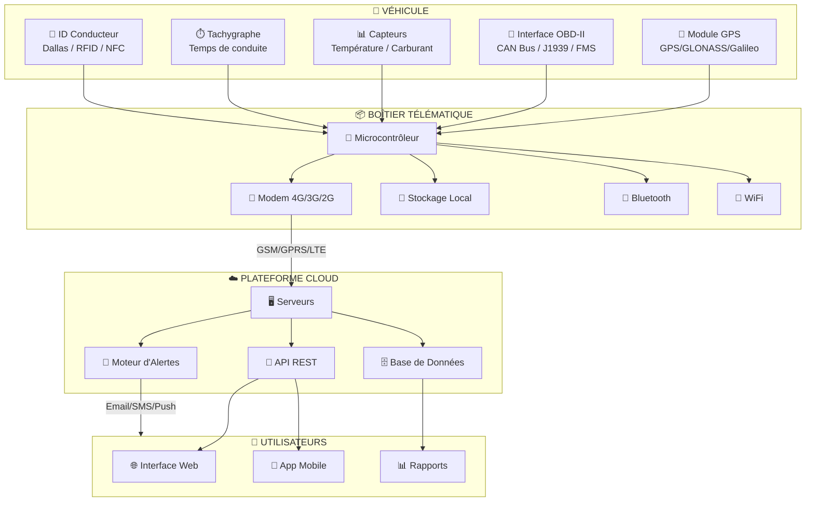

### 📈 Flux de Données Temps Réel

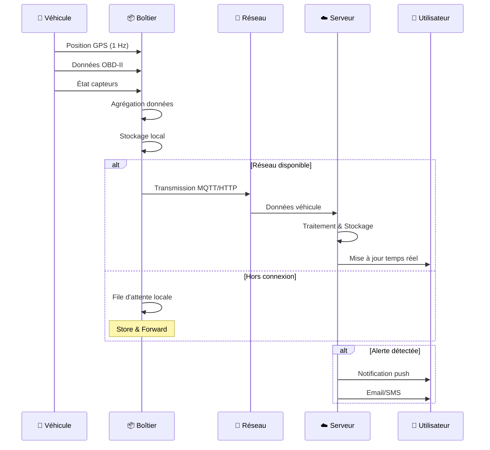

---

## 2. Solutions Hardware Analysées

### 2.1 Samsara VG34/VG34-EU

**Fabricant**: Samsara Networks  
**Type**: Passerelle IoT pour véhicules  
**Document source**: `VG34_datasheet_FR.pdf`

#### 📷 Aperçu Visuel

| Page 1 - Présentation | Page 2 - Sources de données |
|:---------------------:|:---------------------------:|
| 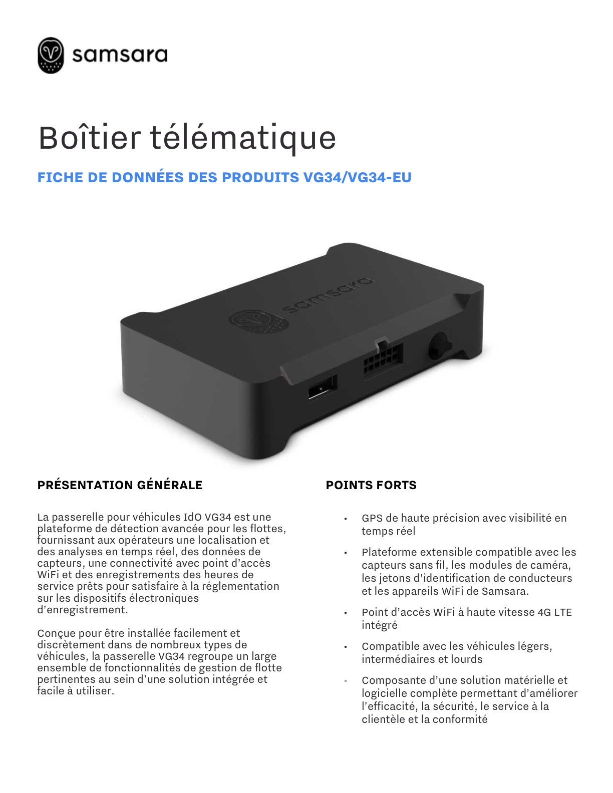 | 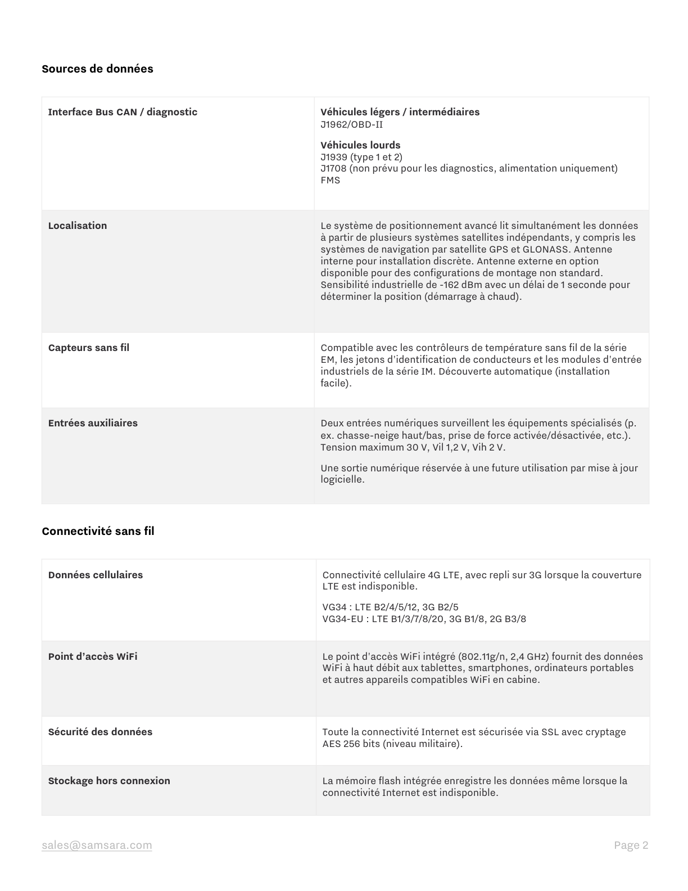 |

| Page 3 - Connectivité | Page 4 - Logiciel |
|:---------------------:|:-----------------:|
| 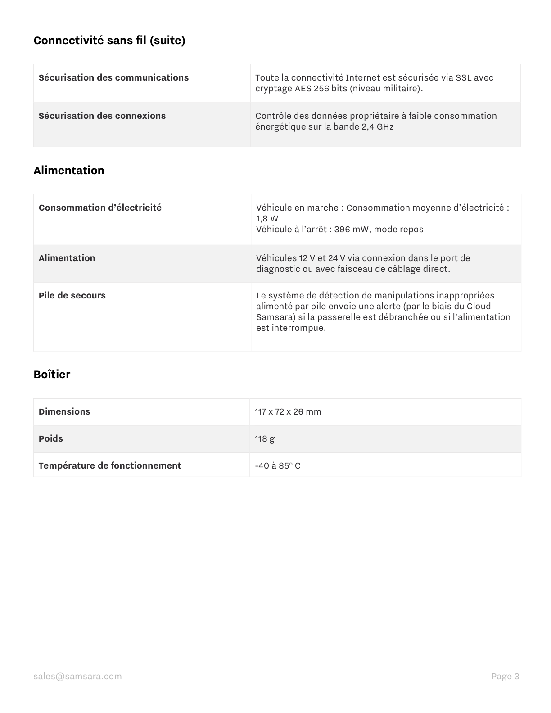 | 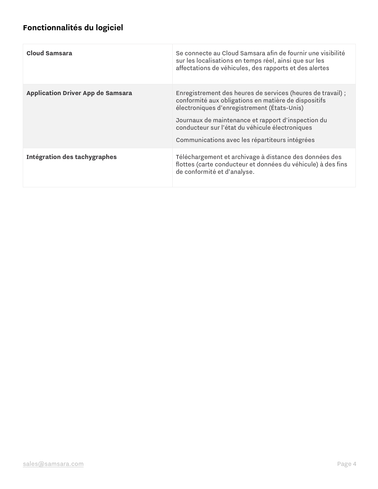 |

#### 🔧 Architecture Interne VG34

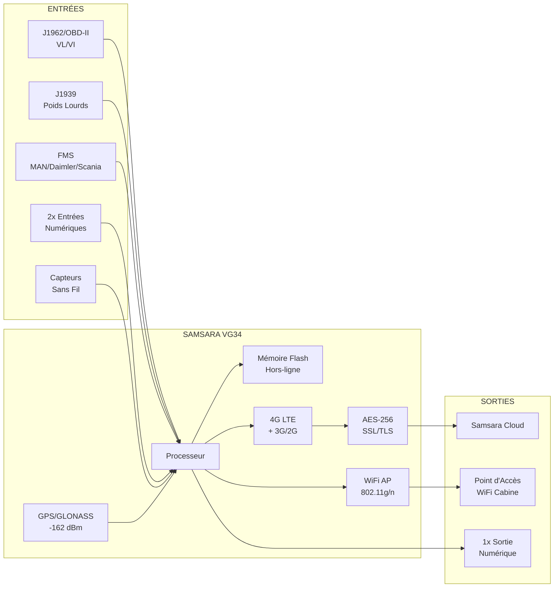

#### Spécifications Techniques

| Caractéristique | Valeur |
|-----------------|--------|
| **Dimensions** | 117 x 72 x 26 mm |
| **Poids** | 118 g |
| **Température de fonctionnement** | -40°C à +85°C |
| **Alimentation** | 12V / 24V |
| **Consommation (marche)** | 1,8 W |
| **Consommation (veille)** | 396 mW |

#### Connectivité

| Type | Spécification |
|------|---------------|
| **Cellulaire VG34** | LTE B2/4/5/12, 3G B2/5 |
| **Cellulaire VG34-EU** | LTE B1/3/7/8/20, 3G B1/8, 2G B3/8 |
| **WiFi** | 802.11g/n, 2,4 GHz (Point d'accès intégré) |
| **Sécurité** | SSL/TLS, AES 256 bits |

#### Interfaces Véhicule

| Interface | Compatibilité |
|-----------|---------------|
| **OBD-II J1962** | Véhicules légers/intermédiaires |
| **J1939** | Poids lourds (Type 1 et 2) |
| **J1708** | Alimentation uniquement |
| **FMS** | MAN, Daimler, Scania, DAF, Iveco, Volvo, Renault |

#### Fonctionnalités GPS

- **Multi-constellation**: GPS + GLONASS
- **Sensibilité**: -162 dBm
- **Démarrage à chaud**: 1 seconde
- **Antenne**: Interne (externe en option)

#### Capteurs Compatibles

- Contrôleurs de température sans fil (série EM)
- Jetons d'identification conducteurs
- Modules d'entrée industriels (série IM)
- 2 entrées numériques auxiliaires
- 1 sortie numérique (future)

#### Fonctionnalités Logicielles (Cloud Samsara)

- ✅ Localisation temps réel
- ✅ Affectation véhicules
- ✅ Rapports et alertes
- ✅ Heures de service (ELD compliance USA)
- ✅ Journaux de maintenance
- ✅ Inspection véhicule électronique
- ✅ Communication répartiteurs
- ✅ Téléchargement tachygraphe à distance

#### Tarification

- Licence annuelle (1, 3 ou 5 ans)
- Inclut: connectivité cellulaire, cloud, apps mobiles, mises à jour firmware, support

---

### 2.2 TomTom LINK 510

**Fabricant**: TomTom Business Solutions  
**Type**: Boîtier de géolocalisation  
**Document source**: `ttb-link510-doc.pdf`

#### 📷 Aperçu Visuel

| Page 1 - Présentation & Avantages | Page 2 - Fonctionnalités & Specs |
|:---------------------------------:|:--------------------------------:|
|  | 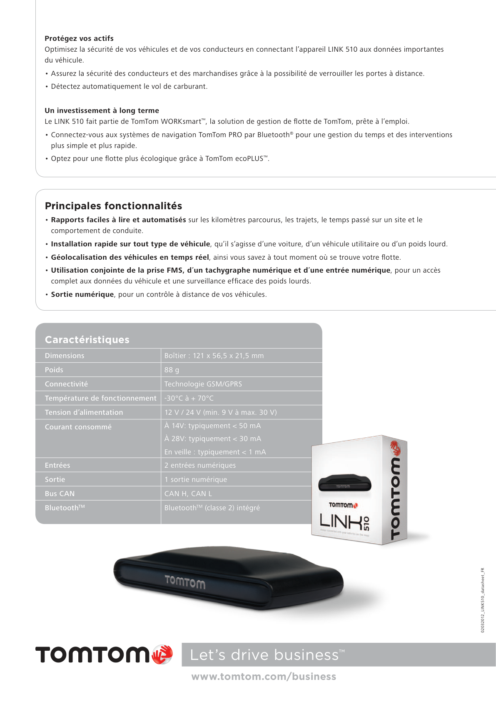 |

#### 🔧 Écosystème TomTom LINK 510

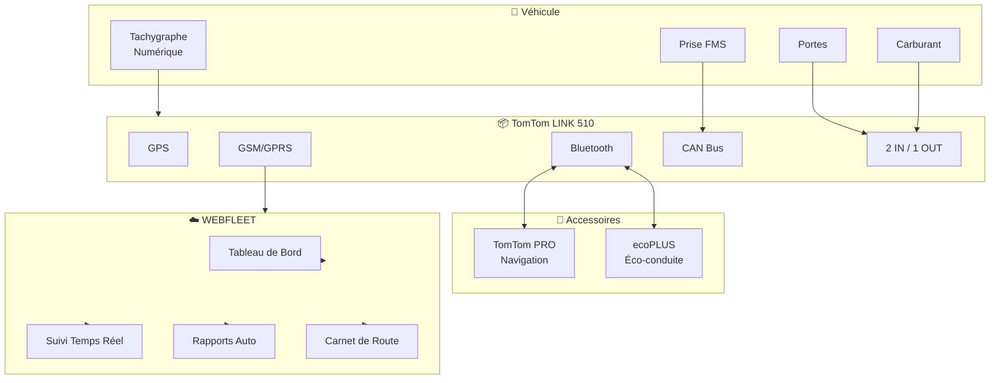

#### Spécifications Techniques

| Caractéristique | Valeur |
|-----------------|--------|
| **Dimensions** | 121 x 56,5 x 21,5 mm |
| **Poids** | 88 g |
| **Température de fonctionnement** | -30°C à +70°C |
| **Alimentation** | 12V / 24V (9V à 30V) |
| **Consommation (14V)** | < 50 mA |
| **Consommation (28V)** | < 30 mA |
| **Consommation (veille)** | < 1 mA |

#### Connectivité

| Type | Spécification |
|------|---------------|
| **Cellulaire** | GSM/GPRS |
| **Bluetooth** | Classe 2 intégré |
| **Bus CAN** | CAN H, CAN L |

#### Interfaces

- 2 entrées numériques
- 1 sortie numérique
- Connexion FMS
- Connexion tachygraphe numérique

#### Fonctionnalités Principales

- ✅ Géolocalisation temps réel
- ✅ Rapports automatisés (km, trajets, temps sur site)
- ✅ Analyse comportement de conduite
- ✅ Carnet de route automatique
- ✅ Détection vol de carburant
- ✅ Verrouillage portes à distance
- ✅ Connexion navigation TomTom PRO (Bluetooth)
- ✅ Intégration TomTom ecoPLUS

#### Plateforme Logicielle

**TomTom WEBFLEET®** - Application SaaS de gestion de flotte
- Tableaux de bord standards
- Rapports personnalisables
- Alertes configurables

---

### 2.3 ATHMO Positel

**Fabricant**: ATHMO (France)  
**Type**: Système de géolocalisation modulaire  
**Document source**: `ATHMO_Informatique_embarquee_generale_fr_MEDIUM.pdf`

#### 📷 Aperçu Visuel

| Page 1 - Couverture | Page 2 - Présentation |
|:-------------------:|:---------------------:|
| 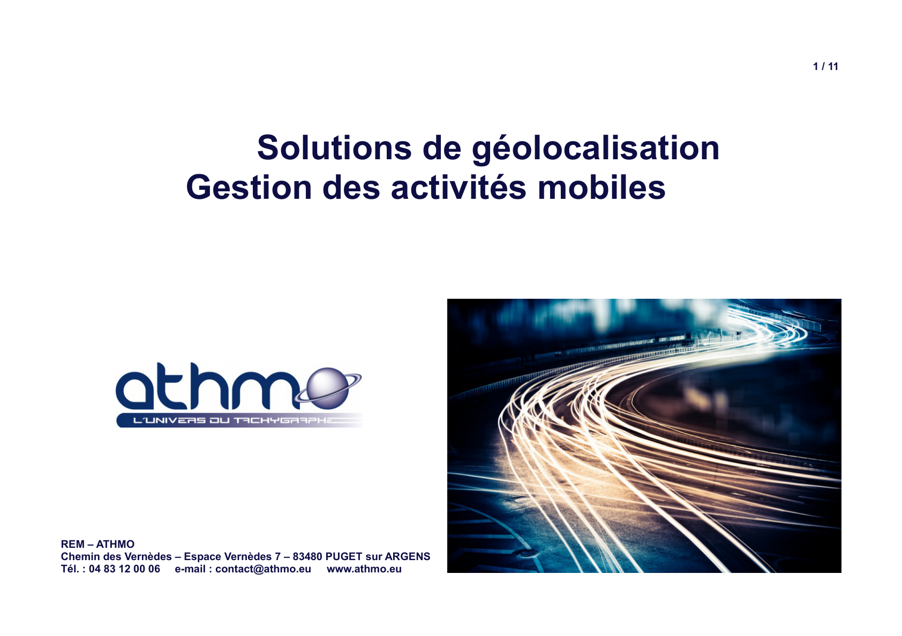 |  |

| Page 3 - Pourquoi s'équiper | Page 4 - Principe Positel |
|:---------------------------:|:-------------------------:|
| 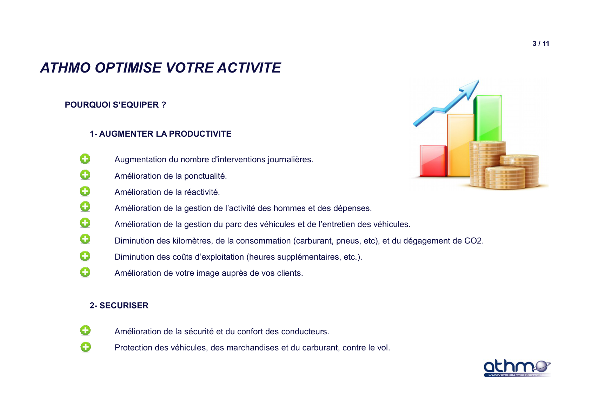 | 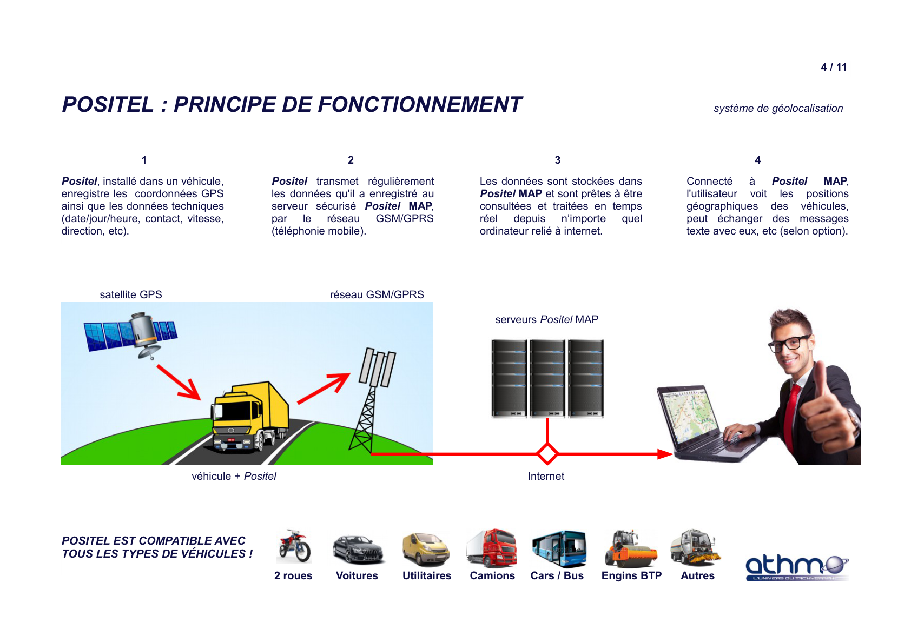 |

| Page 5 - Application Web | Page 6 - Options |
|:------------------------:|:----------------:|
| 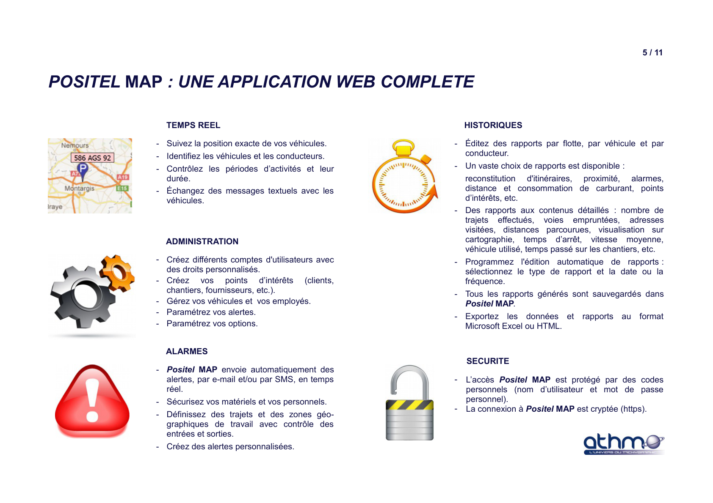 | 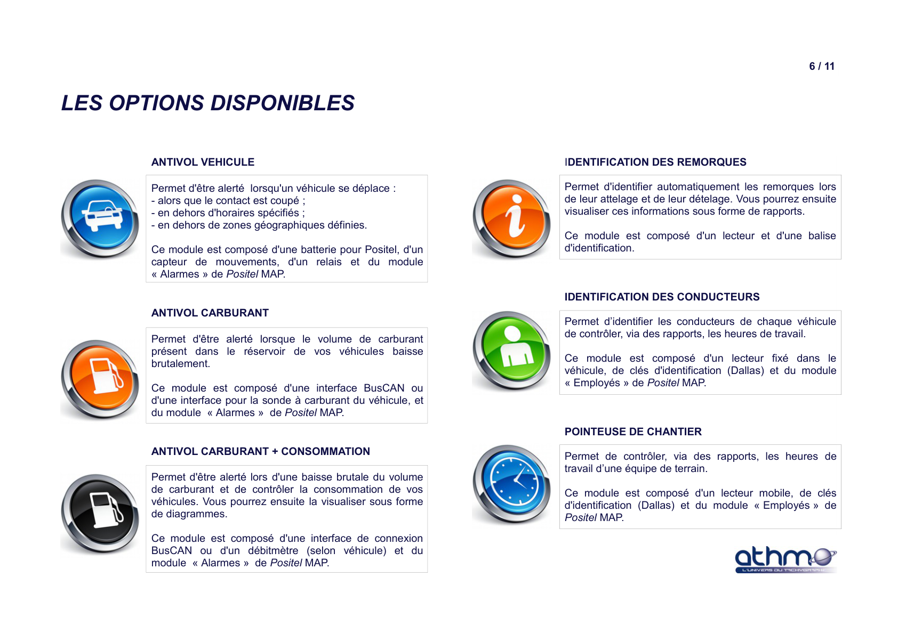 |

| Page 7 - Options (suite) | Page 8 - Packs de base |
|:------------------------:|:----------------------:|
| 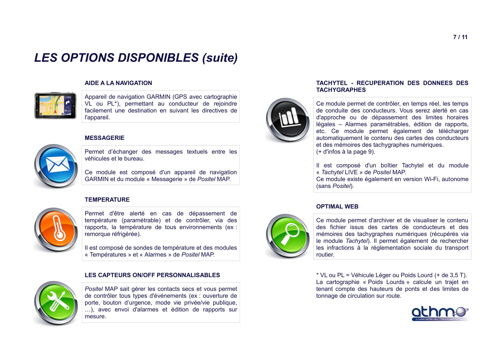 | 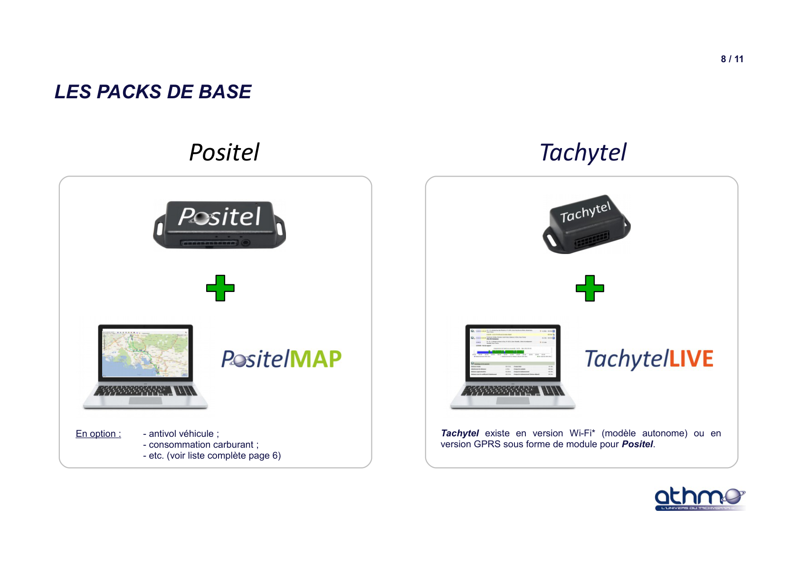 |

#### 🔧 Architecture Modulaire ATHMO Positel

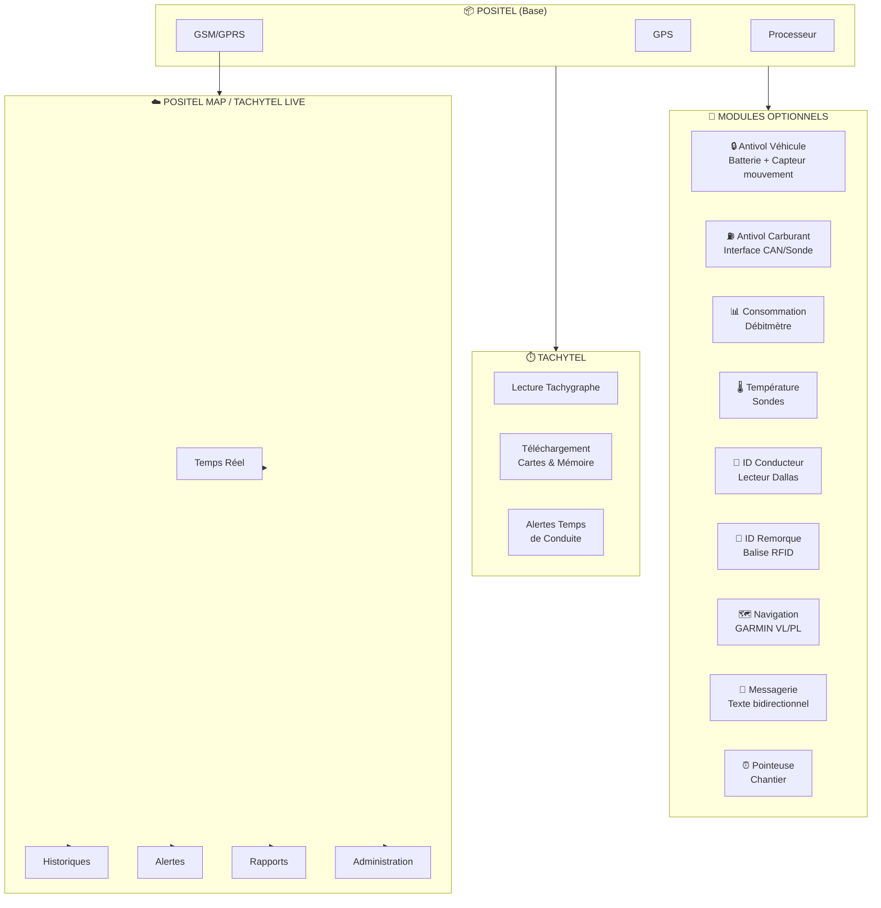

#### 📊 Flux Tachytel - Récupération Temps de Conduite

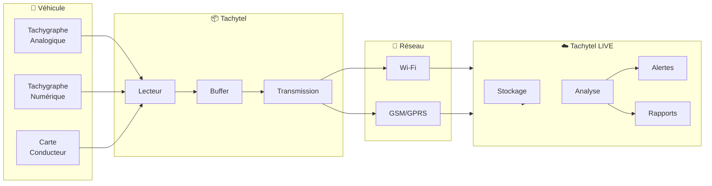

#### Présentation

ATHMO est spécialisée depuis 20+ ans dans l'informatique embarquée pour le transport routier. Historique notable: développement du logiciel KISCAN (lecture disques tachygraphes) commercialisé par VDO/Siemens dans 15 pays européens.

#### Architecture Système

```
[Véhicule + Positel] → [Réseau GSM/GPRS] → [Serveurs Positel MAP] → [Interface Web]
```

#### Compatibilité Véhicules

- 2 roues
- Voitures
- Utilitaires
- Camions
- Cars / Bus
- Engins BTP
- Autres

#### Fonctionnalités de Base (Positel MAP)

**Temps Réel**
- Position exacte des véhicules
- Identification véhicules et conducteurs
- Contrôle périodes d'activité
- Échange de messages textuels

**Historiques & Rapports**
- Reconstitution d'itinéraires
- Proximité et alertes
- Distance et consommation carburant
- Points d'intérêt
- Temps d'arrêt
- Vitesses moyennes
- Temps passé sur chantiers
- Export Excel/HTML

**Administration**
- Comptes utilisateurs avec droits personnalisés
- Points d'intérêt personnalisés
- Gestion véhicules et employés
- Paramétrage alertes

**Sécurité**
- Accès protégé par identifiants
- Connexion HTTPS cryptée
- Geofencing (zones géographiques)
- Alertes entrées/sorties

#### Modules Optionnels

| Module | Description |
|--------|-------------|
| **Antivol Véhicule** | Alerte si déplacement contact coupé, hors horaires, hors zones |
| **Antivol Carburant** | Détection baisse brutale niveau réservoir |
| **Consommation Carburant** | Interface CAN Bus ou débitmètre |
| **Identification Conducteurs** | Lecteur + clés Dallas |
| **Identification Remorques** | Lecteur + balise identification |
| **Pointeuse Chantier** | Lecteur mobile + clés Dallas |
| **Aide Navigation** | GPS GARMIN (cartographie VL ou PL) |
| **Messagerie** | Messages textuels véhicule ↔ bureau |
| **Température** | Sondes + alertes dépassement |
| **Capteurs ON/OFF** | Contacts secs personnalisables |

#### Module Tachytel (Chronotachygraphe)

**Fonctionnalités**
- Récupération temps d'activités en temps réel
- Compatible tachygraphes analogiques (disques) et numériques
- Téléchargement cartes conducteurs à distance
- Téléchargement mémoire tachygraphe
- Alertes approche/dépassement limites horaires
- Rapports d'activités

**Modes de transmission**
- Wi-Fi (version autonome)
- GSM/GPRS (module Positel)

**Application Tachytel LIVE**
- Cumuls quotidiens, hebdomadaires, mensuels
- Temps de conduite, travail, repos, disponibilité
- Double équipage
- Téléchargement à distance sans carte entreprise
- Export Excel

#### Conformité CNIL

- Conforme norme simplifiée n°51
- Documentation fournie pour déclaration
- Information obligatoire des personnels

---

### 2.4 Becker Transit 7SL (GPS Navigation)

**Fabricant**: United Navigation GmbH (Becker)  
**Type**: GPS de navigation pour poids lourds  
**Document source**: `mode-demploi-1489844-gps-pour-poids-lourd-becker-transit-7sl-eu-178-cm-7-pouces-europe.pdf`

#### 📷 Aperçu Visuel

| Page 1 - Couverture | Page 11 - Fonctions |
|:-------------------:|:-------------------:|
| 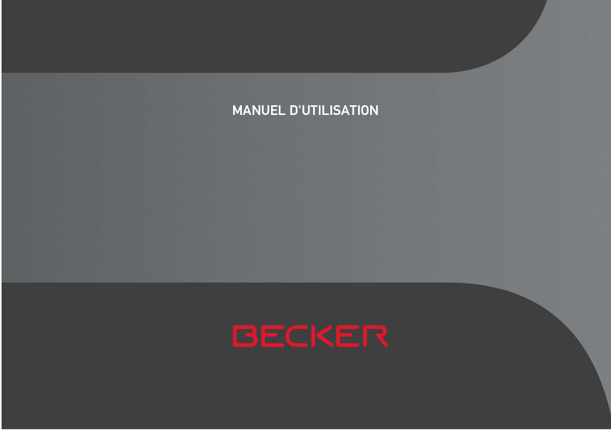 | 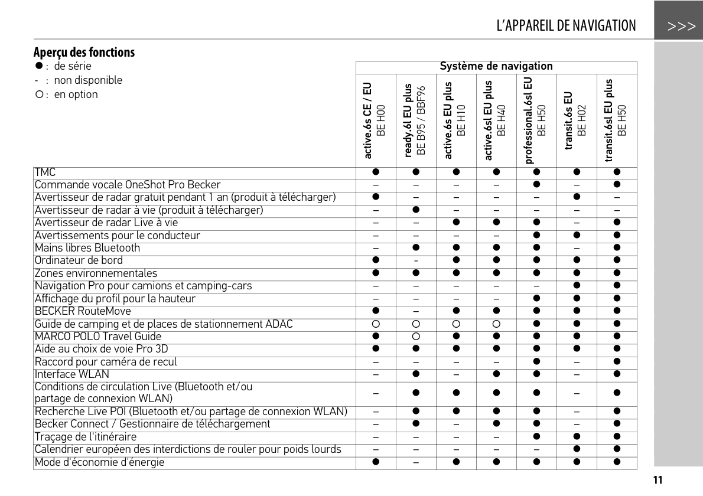 |

| Page 71 - Navigation Camion | Page 72 - Profil Véhicule |
|:---------------------------:|:-------------------------:|
| 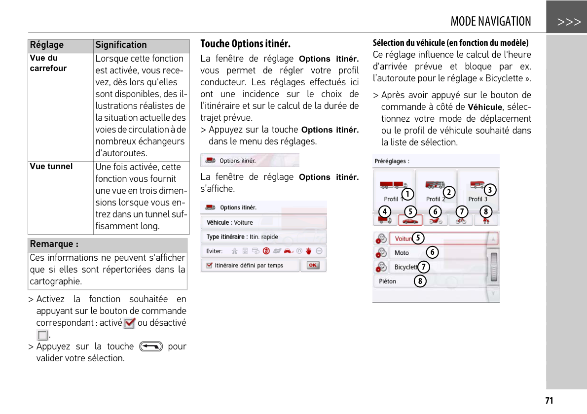 | 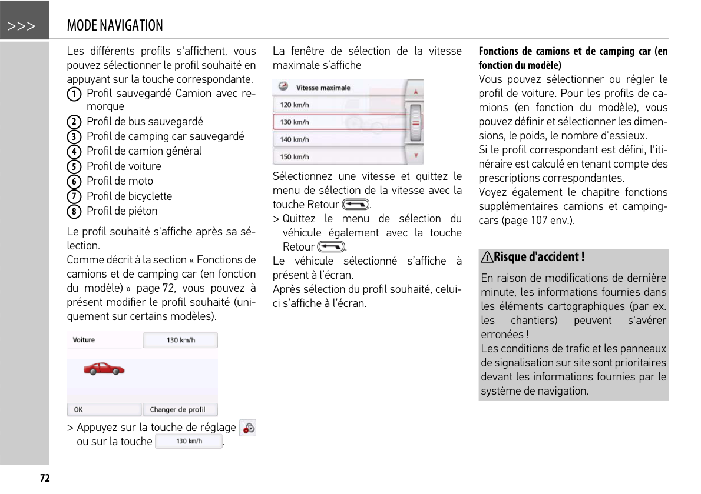 |

#### 🗺️ Logique de Navigation Poids Lourd

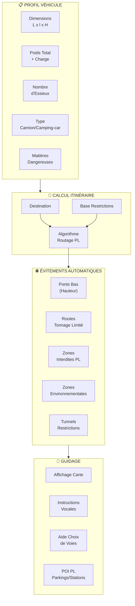

#### Spécifications Techniques

| Caractéristique | Valeur |
|-----------------|--------|
| **Écran** | 7 pouces (17,8 cm) tactile |
| **Alimentation** | 12V / 24V |
| **Température stockage** | -20°C à +60°C |
| **Température fonctionnement** | 0°C à +45°C |
| **Garantie** | 24 mois (batterie: 6 mois) |

#### Fonctionnalités Navigation Poids Lourd

**Profil Véhicule**
- Configuration dimensions (longueur, largeur, hauteur)
- Configuration poids
- Nombre d'essieux
- Type de véhicule (camion, camping-car)

**Calcul d'Itinéraire Adapté**
- Évitement ponts bas (hauteur)
- Évitement routes limitées en tonnage
- Évitement zones interdites PL
- Zones environnementales (LEZ)

**Alertes Conducteur**
- Avertissements vitesse
- Avertisseur de radars (option)
- Alertes zones environnementales
- Avertissements spécifiques camion

#### Fonctionnalités Avancées (selon modèle)

| Fonction | Description |
|----------|-------------|
| **TMC** | Infos trafic temps réel |
| **Live Traffic** | Trafic via données mobiles |
| **Commande vocale** | OneShot Pro Becker |
| **Bluetooth** | Mains libres |
| **Caméra de recul** | Raccordement externe |
| **WiFi** | Mises à jour et POI Live |
| **Calendrier interdictions PL** | Interdictions de rouler européennes |
| **Profil hauteur** | Affichage dénivelé itinéraire |

#### Points d'Intérêt (POI)

- Guide camping ADAC
- MARCO POLO Travel Guide
- Parkings sécurisés
- Stations service
- Aires de repos

---

## 3. Solutions Logicielles

### 3.1 Plateformes Cloud Comparées

| Plateforme | Fabricant | Type | Accès |
|------------|-----------|------|-------|
| **Samsara Cloud** | Samsara | SaaS | Web + Mobile |
| **WEBFLEET** | TomTom | SaaS | Web |
| **Positel MAP** | ATHMO | SaaS | Web |
| **Tachytel LIVE** | ATHMO | SaaS | Web |

### 3.2 Fonctionnalités Logicielles Comparées

| Fonctionnalité | Samsara | TomTom | ATHMO |
|----------------|---------|--------|-------|
| Suivi temps réel | ✅ | ✅ | ✅ |
| Historique trajets | ✅ | ✅ | ✅ |
| Geofencing | ✅ | ✅ | ✅ |
| Alertes personnalisées | ✅ | ✅ | ✅ |
| Rapports automatiques | ✅ | ✅ | ✅ |
| Export données | ✅ | ✅ | ✅ (Excel/HTML) |
| Analyse éco-conduite | ✅ | ✅ | ✅ |
| Gestion conducteurs | ✅ | ✅ | ✅ |
| Messagerie | ✅ | ✅ | ✅ |
| Tachygraphe distant | ✅ | ✅ | ✅ |
| API disponible | ✅ | ✅ | Non spécifié |
| App mobile | ✅ | ✅ | Non spécifié |

---

## 4. Aspects Réglementaires

### 📊 Vue d'Ensemble Réglementaire

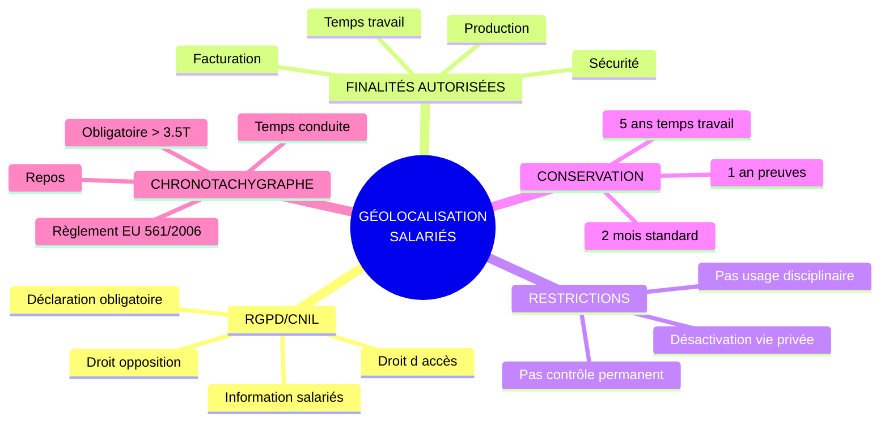

### 4.1 RGPD et Géolocalisation des Salariés

**Document source**: `La-geolocalisation-des-vehicules-mis-a-disposition-des-salaries.pdf`

#### 📋 Processus de Mise en Conformité

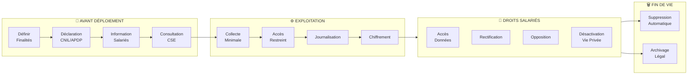

#### Finalités Autorisées

La mise en place d'un dispositif de géolocalisation peut répondre aux objectifs suivants :

1. **Amélioration du processus de production**
   - Allocation optimale des moyens (envoi véhicule le plus proche)
   - Analyse a posteriori des déplacements

2. **Sécurité**
   - Sécurité des personnes (travailleurs isolés)
   - Sécurité des marchandises (transport de fonds)
   - Sécurité du véhicule

3. **Suivi marchandises**
   - Respect chaîne du froid
   - Traçabilité

4. **Facturation**
   - Suivi prestations de transport
   - Ramassage scolaire, nettoyage, etc.

5. **Temps de travail**
   - Uniquement si pas d'autre moyen disponible

6. **Preuve d'exécution**
   - Constitution de preuves de prestation

#### Restrictions Importantes

| Situation | Règle |
|-----------|-------|
| **Véhicule usage privé** | Possibilité de désactiver la géolocalisation hors temps de travail |
| **Mandat syndical/électif** | Pas de géolocalisation pendant exercice du mandat |
| **Liberté d'organisation** | Pas de géolocalisation (VRP, visiteurs médicaux) |
| **Contrôle permanent** | Interdit |
| **Usage disciplinaire** | Interdit sauf exceptions |

#### Données Collectables

- Identification employé (nom, prénom, matricule, immatriculation)
- Données de localisation
- Historique des déplacements
- Vitesse de circulation
- Kilomètres parcourus
- Durées d'utilisation
- Temps de conduite
- Nombre d'arrêts

#### Durées de Conservation

| Usage | Durée |
|-------|-------|
| **Standard** | 2 mois |
| **Preuve d'intervention** | 1 an |
| **Suivi temps de travail** | 5 ans |

#### Obligations Employeur

1. Information préalable des employés
2. Déclaration CNIL/APDP
3. Politique d'habilitations
4. Authentification forte (identifiant + mot de passe)
5. Journalisation des accès
6. Sécurisation des échanges de données

### 4.2 Chronotachygraphes

**Réglementation applicable**: Règlement (CEE) n° 561/2006

#### Véhicules Concernés

Tout véhicule automobile dont le poids maximal autorisé > 3,5 tonnes

#### Données Enregistrées

- Vitesse
- Distance parcourue
- Temps de conduite
- Temps de travail (autre)
- Interruptions de travail
- Temps de repos journalier
- Ouverture du boîtier

#### Application Territoriale

Applicable quel que soit le pays d'immatriculation, dès circulation sur le territoire de l'UE.

---

## 5. Technologies de Données FCD

### 5.1 Floating Car Data (FCD)

**Document source**: `files.pdf` (FAQ Cerema)

#### 📊 Architecture FCD

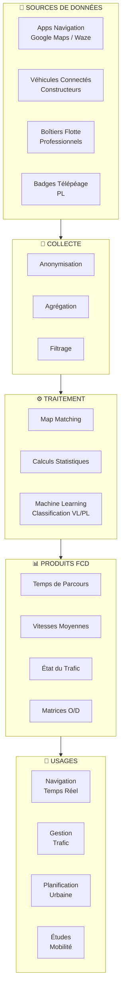

#### Définition

Les données FCD (Floating Car Data) sont des données de géolocalisation collectées anonymement via :
- Applications de navigation (Google Maps, Waze)
- Dispositifs intégrés constructeurs
- Boîtiers de suivi de flotte
- Badges de télépéage

#### Sources de Données

| Source | Avantages | Limitations |
|--------|-----------|-------------|
| **Apps navigation** | Large base utilisateurs | Activation manuelle requise |
| **Constructeurs** | Collecte continue | Véhicules récents uniquement |
| **Flottes professionnelles** | Fiable, continu | Profils spécifiques (PL, taxis) |
| **Télépéage** | Identification certaine PL | Couverture limitée autoroutes |

#### Distinction VL/PL

- Badges télépéage PL → identification certaine
- Modèles statistiques basés sur comportement de conduite
- Profils de vitesse et accélération
- Trajectoires et itinéraires
- Horaires de circulation

#### Usages

| Usage | Pertinence FCD |
|-------|----------------|
| Temps de parcours | ✅ Excellent |
| Vitesses moyennes | ✅ Excellent |
| Couverture réseau | ✅ Excellent |
| Débits véhicules | ⚠️ Complémentaire (comptages) |
| Régulation feux | ⚠️ Limité |
| Trajets courts | ⚠️ Sous-représentés |

#### Coût d'Acquisition

Paramètres influençant le prix :
1. Type de données (agrégées vs désagrégées)
2. Granularité spatiale
3. Granularité temporelle
4. Volume et fréquence d'échantillonnage
5. Droits d'usage
6. Qualité et enrichissement
7. Niveau de service (temps réel vs différé)

---

## 6. Recherche Académique

### 6.1 Thèse El Najjar (2003)

**Document source**: `these_Maan_E_El_Najjar-1.pdf`

**Titre**: Localisation dynamique d'un véhicule sur une carte routière numérique pour l'assistance à la conduite

**Institution**: Université de Technologie de Compiègne (UTC), Laboratoire HeuDiaSyc

#### 📊 Architecture de Fusion Multi-Capteurs (Map-Matching)

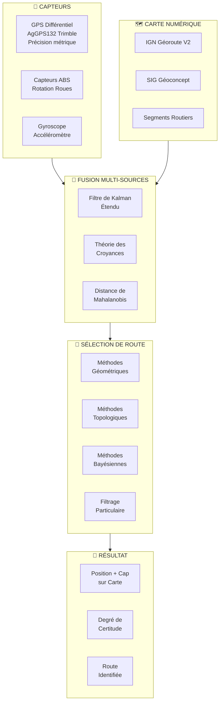

#### 🔄 Processus de Map-Matching

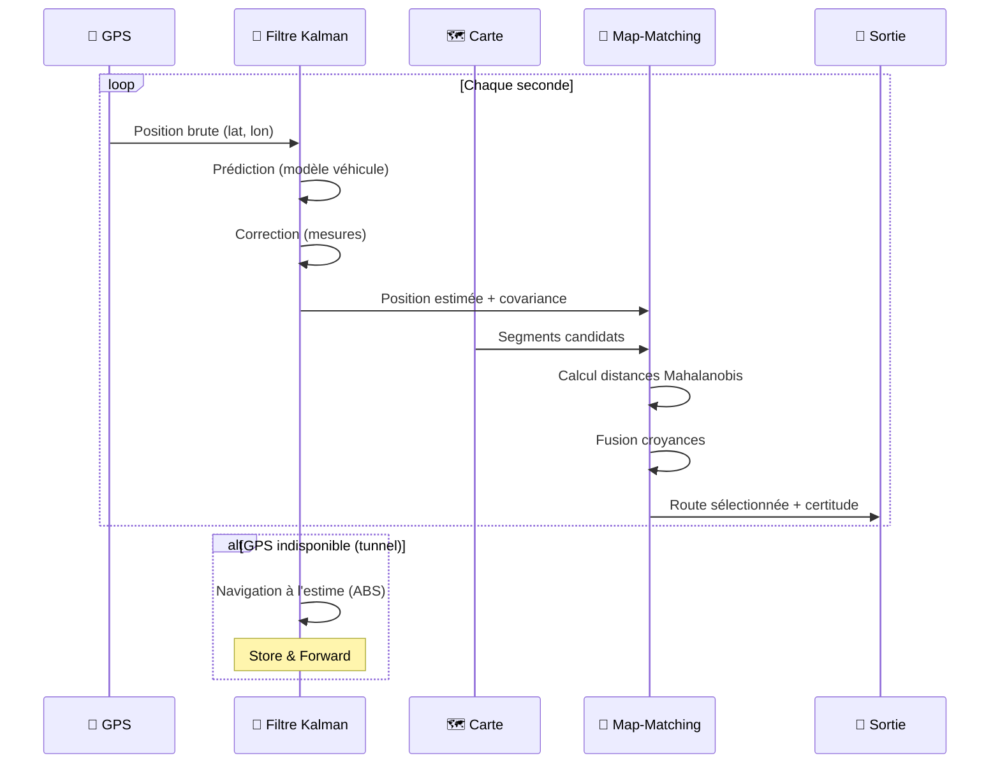

#### Problématique

Localisation précise d'un véhicule sur une carte routière numérique pour les systèmes ADAS (Advanced Driver Assistance Systems).

#### Approche Méthodologique

**Fusion Multi-Sources**
- GPS différentiel (AgGPS132 Trimble, précision métrique)
- Capteurs proprioceptifs (ABS - rotation roues)
- Carte routière numérique (IGN Géoroute V2)
- SIG Géoconcept

**Algorithmes**
- Filtrage de Kalman étendu
- Théorie des croyances (Dempster-Shafer)
- Map-matching (localisation cartographique)

#### Méthodes de Sélection de Routes

1. **Méthodes Déterministes**
   - Géométriques
   - Topologiques
   - Détection de virages
   - Comparaison de longueurs

2. **Méthodes Bayésiennes**
   - Gaussienne (distance de Mahalanobis)
   - Filtrage particulaire

3. **Approche Crédibiliste**
   - Fusion multi-critères
   - Quantification du degré de certitude

#### Résultats

- Localisation temps réel sur carte
- Qualification des résultats (précision + certitude)
- Gestion de l'intermittence GPS (tunnels)
- Architecture temps réel mono et multi-machines

#### Applications ADAS Identifiées

- Anticipation de virages
- Alerte de sortie de route
- Régulation de distance inter-véhicules
- Prévention de collisions
- Information conducteur enrichie

---

## 7. Tableau Comparatif Global

### 📊 Radar Comparatif des Solutions

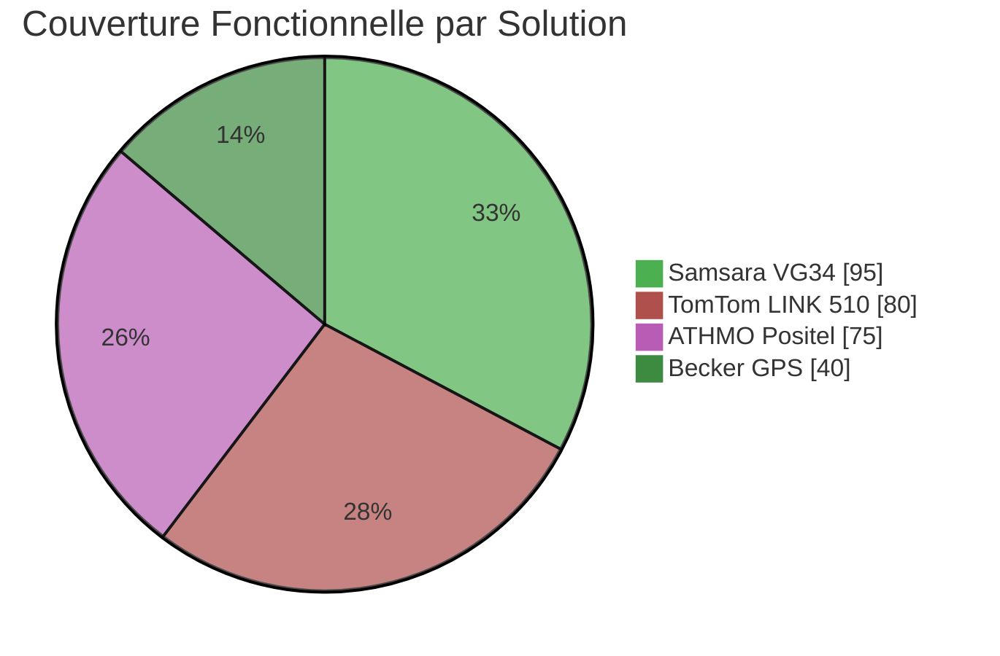

### 📈 Positionnement des Solutions

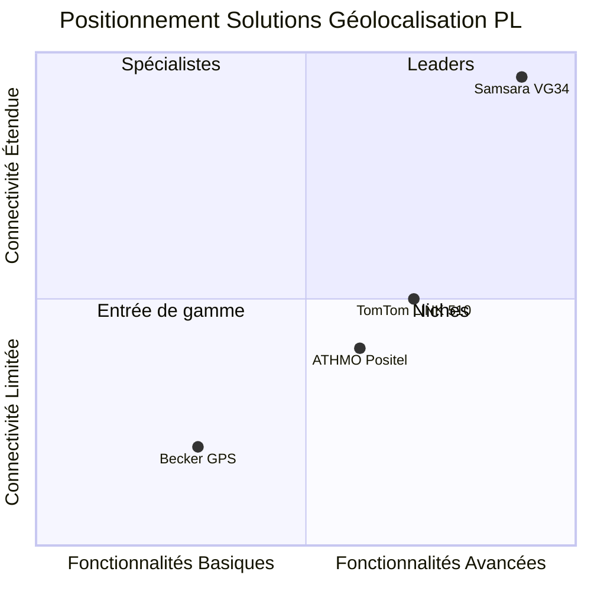

### 7.1 Comparatif Hardware

| Critère | Samsara VG34 | TomTom LINK 510 | ATHMO Positel |
|---------|--------------|-----------------|---------------|
| **Dimensions** | 117x72x26 mm | 121x56,5x21,5 mm | Non spécifié |
| **Poids** | 118 g | 88 g | Non spécifié |
| **Temp. fonct.** | -40°C à +85°C | -30°C à +70°C | Non spécifié |
| **Alimentation** | 12V/24V | 12V/24V | 12V/24V |
| **Cellulaire** | 4G LTE + 3G + 2G | GSM/GPRS | GSM/GPRS |
| **GPS** | GPS + GLONASS | GPS | GPS |
| **WiFi** | ✅ Point d'accès | ❌ | ❌ |
| **Bluetooth** | ✅ | ✅ Classe 2 | ❌ |
| **OBD-II** | ✅ J1962/J1939/J1708 | ✅ CAN Bus | ✅ CAN Bus |
| **FMS** | ✅ | ✅ | Non spécifié |
| **Entrées numériques** | 2 | 2 | Oui (options) |
| **Sortie numérique** | 1 (future) | 1 | Non spécifié |
| **Capteurs température** | ✅ Sans fil | ❌ | ✅ Filaire |
| **ID conducteur** | ✅ Jetons | ❌ | ✅ Dallas |
| **Antivol** | ✅ | ✅ | ✅ |
| **Tachygraphe** | ✅ Distant | ✅ | ✅ Tachytel |

### 7.2 Comparatif Fonctionnel

| Fonctionnalité | Samsara | TomTom | ATHMO | Becker GPS |
|----------------|---------|--------|-------|------------|
| **Suivi temps réel** | ✅ | ✅ | ✅ | ❌ |
| **Historique trajets** | ✅ | ✅ | ✅ | ✅ |
| **Geofencing** | ✅ | ✅ | ✅ | ❌ |
| **Éco-conduite** | ✅ | ✅ | ✅ | ❌ |
| **Consommation carburant** | ✅ | ✅ | ✅ | ❌ |
| **Maintenance préventive** | ✅ | ✅ | ❌ | ❌ |
| **Navigation PL** | ❌ | ✅ (PRO) | ✅ (GARMIN) | ✅ |
| **Profil véhicule** | ✅ | ✅ | ❌ | ✅ |
| **Messagerie** | ✅ | ✅ | ✅ | ❌ |
| **Tachygraphe distant** | ✅ | ✅ | ✅ | ❌ |
| **Caméra** | ✅ | ❌ | ❌ | ✅ (option) |
| **Conformité ELD (USA)** | ✅ | ✅ | ❌ | ❌ |

### 7.3 Comparatif Connectivité

| Critère | Samsara VG34-EU | TomTom LINK 510 | ATHMO Positel |
|---------|-----------------|-----------------|---------------|
| **4G LTE** | ✅ | ❌ | ❌ |
| **3G** | ✅ | ❌ | ❌ |
| **2G/GPRS** | ✅ | ✅ | ✅ |
| **WiFi** | ✅ 802.11g/n | ❌ | ✅ (Tachytel) |
| **Bluetooth** | ✅ | ✅ | ❌ |
| **Stockage hors-ligne** | ✅ Flash | Non spécifié | Non spécifié |
| **Chiffrement** | AES 256 bits | Non spécifié | HTTPS |

---

## 8. Recommandations

### 8.1 Choix de Solution selon Besoins

| Besoin Principal | Solution Recommandée |
|------------------|---------------------|
| **Flotte internationale, connectivité avancée** | Samsara VG34 |
| **Intégration navigation TomTom** | TomTom LINK 510 |
| **Solution française, support local** | ATHMO Positel |
| **Navigation PL uniquement** | Becker Transit 7SL |
| **Gestion tachygraphes prioritaire** | ATHMO Tachytel |

### 8.2 Fonctionnalités Essentielles à Implémenter

Sur la base de l'analyse des solutions existantes, le système de géolocalisation à développer devrait inclure :

#### 🏗️ Architecture Cible Recommandée

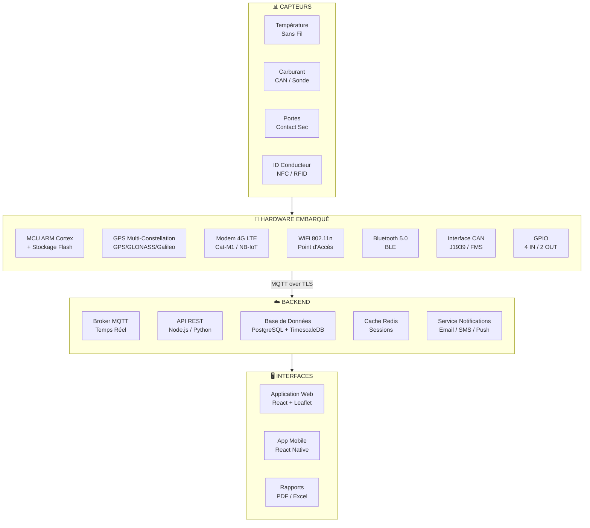

#### 📋 Roadmap de Développement

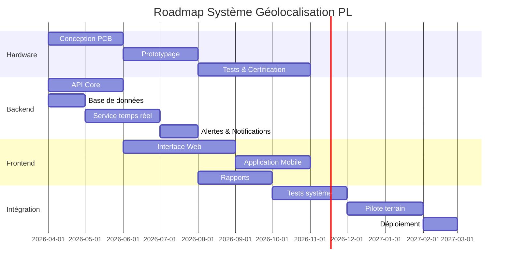

#### Hardware
- [ ] GPS multi-constellation (GPS + GLONASS + Galileo)
- [ ] Connectivité 4G LTE avec fallback 3G/2G
- [ ] Interface OBD-II/CAN Bus (J1939, FMS)
- [ ] WiFi pour mise à jour et point d'accès
- [ ] Bluetooth pour périphériques
- [ ] Entrées/sorties numériques configurables
- [ ] Capteurs température sans fil
- [ ] Identification conducteur (RFID/NFC)
- [ ] Stockage local (store & forward)
- [ ] Température de fonctionnement: -40°C à +85°C

#### Logiciel
- [ ] Plateforme web responsive
- [ ] Application mobile (iOS/Android)
- [ ] Suivi temps réel sur carte (OpenStreetMap)
- [ ] Geofencing multi-zones
- [ ] Alertes personnalisables (email, SMS, push)
- [ ] Rapports automatiques (PDF, Excel)
- [ ] Analyse éco-conduite
- [ ] Gestion conducteurs et véhicules
- [ ] Messagerie bidirectionnelle
- [ ] API REST pour intégrations
- [ ] Téléchargement tachygraphe distant
- [ ] Conformité RGPD (désactivation hors travail)

#### Navigation PL
- [ ] Profil véhicule (dimensions, poids, essieux)
- [ ] Évitement restrictions (hauteur, tonnage)
- [ ] Zones environnementales (LEZ)
- [ ] POI spécifiques PL (parkings sécurisés, stations)
- [ ] Calendrier interdictions de rouler

### 8.3 Points de Vigilance

1. **Conformité RGPD**
   - Déclaration CNIL obligatoire
   - Information préalable des salariés
   - Possibilité de désactivation hors temps de travail
   - Conservation limitée des données

2. **Interopérabilité**
   - Support protocoles standards (FMS, J1939)
   - API ouverte pour intégrations tierces
   - Export données formats standards

3. **Fiabilité**
   - Stockage local en cas de perte réseau
   - Synchronisation automatique
   - Redondance GPS (multi-constellation)

4. **Évolutivité**
   - Architecture modulaire
   - Mise à jour firmware à distance
   - Ajout de capteurs sans remplacement matériel

---

## 9. Galerie d'Images Extraites

### 9.1 Documentation LINK (Images uniquement - pas de texte extractible)

Ce document était au format image dans le PDF original. Voici les captures :

| Page 1 | Page 2 | Page 3 |
|:------:|:------:|:------:|
| 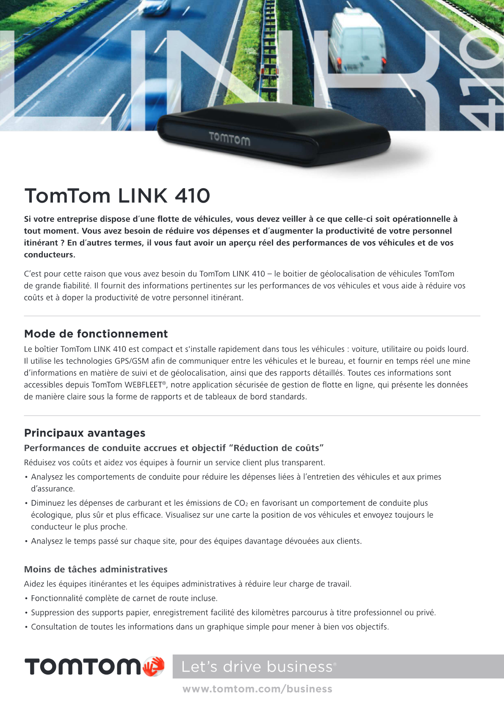 | 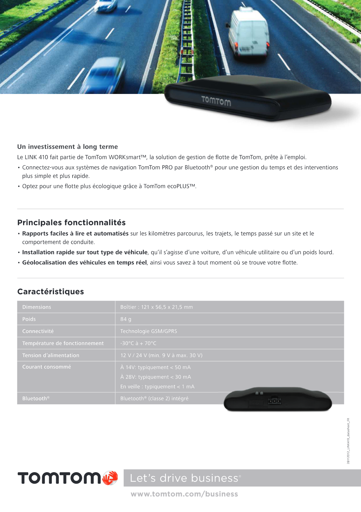 | 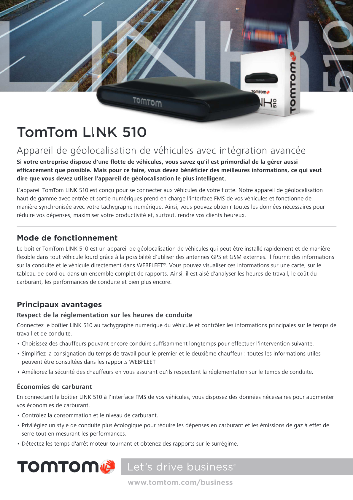 |

### 9.2 Livre Blanc - Gestion de Flotte

| Page 1 - Couverture | Page 2 - Sommaire |
|:-------------------:|:-----------------:|
|  | 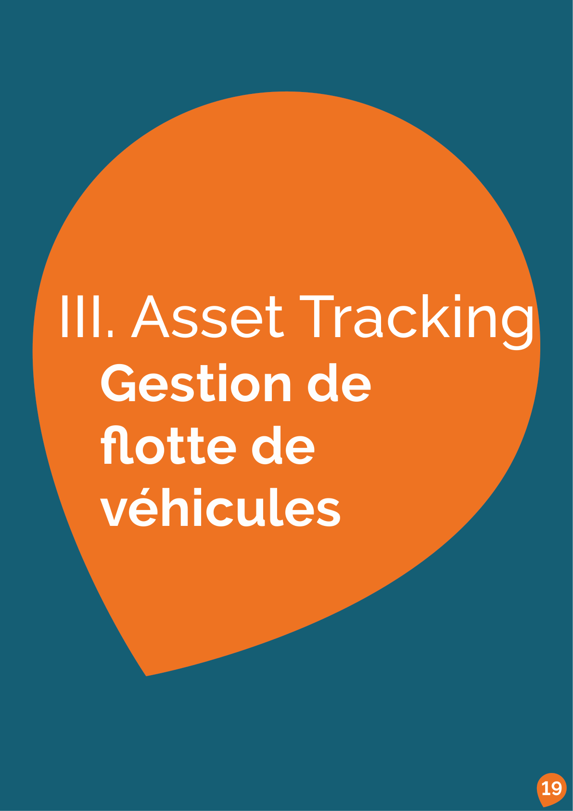 |

| Page 3 - Définitions | Page 4 - Secteurs |
|:--------------------:|:-----------------:|
| 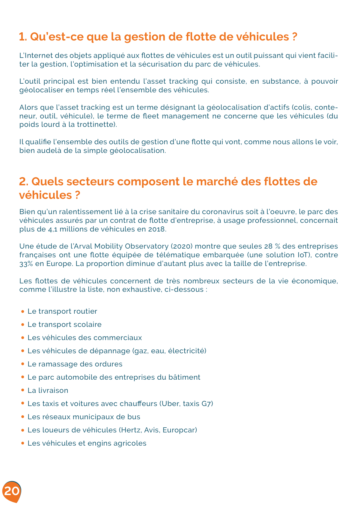 | 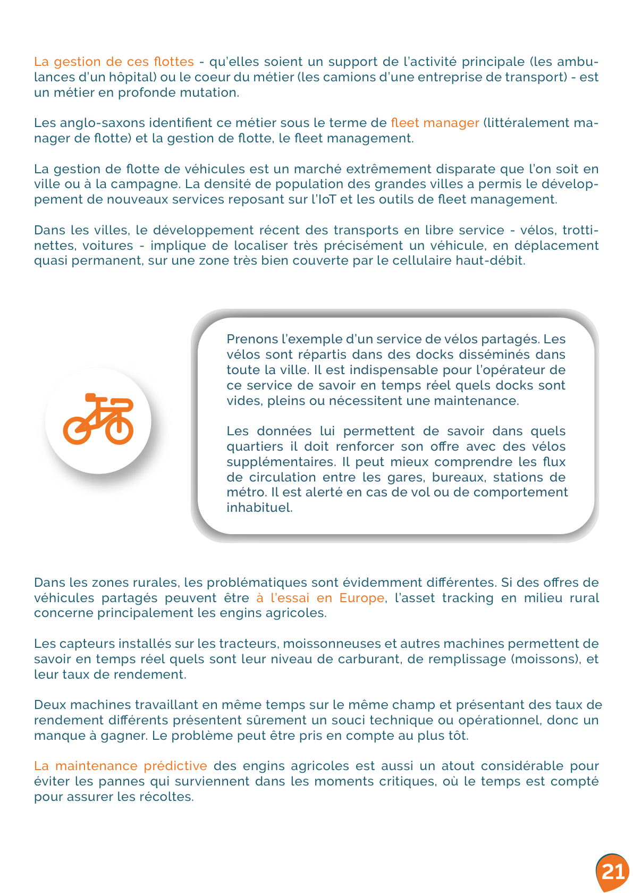 |

### 9.3 Réglementation CNIL/APDP - Géolocalisation des Salariés

| Page 1 - Introduction | Page 2 - Finalités | Page 3 - Justification |
|:---------------------:|:------------------:|:----------------------:|
| 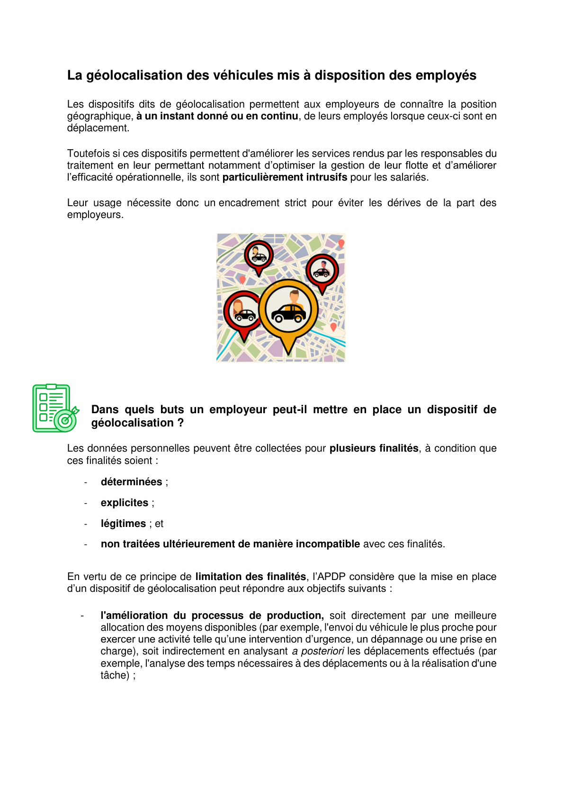 | 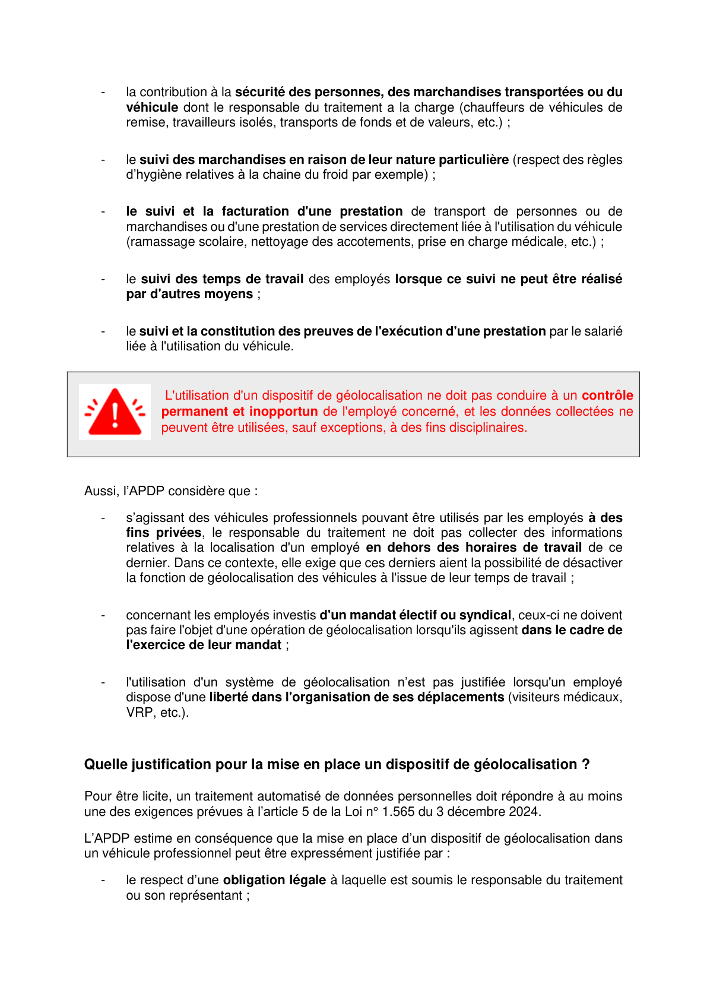 | 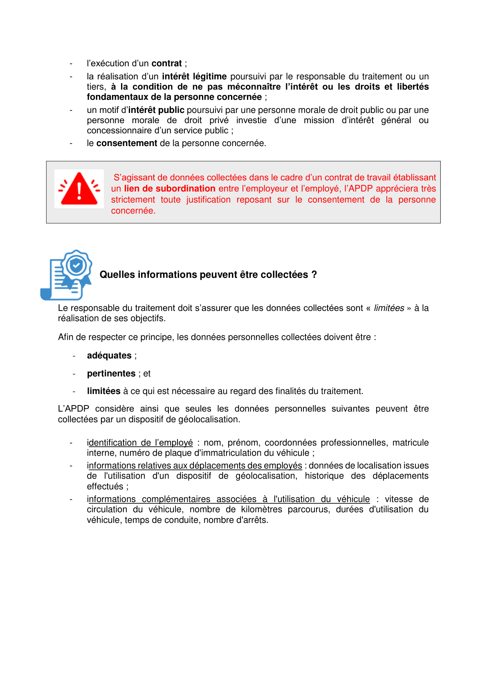 |

### 9.4 Index des Images Extraites

| Fichier | Source | Description |
|---------|--------|-------------|
| `VG34_page_01.png` | VG34_datasheet_FR.pdf | Présentation générale Samsara VG34 |
| `VG34_page_02.png` | VG34_datasheet_FR.pdf | Sources de données et interfaces |
| `VG34_page_03.png` | VG34_datasheet_FR.pdf | Connectivité et alimentation |
| `VG34_page_04.png` | VG34_datasheet_FR.pdf | Fonctionnalités logicielles |
| `TomTom_LINK510_page_01.png` | ttb-link510-doc.pdf | Présentation et avantages |
| `TomTom_LINK510_page_02.png` | ttb-link510-doc.pdf | Caractéristiques techniques |
| `ATHMO_page_01.png` | ATHMO_Informatique_embarquee.pdf | Couverture |
| `ATHMO_page_02.png` | ATHMO_Informatique_embarquee.pdf | Présentation entreprise |
| `ATHMO_page_03.png` | ATHMO_Informatique_embarquee.pdf | Pourquoi s'équiper |
| `ATHMO_page_04.png` | ATHMO_Informatique_embarquee.pdf | Principe Positel |
| `ATHMO_page_05.png` | ATHMO_Informatique_embarquee.pdf | Application Positel MAP |
| `ATHMO_page_06.png` | ATHMO_Informatique_embarquee.pdf | Options disponibles |
| `ATHMO_page_07.png` | ATHMO_Informatique_embarquee.pdf | Options (suite) |
| `ATHMO_page_08.png` | ATHMO_Informatique_embarquee.pdf | Packs de base |
| `LINK_page_01.png` | LINK.pdf | Documentation produit (image) |
| `LINK_page_02.png` | LINK.pdf | Documentation produit (image) |
| `LINK_page_03.png` | LINK.pdf | Documentation produit (image) |
| `LivreBlanc_page_01.png` | livre-blanc-gestion-de-flotte.pdf | Couverture |
| `LivreBlanc_page_02.png` | livre-blanc-gestion-de-flotte.pdf | Sommaire |
| `LivreBlanc_page_03.png` | livre-blanc-gestion-de-flotte.pdf | Définitions |
| `LivreBlanc_page_04.png` | livre-blanc-gestion-de-flotte.pdf | Secteurs d'activité |
| `CNIL_Geoloc_page_01.png` | La-geolocalisation-des-vehicules.pdf | Introduction |
| `CNIL_Geoloc_page_02.png` | La-geolocalisation-des-vehicules.pdf | Finalités autorisées |
| `CNIL_Geoloc_page_03.png` | La-geolocalisation-des-vehicules.pdf | Justification légale |
| `Becker_GPS_page_01.png` | mode-demploi-becker-transit.pdf | Couverture manuel |
| `Becker_GPS_page_11.png` | mode-demploi-becker-transit.pdf | Aperçu des fonctions |
| `Becker_GPS_page_12.png` | mode-demploi-becker-transit.pdf | Fonctions (suite) |
| `Becker_GPS_page_71.png` | mode-demploi-becker-transit.pdf | Navigation camion |
| `Becker_GPS_page_72.png` | mode-demploi-becker-transit.pdf | Profil véhicule |

---

## Annexes

### A. Documents Sources Analysés

| # | Fichier | Type | Pages | Taille |
|---|---------|------|-------|--------|
| 1 | `VG34_datasheet_FR.pdf` | Fiche technique | 11 | 407 KB |
| 2 | `ttb-link510-doc.pdf` | Fiche technique | 2 | 472 KB |
| 3 | `ATHMO_Informatique_embarquee_generale_fr_MEDIUM.pdf` | Brochure | 11 | 885 KB |
| 4 | `livre-blanc-gestion-de-flotte-de-vehicules-corrige.pdf` | Livre blanc | 9+ | 1.3 MB |
| 5 | `La-geolocalisation-des-vehicules-mis-a-disposition-des-salaries.pdf` | Réglementation | 7 | 381 KB |
| 6 | `these_Maan_E_El_Najjar-1.pdf` | Thèse | 200+ | 2.7 MB |
| 7 | `mode-demploi-gps-poids-lourd-becker-transit-7sl.pdf` | Manuel | 150+ | 5.8 MB |
| 8 | `files.pdf` | FAQ technique | 5 | 130 KB |
| 9 | `LINK.pdf` | Documentation | - | 1.1 MB |
| 10 | `Telechargez-la-brochure-Technologie-a-bord_2019.pdf` | Brochure | - | 803 KB |

### B. Glossaire

| Terme | Définition |
|-------|------------|
| **ADAS** | Advanced Driver Assistance Systems |
| **CAN Bus** | Controller Area Network - Bus de communication véhicule |
| **ELD** | Electronic Logging Device (USA) |
| **FCD** | Floating Car Data |
| **FMS** | Fleet Management System (standard européen) |
| **GNSS** | Global Navigation Satellite System |
| **J1939** | Protocole CAN pour poids lourds |
| **LEZ** | Low Emission Zone |
| **OBD-II** | On-Board Diagnostics version 2 |
| **POI** | Point of Interest |
| **SIG** | Système d'Information Géographique |
| **TMC** | Traffic Message Channel |

---

*Document généré automatiquement à partir de l'analyse des PDFs du dossier "Localisation poid lourd"*
