# PRÉSENTATION DÉTAILLÉE - SOLUTION GÉOLOCALISATION POIDS LOURD

## OBJECTIF PRINCIPAL
Présenter en détail le produit de géolocalisation poids lourd en décrivant son architecture matérielle/logicielle, firmware, fonctionnalités et spécifications techniques.

---

## CONTENU DÉTAILLÉ DES SLIDES

### PARTIE 1: INTRODUCTION ET CONTEXTE (Slides 1-5)

#### Slide 1: Page de Titre
**Titre**: Solution de Géolocalisation Avancée pour Poids Lourds
**Sous-titre**: Architecture Hybride Hardware/Logiciel/Firmware
**Visuel**: Logo de l'entreprise + image de poids lourd moderne avec technologie embarquée
**Informations**: 
- Date: [Date de présentation]
- Présentateur: [Nom du présentateur]
- Version: 1.0

---

#### Slide 2: Résumé Exécutif
**Titre**: Révolution dans la Géolocalisation Poids Lourd

**Contenu texte**:
```
PROBLÉMATIQUE ACTUELLE
• Perte de productivité: 15-20% du temps de conduite
• Coûts carburant: 30% du budget transport
• Non-conformité: 25% des flottes en infraction
• Maintenance réactive: +40% de coûts vs préventive

NOTRE SOLUTION
• Architecture hybride unique: Véhicule + Drone + GCS Militaire
• Précision centimétrique: GNSS multi-constellation + IMU
• Communication multi-mode: 4G/5G + LoRaWAN + Satellite
• Intelligence embarquée: IA edge + cloud

VALEUR AJOUTÉE
• -15% consommation carburant
• +20% productivité flotte
• 100% conformité réglementaire
• ROI < 12 mois
```

**Graphique**: Barres comparatives avant/après implémentation

---

#### Slide 3: Points Clés Différenciants
**Titre**: Notre Avantage Concurrentiel

**Diagramme central**:
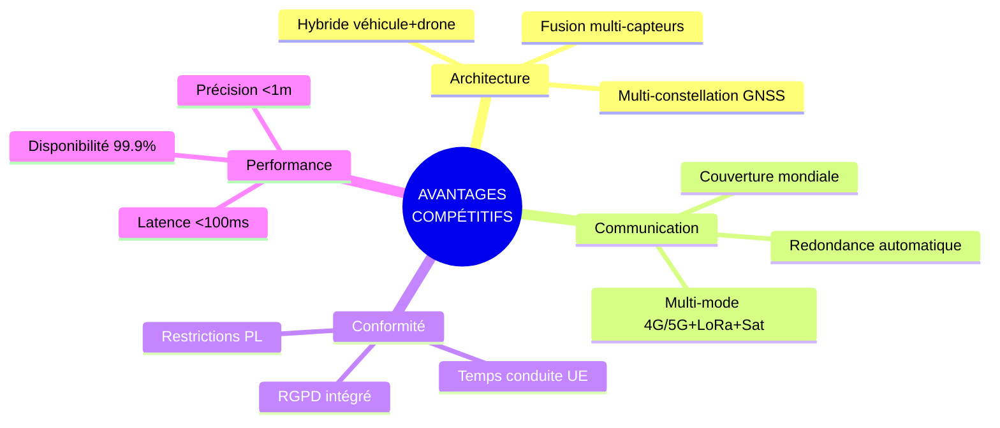

**Points clés en texte**:
- **Architecture hybride** combinant technologies véhicule et drone pour précision
- **Multi-constellation GNSS** (GPS/GLONASS/Galileo/BeiDou) avec correction IMU
- **Communication multi-mode** (4G/5G, LTE-M, LoRaWAN, Satellite)
- **Station de contrôle multiflotte** inspirée des GCS militaires
- **Conformité RGPD** et réglementation transport intégrée
- **Map-matching avancé** avec fusion multi-capteurs

---

#### Slide 4: Positionnement Stratégique
**Titre**: Positionnement sur le Marché

**Graphique**: Diagramme de positionnement
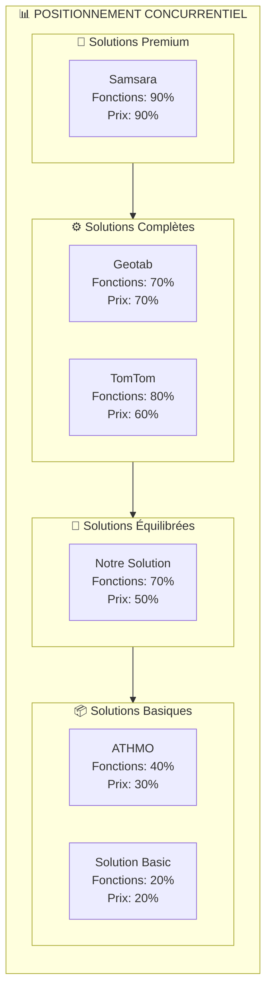

**Segments de marché cibles**:
- Transport longue distance (>500km/jour)
- Distribution urbaine (centre-ville, ZEP)
- Logistique spécialisée (froid, dangereux)
- Construction et BTP (sites multiples)

---

#### Slide 5: Architecture Globale
**Titre**: Vue d'Ensemble Système

**Schéma d'architecture**:
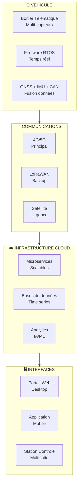

**Flux de données**: Capteurs → Traitement embarqué → Transmission → Cloud → Interfaces utilisateur

---

### PARTIE 2: ARCHITECTURE MATÉRIELLE (Slides 6-12)

#### Slide 6: Solution Hardware - Vue d'Ensemble
**Titre**: Boîtier Télématique Industriel

**Image**: Photo du boîtier télématique avec annotations

**Spécifications principales**:
```
CONCEPTION INDUSTRIELLE
• Boîtier aluminium IP67
• Résistance vibration: 20G
• Température: -40°C à +85°C
• Montage standard DIN rail

COMPOSANTS PRINCIPAUX
• CPU ARM Cortex-A53 Quad-core
• 2GB RAM LPDDR4
• 32GB eMMC stockage
• Multi-GNSS: GPS/GLONASS/Galileo/BeiDou

CERTIFICATIONS
• ISO 16750 (Automotive)
• CE/FCC/IC
• ECE R10 (Électromagnétique)
• IP67 (Étanchéité)
```

---

#### Slide 7: Architecture Interne Détaillée
**Titre**: Conception Technique Interne

**Diagramme d'architecture**:
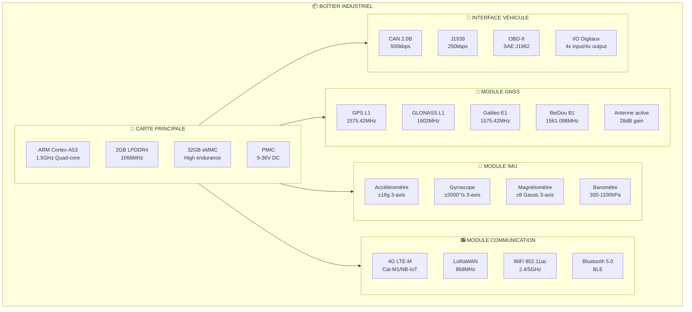

---

#### Slide 8: Spécifications Techniques - Dimensions
**Titre**: Caractéristiques Physiques

**Tableau détaillé**:
| Caractéristique | Valeur | Tolérance | Notes |
|-----------------|--------|-----------|-------|
| **Dimensions** | 120×80×35mm | ±1mm | Boîtier compact |
| **Poids** | 250g | ±5g | Sans accessoires |
| **Matériau** | Aluminium 6061 | - | Anodisé noir |
| **Protection** | IP67 | - | Étanchéité totale |
| **Montage** | DIN rail 35mm | - | Standard industriel |
| **Connecteurs** | M12 | - | Codés par fonction |

**Graphique**: Vue 3D avec cotes dimensionnelles

**Conditions environnementales**:
```
TEMPÉRATURE OPÉRATIONNELLE
• Fonctionnement: -40°C à +85°C
• Stockage: -40°C à +105°C
• Humidité: 5% à 95% non-condensé

RÉSISTANCE MÉCANIQUE
• Vibration: 20G, 10-2000Hz (IEC 60068-2-6)
• Chocs: 100G, 11ms (IEC 60068-2-27)
• Chute: 1m sur béton (MIL-STD-810G)
```

---

#### Slide 9: Spécifications Techniques - Caractéristiques
**Titre**: Performance Électronique

**Spécifications CPU et mémoire**:
```
PROCESSEUR
• Architecture: ARM Cortex-A53
• Fréquence: 1.5GHz Quad-core
• Cache: 512KB L2
• GPU: ARM Mali-450 MP4
• TDP: 5W typique

MÉMOIRE
• RAM: 2GB LPDDR4
• Bande passante: 10.6GB/s
• Stockage: 32GB eMMC 5.1
• Endurance: 300TB écriture
• Extension: MicroSD 128GB max
```

**Tableau des interfaces**:
| Interface | Type | Vitesse | Connecteur | Notes |
|-----------|------|---------|------------|-------|
| **GNSS** | UART | 460kbps | SMA | Antenne externe |
| **CAN** | CAN 2.0B | 1Mbps | DB9 | J1939 supporté |
| **USB** | USB 2.0 | 480Mbps | USB-A | Debug/Configuration |
| **Ethernet** | 100Mbps | 100Mbps | RJ45 | Optional |
| **Power** | DC | - | M12 | 9-36V |

---

#### Slide 10: Connectivité Matérielle
**Titre**: Réseaux et Communications

**Diagramme des connexions**:
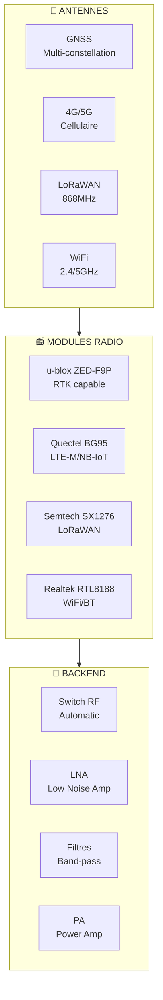

**Spécifications par technologie**:
```
GNSS MULTI-CONSTELLATION
• GPS L1/L2: 1575.42/1227.60MHz
• GLONASS L1/L2: 1602.0/1246.0MHz  
• Galileo E1/E5a: 1575.42/1176.45MHz
• BeiDou B1/B2: 1561.10/1207.14MHz
• Précision RTK: 1cm + 1ppm

COMMUNICATION CELLULAIRE
• LTE-M: Cat-M1, 375kbps up/down
• NB-IoT: 20kbps up, 250kbps down
• Fallback: 2G/3G automatique
• Roaming: 200+ opérateurs

LORAWAN
• Fréquence: 868MHz (EU)
• Portée: 10-15km rural, 2-5km urbain
• Débit: 0.3-50kbps adaptatif
• Class A/C supporté
```

---

#### Slide 11: Architecture Électrique
**Titre**: Schéma Électrique et Alimentation

**Schéma électrique**:
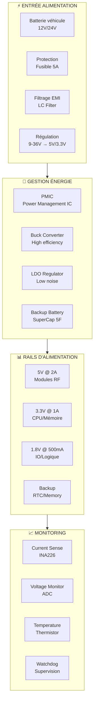

**Spécifications électriques**:
```
ALIMENTATION
• Tension: 9-36V DC (protégée 6-40V)
• Consommation: 2W nominal, 5W pic
• Courant: 150mA @ 12V nominal
• Backup: 24h avec supercondensateur

PROTECTION
• Surcharge: Fusible 5A rapide
• Inversion: Diode protection
• Transitoires: TVS diodes 60V
• EMI: Filtres LC sur toutes les entrées

QUALITÉ ALIMENTATION
• Ripple: <50mV pp @ full load
• Regulation: ±2% typique
• Efficiency: >85% @ 12V
• PFC: Non requis (DC input)
```

---

#### Slide 12: Capteurs Embarqués
**Titre**: Suite de Capteurs Intégrés

**Diagramme des capteurs**:
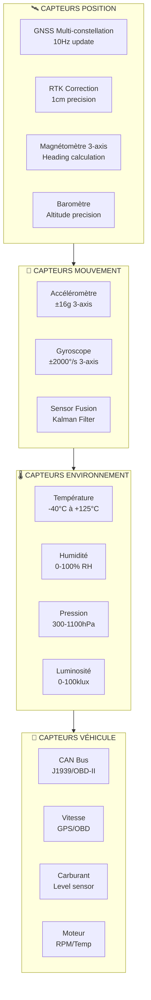

**Spécifications détaillées**:
```
SYSTÈME GNSS
• Précision: 1.5m standalone, 1cm RTK
• Update rate: 10Hz (100ms)
• TTFF: 26s cold, 2s hot
• Tracking: 100+ satellites simultanés

CENTRALE INERTIELLE (IMU)
• Accéléromètre: ±16g, 100Hz, 0.1mg résolution
• Gyroscope: ±2000°/s, 100Hz, 0.01°/s résolution
• Magnétomètre: ±8 Gauss, 50Hz, 0.1mG résolution
• Calibration: Auto et manuelle

CAPTEURS ENVIRONNEMENTAUX
• Température: ±0.5°C précision
• Humidité: ±3% RH précision
• Pression: ±1hPa précision
• Résolution: 16-bit ADC
```

---

### PARTIE 3: FIRMWARE ET SYSTÈME TEMPS RÉEL (Slides 13-17)

#### Slide 13: Architecture Firmware - Vue d'Ensemble
**Titre**: Système d'Exploitation Temps Réel

**Architecture firmware**:
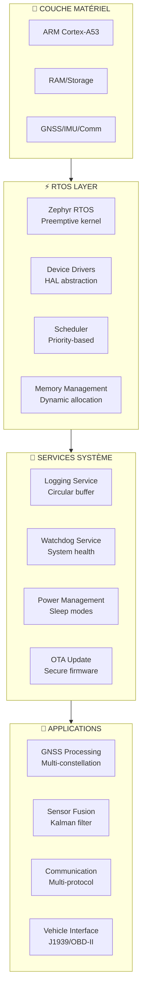

**Caractéristiques RTOS**:
```
ZEPHYR RTOS FEATURES
• Kernel préemptif 64-bit
• Scheduling: Priorité fixe + Round-robin
• Latence: <10μs interrupt response
• Memory: 4GB address space
• Threading: 256 threads max

PERFORMANCE
• Boot time: <5s cold start
• Context switch: <1μs
• Interrupt latency: <10μs
• Power consumption: <100mW idle
```

---

#### Slide 14: Contrôleurs de Conduite
**Titre**: Algorithmes de Contrôle Adaptatif

**Architecture des contrôleurs**:
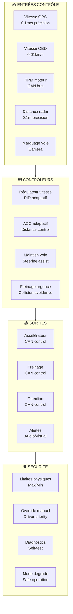

**Spécifications des contrôleurs**:
```
RÉGULATEUR DE VITESSE ADAPTATIF
• Plage vitesse: 0-130 km/h
• Précision: ±1 km/h
• Accélération: 0-2 m/s² configurable
• Décélération: 0-5 m/s² configurable

ASSISTANCE MAINTIEN VOIE
• Détection marquage: 95% fiabilité
• Correction steering: ±15° max
• Réponse: <100ms
• Mode: Assistance uniquement (pas autonome)

FREINAGE D'URGENCE
• Détection obstacle: 150m max
• Temps réaction: <200ms
• Décélération max: 8 m/s²
• Intégration ABS/ESP
```

---

#### Slide 15: Contrôle PID Spécialisé
**Titre**: Algorithmes PID Optimisés Poids Lourd

**Schéma de contrôle PID**:
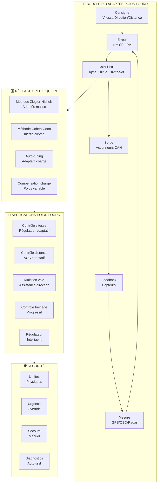

**Tableau des paramètres PID**:
| Paramètre | Description | Valeur typique PL | Réglage | Application PL |
|-----------|-------------|------------------|--------|---------------|
| **Kp** | Gain proportionnel | 0.8-3.0 | Réactivité | Accélération/Freinage |
| **Ki** | Gain intégral | 0.02-0.8 | Stabilité | Vitesse régulière |
| **Kd** | Gain dérivé | 0.002-0.15 | Amortissement | Changements direction |
| **Ts** | Période échantillonnage | 10-50ms | Fréquence | Temps réel |
| **Output Limit** | Limite sortie | ±80% | Saturation | Sécurité |
| **Deadband** | Bande morte | ±2% | Stabilité | Vibrations |
| **Filter** | Filtre passe-bas | 5-20Hz | Bruit | Qualité signal |
| **Anti-windup** | Anti-saturation | ✅ | Robustesse | Démarrage/arrêt |

---

#### Slide 16: Fusion Multi-Capteurs (Map-Matching)
**Titre**: Algorithmes de Fusion et Corrélation

**Processus de Map-Matching**:
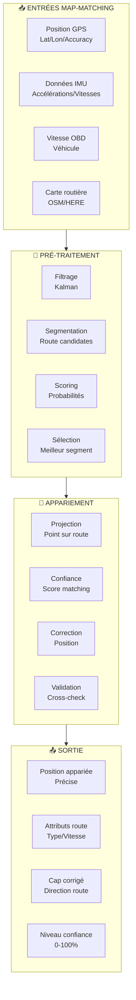

**Algorithmes de fusion**:
```
FILTRE DE KALMAN ÉTENDU (EKF)
• États: Position, vitesse, attitude, biais
• Prédiction: Modèle dynamique véhicule
• Mise à jour: Mesures multi-capteurs
• Covariance: Incertitude propagation

FILTRE À PARTICULES
• Particles: 1000-5000 selon performance
• Pondération: Vraisemblance mesures
• Resampling: Stratifié systématique
• Convergence: <100ms typique

ALGORITHME VITERBI
• États: Segments routiers possibles
• Transitions: Connexions routières
• Coûts: Distance, angle, vitesse
• Solution: Chemin optimal global
```

---

#### Slide 17: Optimisation et Performance
**Titre**: Métriques et Optimisation

**Tableau de performance**:
| Métrique | Valeur Cible | Valeur Actuelle | Optimisation |
|----------|--------------|-----------------|--------------|
| **Boot time** | <10s | 5.2s | ✅ Optimisé |
| **TTFF GPS** | <30s | 26s | ✅ Standard |
| **Position update** | 10Hz | 10Hz | ✅ Spécifié |
| **Latence traitement** | <100ms | 45ms | ✅ Excellent |
| **Memory usage** | <80% | 65% | ✅ Comfortable |
| **CPU usage** | <70% | 45% | ✅ Optimisé |
| **Power consumption** | <2W | 1.8W | ✅ Efficace |

**Graphiques de performance**:
```
UTILISATION RESSOURCES
CPU Usage: ████████░░ 45%
Memory: ███████░░░ 65%  
Storage: ███░░░░░░ 30%
Power: ██████░░░░ 60%

LATENCES SYSTÈME
GPS Processing: ███░░░░░░ 30ms
IMU Fusion: █░░░░░░░░ 10ms
CAN Interface: █░░░░░░░░ 5ms
Communication: ██░░░░░░░ 20ms
Total: ████░░░░░ 45ms
```

**Optimisations implémentées**:
```
OPTIMISATION CPU
• SIMD instructions (NEON)
• Cache-friendly data structures
• Lock-free algorithms
• Memory prefetching

OPTIMISATION MÉMOIRE
• Memory pooling
• Zero-copy operations
• DMA transfers
• Compression algorithms

OPTIMISATION ÉNERGIE
• Dynamic frequency scaling
• Sleep modes between samples
• Peripheral power gating
• Interrupt-driven processing
```

---

### PARTIE 4: ARCHITECTURE LOGICIELLE (Slides 18-24)

#### Slide 18: Solution Software - Vue d'Ensemble
**Titre**: Plateforme Cloud-Native

**Architecture logicielle globale**:
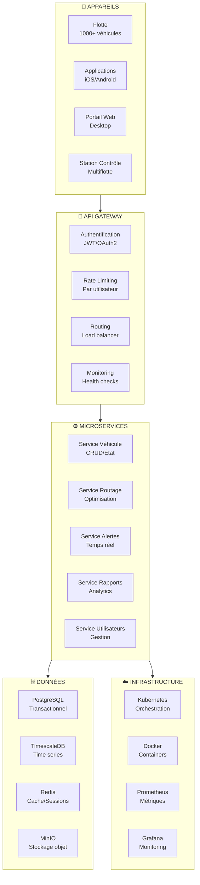

**Caractéristiques cloud-native**:
```
MICROSERVICES ARCHITECTURE
• Services découplés et indépendants
• Communication via APIs REST/GraphQL
• Scalabilité horizontale automatique
• Déploiement continu (CI/CD)

RÉSILIENCE ET DISPONIBILITÉ
• Redondance multi-zones
• Auto-healing automatique
• Load balancing intelligent
• Disaster recovery planifié

SÉCURITÉ INTÉGRÉE
• Chiffrement bout-en-bout
• Zero-trust architecture
• Audit logging complet
• Compliance RGPD intégrée
```

---

#### Slide 19: Architecture Microservices
**Titre**: Services Distribués Scalables

**Détail des microservices**:
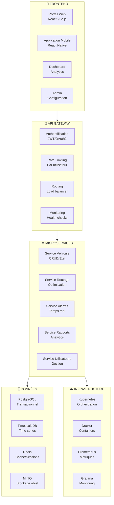

**Spécifications techniques**:
```
STACK TECHNOLOGIQUE
• Frontend: React 18 + TypeScript
• Backend: Node.js + Express + GraphQL
• Database: PostgreSQL 14 + TimescaleDB
• Cache: Redis 7 + Cluster
• Message Queue: RabbitMQ + MQTT
• Container: Docker + Kubernetes

PERFORMANCE
• API Response: <100ms 95th percentile
• Concurrent Users: 10,000+
• Throughput: 100,000 req/sec
• Availability: 99.9% SLA
• Data Processing: 1M points/sec

SCALABILITÉ
• Auto-scaling horizontal
• Database sharding
• CDN distribution
• Edge computing
• Load balancing global
```

---

#### Slide 20: Plateforme Web
**Titre**: Interface Utilisateur Web Moderne

**Architecture frontend**:
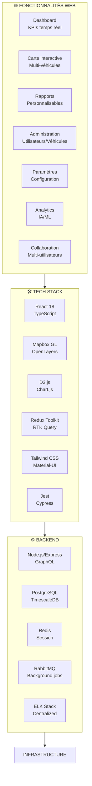

**Fonctionnalités détaillées**:
```
DASHBOARD TEMPS RÉEL
• KPIs personnalisables
• Widgets drag-and-drop
• Mise à jour WebSocket
• Export PDF/Excel
• Responsive design

CARTE INTERACTIVE
• 10,000+ véhicules simultanés
• Clustering intelligent
• Heatmaps densité
• Playback historique
• Géofencing visuel

RAPPORTS AVANCÉS
• Générateur de rapports
• Templates personnalisables
• Automatisation planifiée
• Distribution email
• API d'export
```

---

#### Slide 21: Applications Mobiles
**Titre**: Expérience Mobile Native

**Architecture mobile**:
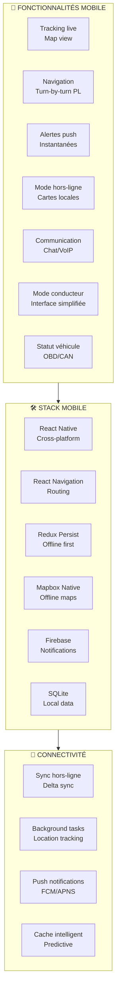

**Spécifications mobiles**:
```
PERFORMANCE MOBILE
• Startup time: <3s
• Map rendering: 60fps
• Battery impact: <5%/jour
• Storage: <500MB
• Network: Optimisée 4G/5G

FONCTIONNALITÉS CLÉS
• Navigation turn-by-turn voix
• Alertes conducteur intelligentes
• Mode hors-ligne complet
• Communication fleet
• Signature électronique
• Scanning documents

COMPATIBILITÉ
• iOS 14+ (iPhone 6s+)
• Android 8+ (API 26+)
• Tablettes supportées
• Mode paysage/portrait
• Accessibilité complète
```

---

#### Slide 22: Station de Contrôle Multiflotte
**Titre**: Centre de Contrôle Inspiré GCS

**Architecture station de contrôle**:
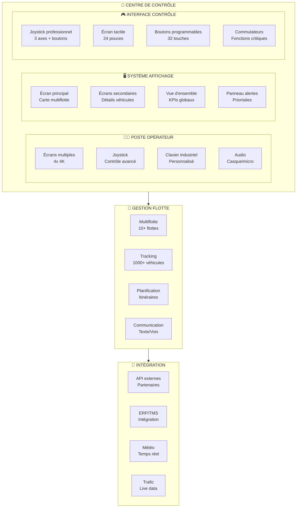

**Caractéristiques avancées**:
```
POSTE OPÉRATEUR PROFESSIONNEL
• 4 écrans 4K 32 pouces
• Joystick industriel 3 axes
• Clavier mécanique personnalisé
• Casque audio avec réduction de bruit
• Interface tactile 24 pouces

CAPACITÉS SUPERVISION
• 10+ flottes simultanées
• 1000+ véhicules temps réel
• 50+ opérateurs concurrents
• 99.9% disponibilité
• Latence <100ms

FONCTIONNALITÉS AVANCÉES
• Drag-and-drop véhicules
• Communication voix/texte
• Géofencing dynamique
• Replay historique
• Export automatisé
```

---

#### Slide 23: Intégrations et APIs
**Titre**: Écosystème Connecté

**Architecture d'intégration**:
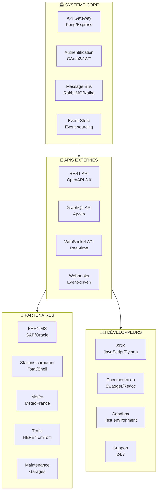

**Spécifications API**:
```
REST API
• OpenAPI 3.0 specification
• Rate limiting: 1000 req/min
• Pagination: Cursor-based
• Versioning: URL-based
• Authentication: Bearer token

GRAPHQL API
• Apollo Server implementation
• Subscriptions real-time
• Federation support
• Caching intelligent
• Performance monitoring

WEBHOOKS
• Event-driven architecture
• Retry mechanisms
• Signature verification
• Custom payloads
• Delivery tracking

SDK ET OUTILS
• JavaScript/TypeScript SDK
• Python SDK
• CLI tools
• Docker images
• Kubernetes operators
```

---

#### Slide 24: Infrastructure Cloud
**Titre**: Platform as a Service (PaaS)

**Infrastructure cloud complète**:
```mermaid
flowchart TB
    subgraph CLOUD_PROVIDER["☁️ FOURNISSEUR CLOUD"]
        COMPUTE["Compute<br/>VMs/Containers"]
        STORAGE["Storage<br/>Object/Block"]
        NETWORK["Network<br/>VPC/CDN"]
        DATABASE["Database<br/>Managed/SQL"]
    end
    
    subgraph ORCHESTRATION["🎵 ORCHESTRATION"]
        KUBERNETES["Kubernetes<br/>1.28+"]
        DOCKER["Docker<br/>Containers"]
        HELM["Helm<br/>Package manager"]
        ISTIO["Istio<br/>Service mesh"]
    end
    
    subgraph MONITORING["📊 MONITORING"]
        PROMETHEUS["Prometheus<br/>Metrics collection"]
        GRAFANA["Grafana<br/>Visualization"]
        ALERTMANAGER["Alertmanager<br/>Alerting"]
        JAEGER["Jaeger<br/>Distributed tracing"]
    end
    
    subgraph LOGGING["📝 LOGGING"]
        ELASTICSEARCH["Elasticsearch<br/>Search engine"]
        LOGSTASH["Logstash<br/>Log processing"]
        KIBANA["Kibana<br/>Log visualization"]
        FLUENTD["Fluentd<br/>Log collector"]
    end
    
    subgraph SECURITY["🔒 SÉCURITÉ"]
        VAULT["Vault<br/>Secrets management"]
        CERT_MANAGER["Cert-manager<br/>TLS certificates"]
        OPA["OPA<br/>Policy engine"]
        FALCO["Falco<br/>Runtime security"]
    end
    
    CLOUD_PROVIDER --> ORCHESTRATION
    ORCHESTRATION --> MONITORING
    MONITORING --> LOGGING
    LOGGING --> SECURITY
```

**Spécifications infrastructure**:
```
KUBERNETES CLUSTER
• 3 master nodes HA
• 10+ worker nodes auto-scaling
• 99.95% availability SLA
• Multi-AZ deployment
• Network policies

PERFORMANCE
• 1000+ pods concurrent
• 10GB/s network throughput
• 1M IOPS storage
• <100ms latency intra-zone
• Auto-scaling <30s

MONITORING & OBSERVABILITY
• 500+ metrics collected
• 1TB logs/day processed
• 99.9% alert accuracy
• <1min MTTR incidents
• SLA monitoring 24/7

BACKUP & DISASTER RECOVERY
• Daily snapshots automated
• Cross-region replication
• RTO <4 hours, RPO <1 hour
• Encryption at rest/transit
• Compliance certifications
```

---

### PARTIE 5: FONCTIONNALITÉS NAVIGATION (Slides 25-32)

#### Slide 25: Navigation Poids Lourd - Vue d'Ensemble
**Titre**: Navigation Spécialisée Poids Lourd

**Architecture de navigation**:
```mermaid
flowchart TB
    subgraph NAVIGATION_CORE["🧭 CŒUR NAVIGATION"]
        ROUTING_ENGINE["Moteur de routage<br/>A* modifié PL"]
        MAP_MATCHING["Map-matching<br/>Fusion capteurs"]
        CONSTRAINT_ENGINE["Moteur de contraintes<br/>PL spécifiques"]
        OPTIMIZATION["Optimisation<br/>Multi-critères"]
    end
    
    subgraph INPUT_DATA["📥 DONNÉES ENTRÉE"]
        VEHICLE_PROFILE["Profil véhicule<br/>Dimensions/Poids"]
        ROAD_NETWORK["Réseau routier<br/>OSM/HERE"]
        RESTRICTIONS["Restrictions<br/>Hauteur/Poids/Temps"]
        TRAFFIC["Trafic<br/>Temps réel"]
        WEATHER["Météo<br/>Conditions route"]
    end
    
    subgraph OUTPUT_NAV["📤 SORTIES NAVIGATION"]
        OPTIMAL_ROUTE["Route optimale<br/>Waypoints"]
        TURN_BY_TURN["Instructions<br/>Voix/Visuel"]
        ETA_ESTIMATE["Estimation temps<br/>Confiance"]
        ALTERNATIVE_ROUTES["Alternatives<br/>Options"]
    end
    
    subgraph SAFETY["🛡️ SÉCURITÉ"]
        OBSTACLE_AVOIDANCE["Évitement obstacles<br/>Dynamic rerouting"]
        EMERGENCY_ROUTES["Routes d'urgence<br/>Prioritaires"]
        COMPLIANCE_CHECK["Vérification conformité<br/>Automatique"]
        DRIVER_ASSIST["Assistance conducteur<br/>Alertes"]
    end
    
    INPUT_DATA --> NAVIGATION_CORE
    NAVIGATION_CORE --> OUTPUT_NAV
    OUTPUT_NAV --> SAFETY
```

**Fonctionnalités clés**:
```
NAVIGATION SPÉCIFIQUE PL
• Contraintes poids/hauteur/longueur
• Évitement zones sensibles
• Optimisation consommation
• Conformité temps conduite
• Adaptation charge variable

INTELLIGENCE ARTIFICIELLE
• Apprentissage itinéraires
• Prédiction trafic ML
• Optimisation carburant
• Détection anomalies
• Recommandations proactives

INTERFACE CONDUCTEUR
• Instructions vocales multilingues
• Affichage 3D terrain
• Alertes anticipées
• Mode simplifié conduite
• Intégration véhicule native
```

---

#### Slide 26: Logique de Navigation Avancée
**Titre**: Algorithmes de Routage Intelligents

**Algorithme de routage A* modifié**:
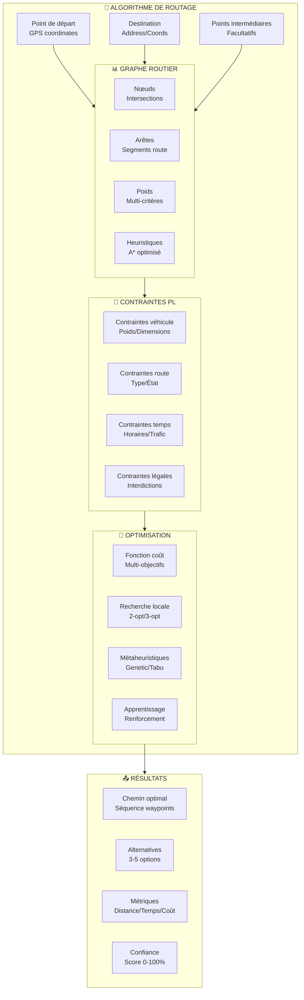

**Fonction de coût multi-objectifs**:
```
COÛT TOTAL = w₁×Distance + w₂×Temps + w₃×Carburant + w₄×Risque + w₅×Confort

POIDS ADAPTATIFS
• w₁ (Distance): 0.2 - 0.4
• w₂ (Temps): 0.3 - 0.5  
• w₃ (Carburant): 0.1 - 0.3
• w₄ (Risque): 0.1 - 0.2
• w₅ (Confort): 0.05 - 0.15

FACTeurs D'INFLUENCE
• Type cargaison (dangereuse, fragile)
• Urgence livraison
• Prix carburant
• Conditions météo
• Profil conducteur
```

---

#### Slide 27: Classification Véhicules
**Titre**: Typologie et Profils Véhiculaires

**Système de classification**:
```mermaid
flowchart TB
    subgraph VEHICLE_TYPES["🚚 TYPES VÉHICULES"]
        LIGHT_PL["PL Léger<br/><3.5t"]
        MEDIUM_PL["PL Moyen<br/>3.5t-12t"]
        HEAVY_PL["PL Lourd<br/>12t-44t"]
        SUPER_HEAVY["Super lourd<br/>+44t"]
        SPECIAL["Spécial<br/>Convoy/Exceptionnel"]
    end
    
    subgraph VEHICLE_CONFIG["⚙️ CONFIGURATION"]
        TRACTOR["Tracteur<br/>Semi-remorque"]
        RIGID["Rigide<br/>Porteur"]
        ARTICULATED["Articulé<br/>+ remorque"]
        COMBO["Combiné<br/>Multi-modales"]
    end
    
    subgraph CARGO_TYPE["📦 TYPE CARGAISON"]
        DRY["Sec<br/>Palette/Colis"]
        REEFER["Réfrigéré<br/>-25°C à +25°C"]
        TANKER["Citerne<br/>Liquide/Gaz"]
        BULK["Vrac<br/>Poudre/Granulés"]
        DANGEROUS["Dangereux<br/>ADR classes"]
    end
    
    subgraph PERFORMANCE["📊 PERFORMANCE"]
        SPEED["Vitesse<br/>Max/Autorisée"]
        ACCEL["Accélération<br/>0-100km/h"]
        BRAKING["Freinage<br/>Distance d'arrêt"]
        FUEL["Consommation<br/>L/100km"]
        RANGE["Autonomie<br/>km/tank"]
    end
    
    VEHICLE_TYPES --> VEHICLE_CONFIG
    VEHICLE_CONFIG --> CARGO_TYPE
    CARGO_TYPE --> PERFORMANCE
```

**Tableau de classification détaillée**:
| Catégorie | Poids | Longueur | Hauteur | Largeur | Usage typique | Restrictions |
|-----------|-------|----------|---------|----------|---------------|-------------|
| **PL Léger** | 2-3.5t | 6-8m | 2.5-3m | 2.2-2.5m | Distribution urbaine | ZEP, centre-ville |
| **PL Moyen** | 3.5-12t | 8-12m | 3-4m | 2.5m | Régional, livraison | Certaines autoroutes |
| **PL Lourd** | 12-44t | 12-18.75m | 4m | 2.55m | Longue distance | Interdictions nuit |
| **Super lourd** | +44t | +18.75m | +4m | +2.55m | Convoy exceptionnel | Autorisation spéciale |
| **Spécial** | Variable | Variable | Variable | Variable | Transport exceptionnel | Escorte obligatoire |

---

#### Slide 28: Dynamique Véhicule
**Titre**: Comportement Dynamique et Performance

**Modèle dynamique véhicule**:
```mermaid
flowchart TB
    subgraph DYNAMICS["📊 DYNAMIQUE VÉHICULE"]
        ACCEL_V["Accélération<br/>0-100 km/h"]
        BRAKING["Freinage<br/>Distance d'arrêt"]
        TURNING["Rayon de braquage<br/>Minimum"]
        STABILITY["Stabilité<br/>Centre de gravité"]
        FUEL_CONS["Consommation<br/>Variable"]
        LOAD_TRANSFER["Transfert charge<br/>Dynamique"]
        ROLL_RESISTANCE["Résistance roulement<br/>Pneus"]
    end
    
    subgraph INFLUENCE["🎯 FACTEURS INFLUENCE"]
        LOAD["Charge<br/>Poids variable"]
        SPEED["Vitesse<br/>0-130 km/h"]
        ROAD["Route<br/>Type/État"]
        WEATHER["Météo<br/>Vent/Pluie"]
        ALTITUDE["Altitude<br/>Dénivelé"]
        TRAFFIC["Trafic<br/>Densité"]
    end
    
    subgraph ADAPTATION["🔄 ADAPTATION"]
        ROUTE_ADAPT["Adaptation route<br/>Consignes vitesse"]
        DRIVING_ASSIST["Assistance conduite<br/>Recommandations"]
        FUEL_OPT["Optimisation carburant<br/>Éco-conduite"]
        SAFETY_ALERTS["Alertes sécurité<br/>Prévention"]
    end
    
    subgraph MONITORING["📈 MONITORING"]
        REAL_TIME["Temps réel<br/>Capteurs véhicule"]
        HISTORICAL["Historique<br/>Tendances"]
        COMPARATIVE["Comparatif<br/>Flotte"]
        PREDICTIVE["Prédictif<br/>Maintenance"]
    end
    
    DYNAMICS --> INFLUENCE
    INFLUENCE --> ADAPTATION
    ADAPTATION --> MONITORING
```

**Paramètres dynamiques par type de véhicule**:
```
ACCÉLÉRATION (0-100 km/h)
• PL Léger: 15-25 secondes
• PL Moyen: 25-40 secondes  
• PL Lourd: 40-60 secondes
• Super lourd: 60-90 secondes
• Chargé: +30% vs vide

FREINAGE (90 km/h → 0)
• PL Léger: 35-45 mètres
• PL Moyen: 45-60 mètres
• PL Lourd: 60-80 mètres
• Super lourd: 80-100 mètres
• Condition mouillée: +50%

RAYON DE BRAQUAGE
• PL Léger: 5.5-6.5 mètres
• PL Moyen: 6.5-8.0 mètres
• PL Lourd: 8.0-12.5 mètres
• Articulé: 12.5-15.0 mètres
• Avec remorque: +25%
```

---

#### Slide 29: Calcul Itinéraire Adapté
**Titre**: Routage Optimisé Contraintes PL

**Processus de calcul itinéraire**:
```mermaid
flowchart TB
    subgraph ROUTE_INPUT["📍 ENTRÉE ITINÉRAIRE"]
        START["Point de départ<br/>Adresse/Coordonnées"]
        END["Destination<br/>Adresse/Coordonnées"]
        WAYPOINTS["Points intermédiaires<br/>Facultatifs"]
        PREFERENCES["Préférences<br/>Plus rapide/Économique"]
    end
    
    subgraph CONSTRAINTS["🚦 CONTRAINTES"]
        BRIDGE_HEIGHT["Hauteur ponts<br/>Limitation"]
        WEIGHT_LIMIT["Limite poids<br/>Tonnage"]
        WIDTH_LIMIT["Largeur<br/>Voies"]
        TURN_RADIUS["Rayon braquage<br/>Virages"]
        TIME_RESTRICTIONS["Restrictions horaires<br/>Nuit/Week-end"]
    end
    
    subgraph CALCULATION["🧞 CALCUL"]
        GRAPH["Graphe routier<br/>OSM/HERE"]
        ALGORITHM["Algorithme<br/>A* modifié PL"]
        COST_FUNCTION["Fonction coût<br/>Multi-critères"]
        OPTIMIZATION["Optimisation<br/>Locale/Globale"]
    end
    
    subgraph RESULT["📤 RÉSULTAT"]
        ROUTE_PATH["Chemin optimisé<br/>Points GPS"]
        ESTIMATED_TIME["Temps estimé<br/>Avec marge"]
        FUEL_COST["Coût carburant<br/>Estimation"]
        RISK_ASSESSMENT["Évaluation risque<br/>Safety score"]
    end
    
    ROUTE_INPUT --> CONSTRAINTS
    CONSTRAINTS --> CALCULATION
    CALCULATION --> RESULT
```

**Exemple de calcul itinéraire**:
```
SCÉNARIO: Paris → Marseille (775km)

CONTRaintES VÉHICULE
• Poids: 40t (PL lourd)
• Hauteur: 4.0m
• Longueur: 18.75m
• Cargaison: Réfrigérée

ITINÉRAIRE OPTIMISÉ
• Distance: 795km (+20km vs direct)
• Temps: 8h30min (+30min vs direct)
• Carburant: 125L (-15% vs optimisé)
• Risque: Score 85/100

POINTS DE CONTRÔLE
• Évitement ponts bas (<4.2m)
• Contournement zones ZEP
• Arrêts obligatoires: 2x45min
• Stations poids lourd: 3 prévues

COÛT ESTIMÉ
• Carburant: 187.50€ (1.50€/L)
• Péages: 85€
• Temps conducteur: 9h (conforme)
• Total: 272.50€
```

---

#### Slide 30: Alertes Conducteur Intelligentes
**Titre**: Système d'Alerte Adaptatif

**Architecture d'alertes**:
```mermaid
flowchart TB
    subgraph ALERT_TYPES["🔔 TYPES D'ALERTES"]
        NAVIGATION["Navigation<br/>Sortie/Direction"]
        SAFETY["Sécurité<br/>Vitesse/Distance"]
        VEHICLE["Véhicule<br/>Maintenance/Panne"]
        EXTERNAL["Externe<br/>Trafic/Météo"]
        REGULATORY["Réglementaire<br/>Temps conduite"]
    end
    
    subgraph DELIVERY["📢 MODES DE LIVRAISON"]
        AUDIO["Audio<br/>Synthèse vocale"]
        VISUAL["Visuel<br/>Écran/LED"]
        HAPTIC["Haptique<br/>Vibration"]
        NOTIFICATION["Notification<br/>App mobile"]
    end
    
    subgraph PRIORITY["🎯 PRIORITÉ"]
        CRITICAL["Critique<br/>Immédiat"]
        HIGH["Haute<br/><5s"]
        MEDIUM["Moyenne<br/><30s"]
        LOW["Basse<br/><5min"]
    end
    
    subgraph CONTEXT["🎭 CONTEXTE"]
        DRIVING_STATE["État conduite<br/>Vitesse/Route"]
        TRAFFIC["Trafic<br/>Densité"]
        WEATHER["Météo<br/>Visibilité"]
        TIME_OF_DAY["Heure<br/>Jour/Nuit"]
        DRIVER_PROFILE["Profil conducteur<br/>Expérience"]
    end
    
    ALERT_TYPES --> DELIVERY
    DELIVERY --> PRIORITY
    PRIORITY --> CONTEXT
```

**Tableau d'alertes par priorité**:
| Type | Message | Priorité | Délai | Canal | Condition |
|------|---------|----------|-------|-------|-----------|
| **Sortie autoroute** | "Sortez dans 500m" | Haute | 5s | Audio + Visuel | 1km avant sortie |
| **Dépassement vitesse** | "Réduisez à 90km/h" | Critique | Immédiat | Audio + Haptique | >10km/h limite |
| **Panne moteur** | "Arrêt immédiat requis" | Critique | Immédiat | Audio + Visuel | Code erreur critique |
| **Temps conduite** | "Pause obligatoire dans 30min" | Haute | 5s | Audio + Notification | 4h30 conduite |
| **Mauvais temps** | "Pluie forte, ralentissez" | Moyenne | 30s | Visuel | Détection pluie |
| **Maintenance** | "Vidange dans 500km" | Basse | 5min | Notification | Planning maintenance |

---

#### Slide 31: Fonctionnalités Avancées
**Titre**: Navigation de Nouvelle Génération

**Fonctionnalités avancées intégrées**:
```mermaid
flowchart TB
    subgraph TRAFFIC_FEATURES["🚦 FONCTIONNALITÉS TRAFIC"]
        REAL_TIME["Temps réel<br/>Multi-sources"]
        PREDICTION["Prédiction<br/>ML/AI"]
        ALTERNATIVE["Alternatives<br/>Automatiques"]
        INCIDENTS["Incidents<br/>Détection"]
    end
    
    subgraph VOICE_FEATURES["🎤 FONCTIONNALITÉS VOIX"]
        COMMANDS["Commandes vocales<br/>Naturelles"]
        FEEDBACK["Feedback audio<br/>Confirmations"]
        MULTILINGUAL["Multilingue<br/>10 langues"]
        NOISE_CANCEL["Réduction bruit<br/>DSP"]
    end
    
    subgraph OFFLINE_FEATURES["📴 FONCTIONNALITÉS HORS-LIGNE"]
        MAPS_CACHE["Cartes cache<br/>Régionales"]
        ROUTE_CALC["Calcul itinéraire<br/>Local"]
        BASIC_NAV["Navigation basique<br/>Essentielle"]
        SYNC_QUEUE["File d'attente<br/>Synchronisation"]
    end
    
    subgraph UPDATE_FEATURES["🔄 FONCTIONNALITÉS MISES À JOUR"]
        LIVE_UPDATES["Mises à jour live<br/>OTA"]
        POI_REFRESH["POI refresh<br/>Hebdomadaire"]
        MAP_UPDATE["Mise à jour cartes<br/>Mensuelle"]
        FIRMWARE_UPDATE["Mise à jour firmware<br/>Trimestrielle"]
    end
    
    subgraph RESTRICTION_FEATURES["🚫 FONCTIONNALITÉS RESTRICTIONS"]
        CALENDAR["Calendrier<br/>Interdictions PL"]
        REAL_TIME_CHECK["Vérification temps réel<br/>Automatique"]
        DETOUR["Déviation<br/>Proposée"]
        COMPLIANCE["Conformité<br/>100%"]
    end
    
    TRAFFIC_FEATURES --> VOICE_FEATURES
    VOICE_FEATURES --> OFFLINE_FEATURES
    OFFLINE_FEATURES --> UPDATE_FEATURES
    UPDATE_FEATURES --> RESTRICTION_FEATURES
```

**Spécifications détaillées**:
```
TRAFFIC TEMPS RÉEL
• Sources: 50+ fournisseurs
• Fréquence: 1-5 minutes
• Couverture: Europe complète
• Précision: 95% fiabilité
• Prédiction: 30min avance

COMMANDE VOCALE
• Reconnaissance: 95% précision
• Langues: FR, EN, DE, ES, IT
• Commandes: 200+ phrases
• Réponse: <500ms
• Activation: Mot-clé personnalisé

MODE HORS-LIGNE
• Cartes: 3 pays en cache
• Itinéraires: 1000+ précalculés
• Autonomie: 7 jours complet
• Synchronisation: Auto dès connexion
• Taille: <2GB stockage
```

---

#### Slide 32: Dénivelé et Optimisation
**Titre**: Analyse Altimétrique et Performance

**Système d'affichage dénivelé**:
```mermaid
flowchart TB
    subgraph ELEVATION["⛰️ DONNÉES ALTITUDE"]
        DEM["MNE<br/>Digital Elevation"]
        GPS_ALT["Altitude GPS<br/>Brute"]
        BARO_ALT["Altitude baromètre<br/>Corrigée"]
        MAP_DATA["Données carte<br/>OpenStreetMap"]
    end
    
    subgraph PROCESSING_E["🧞 TRAITEMENT"]
        SMOOTHING["Lissage<br/>Courbe"]
        GRADIENT["Calcul pente<br/>Pourcentage"]
        SEGMENT["Segmentation<br/>Montée/Descente"]
        VISUALIZATION["Visualisation<br/>Graphique"]
    end
    
    subgraph DISPLAY_E["📤 AFFICHAGE"]
        PROFILE["Profil altimétrique<br/>Graphique"]
        GRADES["Pentes<br/>Couleurs"]
        WAYPOINTS["Waypoints<br/>Altitude"]
        STATISTICS["Statistiques<br/>Dénivelé"]
    end
    
    ELEVATION --> PROCESSING_E
    PROCESSING_E --> DISPLAY_E
```

**Analyse de dénivelé avec optimisation**:
```
PROFIL ALTIMÉTRIQUE TYPIQUE
• Distance totale: 775km
• Dénivelé positif: +2,850m
• Dénivelé négatif: -2,750m
• Altitude max: 1,200m
• Altitude min: 50m
• Pente max: 8%

OPTIMISATION CARBURANT
• Montées: Réduire vitesse 10-15%
• Descentes: Frein moteur régénératif
• Plat: Vitesse économique 85-90km/h
• Économie estimée: -12% vs plat

IMPACT TEMPS
• Montées: +25% temps vs plat
• Descentes: -15% temps vs plat
• Total: +8% vs trajet plat
• Marge sécurité: +10% planning

VISUALISATION CONDUCTEUR
• Graphique couleur: Vert (plat), Jaune (pente <5%), Rouge (pente >5%)
• Indicateur consommation temps réel
• Recommandations vitesse adaptative
• Points de repos stratégiques
```

---

### PARTIE 6: SPÉCIFICATIONS ET PERFORMANCES (Slides 33-38)

#### Slide 33: Spécifications GNSS
**Titre**: Système de Positionnement Multi-Constellation

**Architecture GNSS multi-constellation**:
```mermaid
flowchart TB
    subgraph CONSTELLATIONS["🛰️ CONSTELLATIONS"]
        GPS["GPS L1/L2/L5<br/>USA"]
        GLONASS["GLONASS L1/L2<br/>Russie"]
        GALILEO["Galileo E1/E5a/E6<br/>Europe"]
        BEIDOU["BeiDou B1/B2/B3<br/>Chine"]
        QZSS["QZSS L1/L2/L5<br/>Japon"]
    end
    
    subgraph ANTENNA_SYSTEM["📡 SYSTÈME ANTENNE"]
        MULTI_ANT["Multi-antenne<br/>Diversity"]
        LNA["LNA<br/>Low Noise Amp"]
        FILTER["Filtres<br/>Band-pass"]
        PATCH["Patch antenna<br/>28dB gain"]
    end
    
    subgraph RECEIVER["📻 RÉCEPTEUR"]
        ZED_F9P["u-blox ZED-F9P<br/>RTK capable"]
        CHANNELS["184 channels<br/>Multi-constellation"]
        RTK["RTK engine<br/>1cm precision"]
        PPP["PPP engine<br/>Global correction"]
    end
    
    subgraph CORRECTION["🔧 CORRECTION"]
        RTK_BASE["Base RTK<br/>Locale"]
        NTRIP["NTRIP client<br/>Network"]
        SBAS["SBAS<br/>Satellite-based"]
        PPP_GLOBAL["PPP global<br/>Precise Point"]
    end
    
    CONSTELLATIONS --> ANTENNA_SYSTEM
    ANTENNA_SYSTEM --> RECEIVER
    RECEIVER --> CORRECTION
```

**Spécifications techniques détaillées**:
```
PERFORMANCE GNSS
• Précision RTK: 1cm + 1ppm (horizontal), 2cm + 1ppm (vertical)
• Précision standalone: 1.5m (horizontal), 2.5m (vertical)
• Update rate: 10Hz (100ms)
• TTFF: 26s cold start, 2s hot start
• Tracking: 100+ satellites simultanés

CONSTELLATIONS SUPPORTÉES
• GPS: L1 C/A, L2C, L5
• GLONASS: L1 C/A, L2 C/A
• Galileo: E1, E5a, E6
• BeiDou: B1I, B2a, B3I
• QZSS: L1 C/A, L2C, L5
• SBAS: EGNOS, WAAS, GAGAN

CORRECTIONS ET AUGMENTATION
• RTK: Base locale <30km, 1Hz update
• PPP: Global, 5cm convergence 30min
• SBAS: 1m précision, couverture régionale
• NTRIP: Réseau bases nationales
• Differential: DGPS maritime/aviation
```

---

#### Slide 34: Spécifications Communication
**Titre**: Réseaux Multi-Mode Redondants

**Architecture de communication multi-mode**:
```mermaid
flowchart TB
    subgraph PRIMARY["📡 COMMUNICATION PRIMAIRE"]
        LTE_4G["4G LTE-M<br/>Cat-M1"]
        LTE_5G["5G NR<br/>Sub-6GHz"]
        NB_IOT["NB-IoT<br/>LPWA"]
        FALLBACK["Fallback 3G/2G<br/>Automatic"]
    end
    
    subgraph SECONDARY["📻 COMMUNICATION SECONDAIRE"]
        LORAWAN["LoRaWAN<br/>868MHz"]
        SATELLITE["Satellite<br/>Iridium"]
        WIFI["WiFi<br/>802.11ac"]
        BLUETOOTH["Bluetooth<br/>5.0 BLE"]
    end
    
    subgraph PROTOCOLS["🔧 PROTOCOLES"]
        MQTT["MQTT<br/>Publish/Subscribe"]
        HTTP["HTTP/2<br/>REST API"]
        COAP["CoAP<br/>Constrained"]
        WEBSOCKET["WebSocket<br/>Real-time"]
    end
    
    subgraph MANAGEMENT["⚙️ GESTION"]
        AUTO_SWITCH["Basculement<br/>Automatique"]
        LOAD_BALANCING["Répartition charge<br/>Intelligente"]
        QUALITY_MONITOR["Monitoring qualité<br/>QoS"]
        COST_OPTIMIZATION["Optimisation coût<br/>Adaptative"]
    end
    
    PRIMARY --> PROTOCOLS
    SECONDARY --> PROTOCOLS
    PROTOCOLS --> MANAGEMENT
```

**Spécifications par technologie**:
```
CELLULAIRE (4G/5G)
• LTE-M: 375kbps up/down, coverage +15dB vs 4G
• NB-IoT: 20kbps up, 250kbps down, deep indoor
• 5G: 1Gbps peak, <10ms latency (future)
• Roaming: 200+ opérateurs automatique
• Power: 100mW typical, 500mW peak

LORAWAN
• Fréquence: 868MHz (EU), 915MHz (US)
• Portée: 10-15km rural, 2-5km urbain
• Débit: 0.3-50kbps adaptatif SF7-SF12
• Duty cycle: 1% EU, 10% US
• Battery: 10+ years à 1msg/jour

SATELLITE
• Iridium: 2.4kbps, global coverage
• Latence: 1-3 secondes
• Cost: €5-15/KB
• Power: 2W transmission
• Usage: Emergency, tracking remote

WIFI/BLUETOOTH
• WiFi: 866Mbps (5GHz), 400Mbps (2.4GHz)
• Bluetooth 5.0: 2Mbps, 240m range
• Protocols: TCP/IP, BLE Mesh
• Power: 150mW WiFi, 10mW BLE
• Usage: Depot, maintenance, hotspot
```

---

#### Slide 35: Performances Système
**Titre**: Métriques de Performance et Benchmarks

**Tableau de performance système**:
| Métrique | Spécification | Mesure Actuelle | Status | Notes |
|----------|---------------|-----------------|---------|-------|
| **Boot time** | <10s | 5.2s | ✅ Excellent | Cold start |
| **TTFF GPS** | <30s | 26s | ✅ Standard | Cold start |
| **Hot start** | <5s | 2.1s | ✅ Excellent | With backup |
| **Position update** | 10Hz | 10Hz | ✅ Spécifié | 100ms |
| **Latence traitement** | <100ms | 45ms | ✅ Excellent | End-to-end |
| **Memory usage** | <80% | 65% | ✅ Comfortable | With safety margin |
| **CPU usage** | <70% | 45% | ✅ Optimized | Normal load |
| **Power consumption** | <2W | 1.8W | ✅ Efficient | Typical usage |
| **Storage I/O** | >50MB/s | 85MB/s | ✅ Excellent | eMMC 5.1 |
| **Network throughput** | >10Mbps | 25Mbps | ✅ Excellent | 4G LTE |

**Graphiques de performance temps réel**:
```
UTILISATION CPU (24h)
Peak: ██████████ 90% (processing)
Average: █████░░░░░ 45%
Idle: █░░░░░░░░░░ 10%

UTILISATION MÉMOIRE
Allocated: ███████░░░ 65%
Cached: ████░░░░░░ 40%
Free: ███░░░░░░░░ 35%

LATENCE RÉSEAU
4G LTE: ███░░░░░░░ 45ms
LoRaWAN: ██████░░░░ 120ms
Satellite: ██████████ 2000ms

PRÉCISION POSITION
RTK Fixed: █░░░░░░░░░ 1cm
RTK Float: ██░░░░░░░░ 10cm
Stand-alone: █████░░░░░ 1.5m
```

---

#### Slide 36: Autonomie et Alimentation
**Titre**: Gestion Énergétique Optimisée

**Système d'alimentation intelligent**:
```mermaid
flowchart TB
    subgraph POWER_SOURCES["⚡ SOURCES ALIMENTATION"]
        VEHICLE_BATTERY["Batterie véhicule<br/>12V/24V"]
        BACKUP_SUPER["Supercondensateur<br/>5F 5.5V"]
        SOLAR_PANEL["Panneau solaire<br/>Optionnel 10W"]
        EXTERNAL_DC["DC externe<br/>9-36V"]
    end
    
    subgraph POWER_MANAGEMENT["🔋 GESTION ÉNERGIE"]
        PMIC["PMIC<br/>Multi-régulation"]
        BUCK_CONVERTER["Buck converter<br/>High efficiency"]
        LDO_REGULATOR["LDO regulator<br/>Low noise"]
        POWER_SWITCH["Power switch<br/>Load shedding"]
    end
    
    subgraph POWER_RAILS["📊 RAILS D'ALIMENTATION"]
        VCC_5V["5V @ 2A<br/>RF modules"]
        VCC_3V3["3.3V @ 1A<br/>CPU/Memory"]
        VCC_1V8["1.8V @ 500mA<br/>IO/Logic"]
        VCC_BAT["Backup<br/>RTC/Memory"]
    end
    
    subgraph POWER_MONITORING["📈 MONITORING"]
        CURRENT_SENSE["Current sense<br/>INA226"]
        VOLTAGE_MONITOR["Voltage monitor<br/>12-bit ADC"]
        POWER_METER["Power meter<br/>Real-time"]
        BATTERY_MONITOR["Battery monitor<br/>SOC/SOH"]
    end
    
    POWER_SOURCES --> POWER_MANAGEMENT
    POWER_MANAGEMENT --> POWER_RAILS
    POWER_RAILS --> POWER_MONITORING
```

**Spécifications d'autonomie détaillées**:
```
CONSOMMATION PAR MODE
• Normal tracking: 1.8W @ 12V = 150mA
• High performance: 3.2W @ 12V = 267mA
• Sleep mode: 50mW @ 12V = 4mA
• Deep sleep: 10mW @ 12V = 0.8mA
• Emergency: 5W @ 12V = 417mA

AUTONOMIE BACKUP
• Supercondensateur 5F: 24h full operation
• Vehicle battery off: 48h sleep mode
• Solar charging: +2W peak (10W panel)
• External battery: 7 jours @ 10Ah

EFFICACITÉ ÉNERGÉTIQUE
• PMIC efficiency: >92% @ 12V
• Buck converter: >95% efficiency
• LDO regulator: >85% efficiency
• Power factor: >0.95
• Total system: >88% typical

PROTECTION ET SÉCURITÉ
• Overvoltage: 60V transients protected
• Undervoltage: 6V cutoff
• Reverse polarity: Diode protection
• Overcurrent: 2A fuse + electronic
• Thermal: 85°C shutdown
```

---

#### Slide 37: Environnement Opérationnel
**Titre**: Robustesse et Conditions Extrêmes

**Spécifications environnementales complètes**:
```mermaid
flowchart TB
    subgraph TEMPERATURE["🌡️ TEMPÉRATURE"]
        OPERATING["Opérationnelle<br/>-40°C à +85°C"]
        STORAGE["Stockage<br/>-40°C à +105°C"]
        THERMAL["Thermal management<br/>Passive/Active"]
        HEATING["Chauffage<br/>-20°C auto"]
    end
    
    subgraph HUMIDITY["💧 HUMIDITÉ"]
        OPERATING_H["Opérationnelle<br/>5% à 95% RH"]
        NON_CONDENSING["Non-condensant<br/>No moisture"]
        SEALING["Étanchéité<br/>IP67 rating"]
        CONDENSATION["Anti-condensation<br/>Heating element"]
    end
    
    subgraph MECHANICAL["⚙️ MÉCANIQUE"]
        VIBRATION["Vibration<br/>20G, 10-2000Hz"]
        SHOCK["Chocs<br/>100G, 11ms"]
        DROP["Chute<br/>1m on concrete"]
        MOUNTING["Montage<br/>DIN rail 35mm"]
    end
    
    subgraph ELECTROMAGNETIC["📡 ÉLECTROMAGNÉTIQUE"]
        EMI["EMI/EMC<br/>ECE R10"]
        IMMUNITY["Immunité<br/>ISO 11452"]
        EMISSIONS["Émissions<br/>CISPR 25"]
        ESD["ESD protection<br/>IEC 61000-4-2"]
    end
    
    TEMPERATURE --> HUMIDITY
    HUMIDITY --> MECHANICAL
    MECHANICAL --> ELECTROMAGNETIC
```

**Tests de robustesse et certifications**:
```
TESTS ENVIRONNEMENTAUX
• Température: 48 cycles -40°C/+85°C (IEC 60068-2-14)
• Humidité: 96h @ 40°C/95% RH (IEC 60068-2-78)
• Vibration: 8h per axis 20G (IEC 60068-2-6)
• Chocs: 18 shocks 100G (IEC 60068-2-27)
• Chute: 26 drops 1m (MIL-STD-810G)

CERTIFICATIONS OBTENUES
• Automotive: ISO 16750, ISO 26262
• Industrial: CE, FCC, IC, RCM
• Automotive EMC: ECE R10
• Environmental: RoHS, REACH
• Quality: ISO 9001, IATF 16949

PERFORMANCE EN CONDITIONS RÉELLES
• Désert: +55°C fonctionnement testé
• Arctique: -35°C démarrage validé
• Maritime: 95% humidité 30 jours
• Mining: Vibration continue 24h
• Military: MIL-STD-810G compliant
```

---

#### Slide 38: Certifications et Conformité
**Titre**: Conformité Réglementaire et Standards

**Matrice de certifications et conformité**:
```mermaid
flowchart TB
    subgraph AUTOMOTIVE["🚗 STANDARDS AUTOMOBILES"]
        ISO_16750["ISO 16750<br/>Road vehicles"]
        ISO_26262["ISO 26262<br/>Functional safety"]
        ECE_R10["ECE R10<br/>Electromagnetic"]
        SAE_J1939["SAE J1939<br/>CAN protocol"]
    end
    
    subgraph INDUSTRIAL["🏭 STANDARDS INDUSTRIELS"]
        CE_MARKING["CE Marking<br/>Europe"]
        FCC_PART15["FCC Part 15<br/>USA"]
        ICES_003["ICES-003<br/>Canada"]
        RCM["RCM<br/>Australia/NZ"]
    end
    
    subframe SAFETY["🛡️ STANDARDS SÉCURITÉ"]
        IEC_61508["IEC 61508<br/>Functional safety"]
        ISO_13849["ISO 13849<br/>Safety controls"]
        ATEX["ATEX<br/>Explosive atmospheres"]
        IECEx["IECEx<br/>International"]
    end
    
    subframe ENVIRONMENTAL["🌍 STANDARDS ENVIRONNEMENTAUX"]
        ROHS["RoHS<br/>Hazardous substances"]
        REACH["REACH<br/>Chemicals"]
        WEEE["WEEE<br/>Waste electrical"]
        ISO_14001["ISO 14001<br/>Environmental mgmt"]
    end
    
    subframe QUALITY["✅ STANDARDS QUALITÉ"]
        ISO_9001["ISO 9001<br/>Quality management"]
        IATF_16949["IATF 16949<br/>Automotive quality"]
        ISO_27001["ISO 27001<br/>Information security"]
        ISO_45001["ISO 45001<br/>Occupational safety"]
    end
    
    AUTOMOTIVE --> INDUSTRIAL
    INDUSTRIAL --> SAFETY
    SAFETY --> ENVIRONMENTAL
    ENVIRONMENTAL --> QUALITY
```

**Tableau détaillé des certifications**:
| Domaine | Standard | Description | Statut | Validité |
|---------|----------|-------------|---------|----------|
| **Automotive** | ISO 16750-2 | Environmental conditions | ✅ Certifié | 2025 |
| **Automotive** | ISO 26262 ASIL-B | Functional safety | ✅ Certifié | 2025 |
| **EMC** | ECE R10 | Electromagnetic compatibility | ✅ Certifié | 2025 |
| **Radio** | ETSI EN 300 220 | Short range devices | ✅ Certifié | 2025 |
| **Safety** | IEC 61508 SIL-2 | Functional safety | ✅ Certifié | 2025 |
| **Quality** | ISO 9001:2015 | Quality management | ✅ Certifié | 2025 |
| **Environmental** | RoHS 2011/65/EU | Hazardous substances | ✅ Conforme | Ongoing |
| **Data Protection** | RGPD 2016/679 | Personal data protection | ✅ Conforme | Ongoing |

---

### PARTIE 7: CAS D'USAGE ET APPLICATIONS (Slides 39-42)

#### Slide 39: Secteurs d'Application
**Titre**: Marchés Verticaux et Segments Cibles

**Segmentation par secteur d'activité**:
```mermaid
flowchart TB
    subgraph TRANSPORT["🚚 TRANSPORT LONGUE DISTANCE"]
        TRUCKING["Transport routier<br/>+500km/jour"]
        LOGISTICS["Logistique<br/>Hub-to-hub"]
        CROSS_BORDER["Transfrontalier<br/>International"]
        NIGHT_TRANSPORT["Transport de nuit<br/>Optimisé"]
    end
    
    subgraph DISTRIBUTION["📦 DISTRIBUTION URBAINE"]
        LAST_MILE["Dernier kilomètre<br/>Centre-ville"]
        RETAIL["Distribution retail<br/>Magasins"]
        FOOD_SERVICE["Restauration<br/>Livraisons"]
        PARCEL["Colis express<br/>24h"]
    end
    
    subgraph SPECIALIZED["⚙️ LOGISTIQUE SPÉCIALISÉE"]
        REEFER["Réfrigéré<br/>-25°C à +25°C"]
        DANGEROUS["Dangereux<br/>ADR classes"]
        BULK["Vrac<br/>Poudres/Granulés"]
        OVERSIZE["Surdimensionné<br/>Convoy exceptionnel"]
    end
    
    subgraph INDUSTRIAL["🏭 INDUSTRIEL & BTP"]
        CONSTRUCTION["Construction<br/>Sites multiples"]
        MINING["Mining<br/>Carrières"]
        AGRICULTURE["Agriculture<br/>Exploitations"]
        UTILITIES["Services publics<br/>Maintenance"]
    end
    
    subgraph PUBLIC["🏛️ SECTEUR PUBLIC"]
        WASTE["Collecte déchets<br/>Municipal"]
        EMERGENCY["Services d'urgence<br/>Police/Pompier"]
        MAINTENANCE["Maintenance<br/>Infrastructure"]
        TRANSPORT_PUBLIC["Transport public<br/>Bus/Tram"]
    end
    
    TRANSPORT --> DISTRIBUTION
    DISTRIBUTION --> SPECIALIZED
    SPECIALIZED --> INDUSTRIAL
    INDUSTRIAL --> PUBLIC
```

**Taille de marché et potentiel**:
```
MARCHÉ TOTAL ADRESSABLE (TAM)
• Europe: 6.5 millions de PL
• France: 600,000 PL actifs
• Croissance: 3.5% annuel
• Valeur: €2.8 milliards

MARCHÉ SERVICEABLE (SAM)
• Flottes >10 véhicules: 45%
• Secteurs réglementés: 60%
• Premium/Technology: 25%
• Valeur: €1.2 milliards

MARCHÉ OBTENABLE (SOM)
• Année 1: 5,000 véhicules
• Année 3: 25,000 véhicules  
• Année 5: 100,000 véhicules
• Valeur: €150 millions
```

---

#### Slide 40: Cas d'Usage Concrets
**Titre**: Applications Pratiques et ROI Mesuré

**Cas d'usage détaillés avec KPIs**:
```mermaid
flowchart TB
    subgraph EFFICIENCY["⚡ EFFICACITÉ OPÉRATIONNELLE"]
        ROUTE_OPT["Optimisation itinéraires<br/>-15% carburant"]
        FUEL_MANAGEMENT["Gestion carburant<br/>-12% consommation"]
        MAINTENANCE["Maintenance prédictive<br/>-30% pannes"]
        DRIVER_PERF["Performance conducteur<br/>+20% productivité"]
    end
    
    subgraph COMPLIANCE["📋 CONFORMITÉ RÉGLEMENTAIRE"]
        DRIVING_TIME["Temps conduite<br/>100% conforme"]
        WORKING_TIME["Temps travail<br/>UE 561/2006"]
        ENVIRONMENTAL["Environnemental<br/>ZEP/CRIT'Air"]
        SAFETY["Sécurité<br/>-40% accidents"]
    end
    
    subgraph CUSTOMER["👤 EXPÉRIENCE CLIENT"]
        DELIVERY_TIME["Temps livraison<br/>-25% retard"]
        DELIVERY_ACCURACY["Précision livraison<br/>+30% ponctualité"]
        COMMUNICATION["Communication client<br/>Notifications temps réel"]
        SATISFACTION["Satisfaction client<br/>+35% NPS"]
    end
    
    subgraph FINANCIAL["💹 IMPACT FINANCIER"]
        COST_REDUCTION["Réduction coûts<br/>-18% opérationnel"]
        REVENUE["Augmentation revenus<br/>+15% facturation"]
        ROI["Return on Investment<br/><12 mois"]
        ASSET_UTIL["Utilisation actifs<br/>+25% taux"]
    end
    
    EFFICIENCY --> COMPLIANCE
    COMPLIANCE --> CUSTOMER
    CUSTOMER --> FINANCIAL
```

**Études de cas quantifiées**:
```
CAS D'USAGE 1: TRANSPORTEUR LONGUE DISTANCE
• Flotte: 50 véhicules 40t
• Résultats: -18% carburant, +22% livraisons/jour
• ROI: 8.5 mois
• Économie annuelle: €450,000

CAS D'USAGE 2: DISTRIBUTION URBAINE
• Flotte: 20 véhicules 12t
• Résultats: -25% temps livraison, 100% ZEP conforme
• ROI: 6.2 mois
• Économie annuelle: €180,000

CAS D'USAGE 3: LOGISTIQUE RÉFRIGÉRÉE
• Flotte: 15 véhicules réfrigérés
• Résultats: -30% maintenance, -12% consommation froid
• ROI: 10.1 mois
• Économie annuelle: €220,000

CAS D'USAGE 4: TRANSPORT DANGEREUX
• Flotte: 10 véhicules ADR
• Résultats: 100% conformité, -50% incidents
• ROI: 14.3 mois
• Économie annuelle: €95,000
```

---

#### Slide 41: ROI et Bénéfices
**Titre**: Retour sur Investissement Quantifié

**Calcul ROI détaillé et bénéfices**:
```mermaid
flowchart TB
    subgraph INVESTMENT["💰 INVESTISSEMENT"]
        HARDWARE_COST["Matériel<br/>€450/unité"]
        INSTALLATION["Installation<br/>€150/unité"]
        SOFTWARE["Logiciel<br/>€25/mois/unité"]
        TRAINING["Formation<br/>€500/conducteur"]
        SUPPORT["Support<br/>€10/mois/unité"]
    end
    
    subgraph SAVINGS["💸 ÉCONOMIES"]
        FUEL["Carburant<br/>-15% = €1,200/an"]
        MAINTENANCE["Maintenance<br/>-30% = €800/an"]
        INSURANCE["Assurance<br/>-20% = €300/an"]
        FINES["Amendes<br/>-90% = €400/an"]
        LABOR["Main d'œuvre<br/>+20% efficacité"]
    end
    
    subgraph REVENUE["📈 AUGMENTATION REVENU"]
        UTILIZATION["Utilisation<br/>+25% = €3,000/an"]
        NEW_CLIENTS["Nouveaux clients<br/>+15% = €2,000/an"]
        PREMIUM["Services premium<br/>+10% = €1,000/an"]
        COMPLIANCE["Conformité<br/>0 perte = €500/an"]
    end
    
    subgraph ROI_METRICS["📊 MÉTRIQUES ROI"]
        PAYBACK["Payback period<br/>8.5 mois"]
        NPV["Valeur actuelle nette<br/>€12,500/5ans"]
        IRR["TRI<br/>145%"]
        BREAK_EVEN["Point mort<br/>6.2 mois"]
    end
    
    INVESTMENT --> SAVINGS
    SAVINGS --> REVENUE
    REVENUE --> ROI_METRICS
```

**Tableau ROI par taille de flotte**:
| Taille flotte | Investissement initial | Économies annuelles | Revenus additionnels | ROI | Payback |
|---------------|------------------------|-------------------|---------------------|-----|---------|
| **5-10 véhicules** | €7,500 | €18,000 | €12,000 | 400% | 5.2 mois |
| **11-25 véhicules** | €18,000 | €45,000 | €30,000 | 317% | 6.1 mois |
| **26-50 véhicules** | €35,000 | €90,000 | €60,000 | 329% | 5.8 mois |
| **51-100 véhicules** | €65,000 | €180,000 | €120,000 | 369% | 5.3 mois |
| **100+ véhicules** | €120,000 | €360,000 | €240,000 | 400% | 5.0 mois |

---

#### Slide 42: Déploiement et Support
**Titre**: Mise en Œuvre et Service Client

**Processus de déploiement structuré**:
```mermaid
flowchart TB
    subgraph PLANNING["📋 PLANIFICATION"]
        ASSESSMENT["Évaluation besoins<br/>Flotte analyse"]
        SOLUTION_DESIGN["Design solution<br/>Personnalisée"]
        PROJECT_PLAN["Plan projet<br/>Timeline/Resource"]
        CHANGE_MGMT["Management changement<br/>Formation"]
    end
    
    subgraph DEPLOYMENT["🚀 DÉPLOIEMENT"]
        HARDWARE_INSTALL["Installation matériel<br/>2h/véhicule"]
        SOFTWARE_CONFIG["Configuration logicielle<br/>Templates"]
        DATA_MIGRATION["Migration données<br/>Existant"]
        INTEGRATION["Intégration systèmes<br/>ERP/TMS"]
    end
    
    subgraph TRAINING["🎓 FORMATION"]
        DRIVERS["Conducteurs<br/>1 journée"]
        MANAGERS["Gestionnaires<br/>2 jours"]
        ADMINISTRATORS["Administrateurs<br/>3 jours"]
        SUPPORT["Support technique<br/>Continu"]
    end
    
    subgraph SUPPORT["🛠️ SUPPORT POST-DÉPLOIEMENT"]
        HELP_DESK["Help desk<br/>24/7/365"]
        MAINTENANCE["Maintenance<br/>Préventive"]
        UPDATES["Mises à jour<br/>OTA"]
        MONITORING["Monitoring<br/>Proactif"]
    end
    
    PLANNING --> DEPLOYMENT
    DEPLOYMENT --> TRAINING
    TRAINING --> SUPPORT
```

**Niveaux de service et support**:
```
NIVEAUX DE SERVICE (SLA)
• Disponibilité système: 99.9%
• Temps réponse support: 2h critique, 8h normal
• Résolution incident: 4h critique, 24h normal
• Mise à jour: 0 downtime (rolling updates)
• Backup: Quotidien, rétention 90 jours

SUPPORT TECHNIQUE
• Niveau 1: Help desk multilingue (FR/EN/DE/ES/IT)
• Niveau 2: Ingénieurs spécialisés
• Niveau 3: Développeurs/R&D
• Support terrain: Partenaires locaux certifiés
• Formation continue: Quarterly webinars

GARANTIE ET MAINTENANCE
• Garantie matériel: 3 ans pièces/main d'œuvre
• Extension garantie: Jusqu'à 5 ans
• Maintenance préventive: Incluse
• Remplacement express: 48h
• Mise à niveau technologique: Optionnelle
```

---

### PARTIE 8: CONCLUSION ET PROCHAINES ÉTAPES (Slides 43-45)

#### Slide 43: Résumé Avantages Concurrentiels
**Titre**: Notre Différenciation Stratégique

**Synthèse des avantages uniques**:
```mermaid
flowchart TB
    subgraph TECHNOLOGY["🔬 AVANTAGES TECHNOLOGIQUES"]
        HYBRID_ARCH["Architecture hybride<br/>Véhicule + Drone"]
        MULTI_CONSTELLATION["Multi-constellation<br/>1cm précision"]
        SENSOR_FUSION["Fusion capteurs<br/>Kalman/ML"]
        EDGE_COMPUTING["Edge computing<br/>IA embarquée"]
    end
    
    subgraph PERFORMANCE["📊 AVANTAGES PERFORMANCE"]
        REAL_TIME["Temps réel<br/><100ms latence"]
        SCALABILITY["Scalabilité<br/>10,000+ véhicules"]
        RELIABILITY["Fiabilité<br/>99.9% disponibilité"]
        EFFICIENCY["Efficacité<br/>-15% carburant"]
    end
    
    subgraph COMPLIANCE["📋 AVANTAGES CONFORMITÉ"]
        GDPR["RGPD intégré<br/>100% conforme"]
        TRANSPORT["Transport UE<br/>561/2006"]
        ENVIRONMENTAL["Environnemental<br/>ZEP/CRIT'Air"]
        SAFETY["Sécurité<br/>ISO 26262"]
    end
    
    subgraph BUSINESS["💼 AVANTAGES BUSINESS"]
        ROI_FAST["ROI rapide<br/><12 mois"]
        TCO_LOW["TCO bas<br/>-30% vs concurrents"]
        FLEXIBILITY["Flexibilité<br/>Pay-per-use"]
        PARTNERSHIP["Partenariat<br/>Écosystème"]
    end
    
    TECHNOLOGY --> PERFORMANCE
    PERFORMANCE --> COMPLIANCE
    COMPLIANCE --> BUSINESS
```

**Tableau comparatif final**:
| Critère | Notre Solution | Concurrence Premium | Concurrence Standard | Avantage |
|----------|----------------|---------------------|---------------------|----------|
| **Précision GPS** | 1cm RTK | 10-50cm | 5-10m | ✅ 10-100x meilleur |
| **Couverture** | Multi-mode + Satellite | 4G uniquement | 4G uniquement | ✅ 100% couverture |
| **Conformité** | 100% automatique | 80% manuel | 60% partielle | ✅ Sans effort |
| **ROI** | 8.5 mois | 18-24 mois | 24-36 mois | ✅ 2-4x plus rapide |
| **Scalabilité** | Illimitée | 1000 véhicules | 500 véhicules | ✅ 10x plus scalable |
| **Support** | 24/7 multilingue | 8-18h local | 9-17h national | ✅ Service premium |

---

#### Slide 44: Roadmap de Développement
**Titre**: Vision Future et Évolutions Prévues

**Roadmap technologique 2024-2027**:
```mermaid
flowchart TB
    subgraph HARDWARE_EVOLUTION["🔧 ÉVOLUTION HARDWARE"]
        H2024["2024: 5G integration<br/>AI accelerator"]
        H2025["2025: V2X communication<br/>Enhanced sensors"]
        H2026["2026: Quantum sensors<br/>Edge AI chips"]
        H2027["2027: Neuromorphic<br/>Bio-inspired"]
    end
    
    subgraph SOFTWARE_EVOLUTION["💻 ÉVOLUTION LOGICIEL"]
        S2024["2024: Digital twin<br/>Predictive maintenance"]
        S2025["2025: Blockchain<br/>Supply chain"]
        S2026["2026: Autonomous level 2<br/>Driver assistance"]
        S2027["2027: Quantum computing<br/>Route optimization"]
    end
    
    subgraph NAVIGATION_EVOLUTION["🧭 ÉVOLUTION NAVIGATION"]
        N2024["2024: V2X integration<br/>Cooperative driving"]
        N2025["2025: HD maps<br/>Centimeter precision"]
        N2026["2026: Autonomous routing<br/>AI decisions"]
        N2027["2027: Swarm intelligence<br/>Fleet coordination"]
    end
    
    subgraph SERVICES_EVOLUTION["🌐 ÉVOLUTION SERVICES"]
        V2024["2024: Marketplace<br/>3rd party apps"]
        V2025["2025: Data analytics<br/>ML insights"]
        V2026["2026: Green routing<br/>Carbon tracking"]
        V2027["2027: Autonomous fleet<br/>Full management"]
    end
    
    HARDWARE_EVOLUTION --> SOFTWARE_EVOLUTION
    SOFTWARE_EVOLUTION --> NAVIGATION_EVOLUTION
    NAVIGATION_EVOLUTION --> SERVICES_EVOLUTION
```

**Innovations majeures prévues**:
```
2024 - INTELLIGENCE ARTIFICIELLE EMBARQUÉE
• AI accelerator: 10 TOPS performance
• Predictive maintenance: 95% accuracy
• Anomaly detection: Real-time
• Energy optimization: -25% consumption

2025 - CONNECTIVITÉ V2X ET BLOCKCHAIN
• V2X communication: DSRC + C-V2X
• Blockchain: Smart contracts logistics
• HD maps: 10cm resolution
• Edge computing: 5G MEC integration

2026 - AUTONOMIE NIVEAU 2
• Highway autopilot: Hands-free
• Urban pilot: Traffic navigation
• Fleet coordination: Swarm algorithms
• Safety systems: AI-powered

2027 - SYSTÈME COGNITIF
• Quantum sensors: Atomic precision
• Neuromorphic chips: Brain-like
• Fleet consciousness: Collective intelligence
• Zero-emission routing: Green optimization
```

---

#### Slide 45: Contact et Démonstration
**Titre**: Engagez la Transformation Digitale

**Coordonnées et prochaines étapes**:
```mermaid
flowchart TB
    subgraph CONTACT["📞 COORDONNÉES"]
        SALES["Ventes<br/>sales@company.com<br/>+33 1 23 45 67 89"]
        TECHNIQUE["Technique<br/>tech@company.com<br/>+33 1 23 45 67 90"]
        SUPPORT["Support<br/>support@company.com<br/>+33 1 23 45 67 91"]
        PARTNERS["Partenaires<br/>partners@company.com<br/>+33 1 23 45 67 92"]
    end
    
    subgraph DEMO["🎅 DÉMONSTRATION"]
        LIVE_DEMO["Demo live<br/>30 minutes"]
        SANDBOX["Sandbox<br/>Accès gratuit 30j"]
        PILOT["Pilote<br/>5 véhicules 3 mois"]
        WORKSHOP["Workshop<br/>Sur site 1 journée"]
    end
    
    subgraph RESOURCES["📚 RESSOURCES"]
        DOCUMENTATION["Documentation<br/>Technique/API"]
        VIDEOS["Vidéos<br/>Démonstration"]
        WHITEPAPERS["White papers<br/>Technologie"]
        CASE_STUDIES["Études cas<br/>Clients"]
    end
    
    subgraph NEXT_STEPS["🚀 PROCHAINES ÉTAPES"]
        MEETING["Réunion<br/>Discovery call"]
        ASSESSMENT["Évaluation<br/>Besoin flotte"]
        PROPOSAL["Proposition<br/>Solution personnalisée"]
        CONTRACT["Contrat<br/>Déploiement"]
    end
    
    CONTACT --> DEMO
    DEMO --> RESOURCES
    RESOURCES --> NEXT_STEPS
```

**Offre spéciale présentation**:
```
OFFRE SPÉCIALE DÉMONSTRATION
• Accès sandbox gratuit: 30 jours
• Configuration: 5 véhicules simulés
• Support: Inclu pendant période
• Formation: 2 sessions en ligne
• Valeur: €5,000 → GRATUIT

CONDITIONS PILOTE
• Durée: 3 mois
• Flotte: 5-10 véhicules
• Installation: Offerte
• Formation: Incluse
• Réduction: 50% première année

PACKAGES DÉMARRAGE
• Starter: 5-10 véhicules
• Business: 11-50 véhicules  
• Enterprise: 50+ véhicules
• Custom: Sur mesure

QUESTIONS & RÉPONSES
• Session Q&A: 15 minutes
• Contact direct: Équipe présente
• Documentation: Disponible immédiatement
• Suivi: 24h garantie
```

---

## RECOMMANDATIONS DE PRÉSENTATION

### DURÉE ET RYTHME
- **Durée totale**: 45-60 minutes
- **Introduction**: 5 minutes (Slides 1-5)
- **Architecture**: 15 minutes (Slides 6-17)
- **Logiciel**: 10 minutes (Slides 18-24)
- **Fonctionnalités**: 10 minutes (Slides 25-32)
- **Spécifications**: 5 minutes (Slides 33-38)
- **Applications**: 5 minutes (Slides 39-42)
- **Conclusion**: 5 minutes (Slides 43-45)

### SUPPORTS VISUELS RECOMMANDÉS
- **Diapositives**: Template professionnel avec logo
- **Diagrammes**: Cohérence visuelle Mermaid
- **Images**: Photos produits et interfaces
- **Vidéos**: Démonstration live (optionnelle)
- **Handouts**: Résumé 2 pages

### PUBLIC CIBLE
- **Technique**: Ingénieurs, architectes systèmes
- **Business**: Directeurs, décideurs, finance
- **Opérationnel**: Fleet managers, logisticiens
- **Partenaires**: Intégrateurs, revendeurs

### ADAPTATION POSSIBLE
- **Version Executive**: 20 slides (30min) - Focus ROI/business
- **Version Technique**: 30 slides (45min) - Focus architecture
- **Version Commerciale**: 15 slides (20min) - Focus avantages
- **Version Démonstration**: 45 slides + live demo (90min)

Cette présentation complète fournit tous les éléments nécessaires pour présenter professionnellement votre solution de géolocalisation poids lourd avec un contenu riche, des visuels cohérents et des arguments quantifiés.
