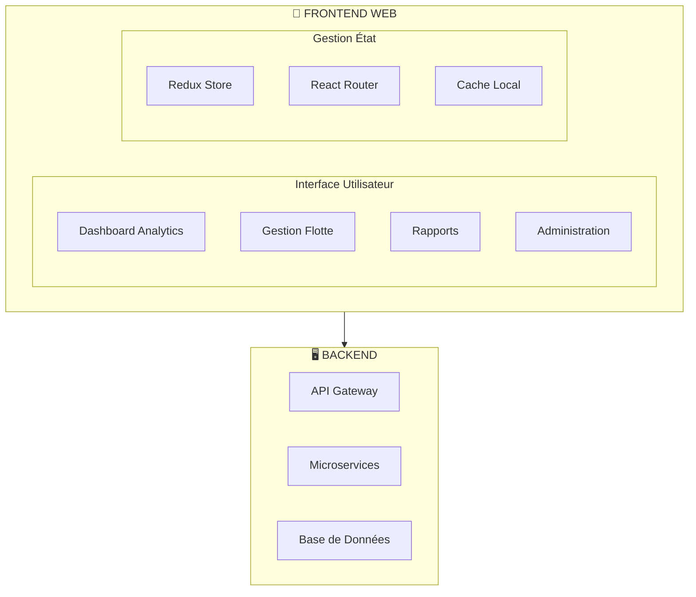
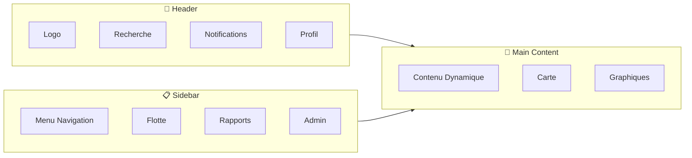

# Plateforme Web - Solution de Géolocalisation Poids Lourd

---

## 📋 Table des Matières

1. [Vue d'ensemble](#vue-densemble)
2. [Architecture Technique](#architecture-technique)
3. [Fonctionnalités Principales](#fonctionnalités-principales)
4. [Spécifications Techniques](#spécifications-techniques)
5. [Interface Utilisateur](#interface-utilisateur)
6. [Modules et Composants](#modules-et-composants)
7. [Intégrations et API](#intégrations-et-api)
8. [Sécurité et Conformité](#sécurité-et-conformité)
9. [Performance et Scalabilité](#performance-et-scalabilité)
10. [Déploiement et Maintenance](#déploiement-et-maintenance)

---

## 🎯 Vue d'ensemble

### Mission
Fournir une plateforme web centralisée pour la gestion complète des flottes de poids lourds avec une interface moderne, intuitive et performante.

### Objectifs Principaux
- **Monitoring en temps réel** de toute la flotte
- **Analytics avancés** pour optimisation opérationnelle
- **Gestion multi-niveaux** (administrateur, gestionnaire, opérateur)
- **Accessibilité universelle** via navigateurs web
- **Intégration transparente** avec systèmes existants

### Public Cible
- **Administrateurs flotte**: Vue d'ensemble et configuration
- **Gestionnaires opérationnels**: Monitoring et rapports
- **Opérateurs logistiques**: Tracking et dispatch
- **Conducteurs**: Accès limité via portail

---

## 🏗️ Architecture Technique

### Architecture Globale


### Stack Technique

#### Frontend
- **Framework**: React 18+ / Vue.js 3+
- **TypeScript**: Typage strict et sécurité
- **State Management**: Redux Toolkit / Pinia
- **Routing**: React Router / Vue Router
- **UI Components**: Material-UI / Ant Design
- **Charts**: Chart.js / D3.js / Recharts
- **Maps**: Leaflet / Mapbox GL JS
- **Real-time**: WebSocket / Socket.io

#### Build et Développement
- **Bundler**: Vite / Webpack 5
- **Package Manager**: npm / pnpm
- **Testing**: Jest + React Testing Library
- **Linting**: ESLint + Prettier
- **CI/CD**: GitHub Actions / GitLab CI

---

## ⚡ Fonctionnalités Principales

### 1. Dashboard Analytics
- **KPIs en temps réel**: Position, vitesse, consommation
- **Cartographie interactive**: Tracking live des véhicules
- **Graphiques dynamiques**: Performance, tendances
- **Alertes visuelles**: Notifications prioritaires
- **Widgets personnalisables**: Layout adaptable

### 2. Gestion de Flotte
- **Vue d'ensemble flotte**: Statut global des véhicules
- **Détails véhicule**: Informations complètes par unité
- **Groupements**: Par client, région, type
- **Historique**: Trajets et événements
- **Maintenance**: Planning et rappels

### 3. Navigation et Routage
- **Carte interactive**: OpenStreetMap / HERE Maps
- **Itinéraires optimisés**: Spécifique poids lourd
- **Traffic en temps réel**: Informations circulation
- **Géofencing**: Zones et alertes
- **POI poids lourd**: Services et stations

### 4. Rapports et Analytics
- **Rapports standards**: Conduite, consommation, productivité
- **Rapports personnalisés**: Créateur de rapports
- **Export**: PDF, Excel, CSV
- **Planning**: Rapports programmés
- **Analytics avancés**: Tendances et prédictions

### 5. Alertes et Notifications
- **Moteur de règles**: Configurable et flexible
- **Multi-canaux**: Email, SMS, Push, Web
- **Priorisation**: Urgence, warning, info
- **Escalade**: Automatique selon règles
- **Historique**: Journal des alertes

### 6. Administration Système
- **Gestion utilisateurs**: Rôles et permissions
- **Configuration véhicule**: Paramètres par type
- **Intégrations**: API tierces et systèmes
- **Maintenance**: Mises à jour et sauvegardes
- **Audit**: Logs et traçabilité

---

## 📊 Spécifications Techniques

### Performance
- **Temps chargement**: < 2 secondes (First Contentful Paint)
- **TTI (Time to Interactive)**: < 3.5 secondes
- **Score Lighthouse**: > 90/100
- **Cache**: Service Worker + HTTP Cache
- **Bundle size**: < 1MB (gzipped)

### Compatibilité Navigateurs
| Navigateur | Version Minimale | Support |
|------------|------------------|---------|
| Chrome | 90+ | ✅ Complet |
| Firefox | 88+ | ✅ Complet |
| Safari | 14+ | ✅ Complet |
| Edge | 90+ | ✅ Complet |
| Opera | 76+ | ✅ Complet |

### Résolutions Supportées
- **Desktop**: 1920x1080 (optimal), 1366x768 (minimum)
- **Tablette**: 1024x768 (landscape), 768x1024 (portrait)
- **Mobile**: 375x667 (minimum), responsive design

### Accessibilité (WCAG 2.1)
- **Niveau AA**: Conformité complète
- **Navigation clavier**: 100% fonctionnelle
- **Lecteurs écran**: NVDA, JAWS, VoiceOver
- **Contrastes**: Ratio 4.5:1 minimum
- **Animations**: Respect prefers-reduced-motion

---

## 🎨 Interface Utilisateur

### Design System
- **Thème**: Material Design 3.0
- **Couleurs**: Palette corporative adaptative
- **Typographie**: Roboto / Inter
- **Icônes**: Material Icons / Feather Icons
- **Spacing**: Grid 8px
- **Animations**: Micro-interactions cohérentes

### Layout Principal


### Thèmes et Personnalisation
- **Thème clair**: Mode jour par défaut
- **Thème sombre**: Mode nuit automatique
- **Thème haute contraste**: Accessibilité
- **Personnalisation**: Couleurs entreprise
- **Langues**: Français, Anglais, Espagnol, Allemand

---

## 🧩 Modules et Composants

### Module Dashboard
```typescript
interface DashboardProps {
  fleetOverview: FleetOverview;
  realTimeData: VehicleData[];
  alerts: Alert[];
  kpis: KPI[];
}

interface KPI {
  title: string;
  value: number | string;
  unit: string;
  trend: 'up' | 'down' | 'stable';
  change: number;
}
```

### Module Cartographie
- **Composant Map**: Leaflet / Mapbox GL
- **Layers**: Véhicules, itinéraires, géofences
- **Clustering**: Groupement véhicules
- **Heatmap**: Densité trafic
- **Controls**: Zoom, layers, recherche

### Module Rapports
- **Générateur**: Interface drag-and-drop
- **Templates**: Rapports prédéfinis
- **Scheduler**: Automatisation
- **Export**: Multi-formats
- **Sharing**: Lien sécurisé

---

## 🔌 Intégrations et API

### API REST Endpoints
```typescript
// Véhicules
GET /api/v1/vehicles
GET /api/v1/vehicles/:id
POST /api/v1/vehicles/:id/location
PUT /api/v1/vehicles/:id

// Flotte
GET /api/v1/fleet/overview
GET /api/v1/fleet/groups
POST /api/v1/fleet/groups

// Rapports
GET /api/v1/reports
POST /api/v1/reports/generate
GET /api/v1/reports/:id/download

// Alertes
GET /api/v1/alerts
POST /api/v1/alerts/rules
PUT /api/v1/alerts/:id/acknowledge
```

### WebSocket Events
```typescript
// Real-time events
'vehicle:location' // Position véhicule
'vehicle:alert' // Alerte véhicule
'fleet:status' // Statut flotte
'system:notification' // Notification système
```

### Intégrations Tierces
- **ERP**: SAP, Oracle, Microsoft Dynamics
- **TMS**: Transics, TMW, Alpega
- **Cartes**: HERE, TomTom, Google Maps
- **Météo**: OpenWeather, WeatherAPI
- **Paiement**: Stripe, Adyen

---

## 🔒 Sécurité et Conformité

### Authentification
- **OAuth 2.0**: Flux d'autorisation standard
- **JWT**: Tokens d'accès et refresh
- **MFA**: Multi-factor authentication
- **SSO**: SAML, LDAP, Active Directory
- **Session**: Timeout et renouvellement automatique

### Autorisations (RBAC)
| Rôle | Permissions |
|------|-------------|
| **Super Admin** | Accès complet système |
| **Admin Flotte** | Gestion flotte complète |
| **Gestionnaire** | Monitoring et rapports |
| **Opérateur** | Tracking et dispatch |
| **Conducteur** | Vue limitée véhicule |

### Sécurité Données
- **HTTPS**: TLS 1.3 obligatoire
- **CORS**: Politique stricte
- **XSS Protection**: Content Security Policy
- **CSRF**: Tokens synchronisation
- **Injection**: SQL injection prevention

### Conformité RGPD
- **Consentement**: Gestion explicite
- **Anonymisation**: Données personnelles
- **Droit oubli**: Suppression données
- **Portabilité**: Export données
- **Audit**: Traçabilité complète

---

## 📈 Performance et Scalabilité

### Optimisation Frontend
- **Code Splitting**: Lazy loading modules
- **Tree Shaking**: Suppression code inutilisé
- **Minification**: CSS/JS optimisés
- **Images**: WebP, lazy loading
- **CDN**: Distribution globale

### Monitoring Performance
- **Core Web Vitals**: LCP, FID, CLS
- **RUM**: Real User Monitoring
- **APM**: Application Performance Monitoring
- **Error Tracking**: Sentry / Bugsnag
- **Analytics**: Google Analytics 4

### Scalabilité
- **Horizontal**: Load balancer + instances
- **Vertical**: Scaling ressources
- **Cache**: Redis CDN
- **Database**: Sharding + réplication
- **Microservices**: Scaling indépendant

---

## 🚀 Déploiement et Maintenance

### Environnements
| Environnement | Usage | URL |
|---------------|-------|-----|
| **Développement** | Dev local | dev.company.com |
| **Staging** | Tests UAT | staging.company.com |
| **Production** | Utilisateurs finaux | app.company.com |

### CI/CD Pipeline
```yaml
# GitHub Actions
stages:
  - test: Unit + E2E tests
  - build: Build production
  - security: SAST + dependency scan
  - deploy: Deploy to staging
  - release: Deploy to production
```

### Monitoring et Logs
- **Application**: Logs structurés JSON
- **Infrastructure**: Metrics Prometheus
- **User Behavior**: Hotjar / FullStory
- **Error Tracking**: Sentry
- **Performance**: New Relic / DataDog

### Maintenance
- **Mises à jour**: Rolling deployments
- **Sauvegardes**: Automatiques quotidiennes
- **Sécurité**: Patchs mensuels
- **Performance**: Optimisations trimestrielles
- **Feature releases**: Cycle 2 semaines

---

## 📚 Documentation et Support

### Documentation Technique
- **API Documentation**: Swagger/OpenAPI 3.0
- **Component Library**: Storybook
- **Architecture Docs**: Confluence/Notion
- **Deployment Guides**: Runbooks détaillés
- **Troubleshooting**: FAQ et solutions

### Support Utilisateur
- **Help Center**: Articles et tutoriels
- **Chat Support**: Intégré dans l'application
- **Video Tutorials**: Formations en ligne
- **Webinars**: Sessions mensuelles
- **Community**: Forum utilisateurs

---

## 🎯 Roadmap Développement

### Q1 2026
- [ ] Interface responsive complète
- [ ] Dashboard analytics temps réel
- [ ] Intégration API backend
- [ ] Module authentification

### Q2 2026
- [ ] Module rapports avancés
- [ ] Système d'alertes intelligent
- [ ] Intégrations tierces (ERP/TMS)
- [ ] Mobile PWA

### Q3 2026
- [ ] Analytics prédictifs ML
- [ ] Interface multilingue
- [ ] Thèmes personnalisables
- [ ] Optimisation performance

### Q4 2026
- [ ] Module maintenance prédictive
- [ ] Intégration IoT étendue
- [ ] API publique tierce
- [ ] Version 2.0 complète

---

*Document généré le 27/03/2026 - Version 1.0*
