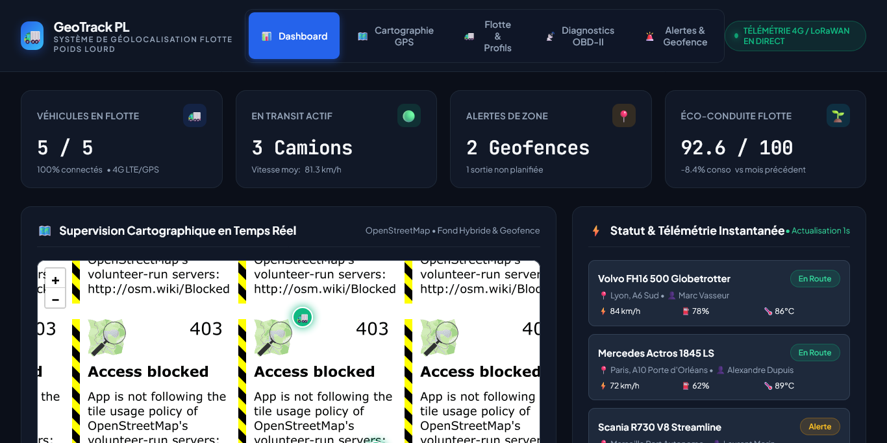
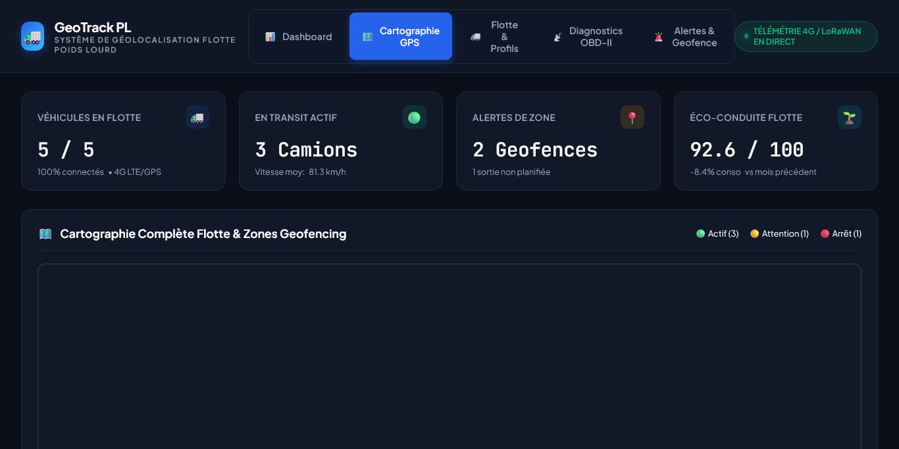
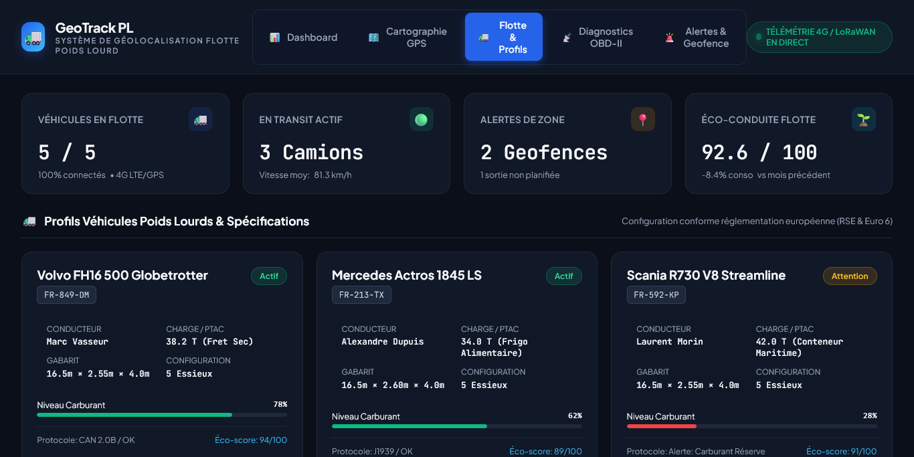
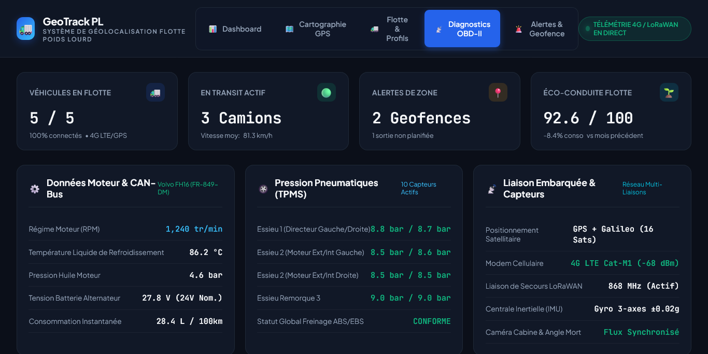
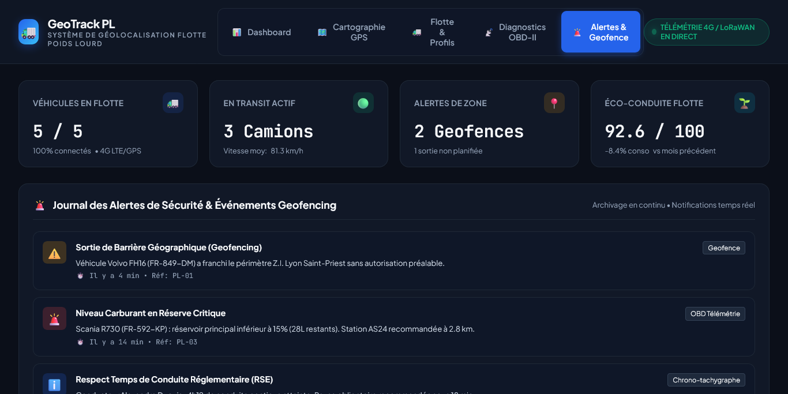
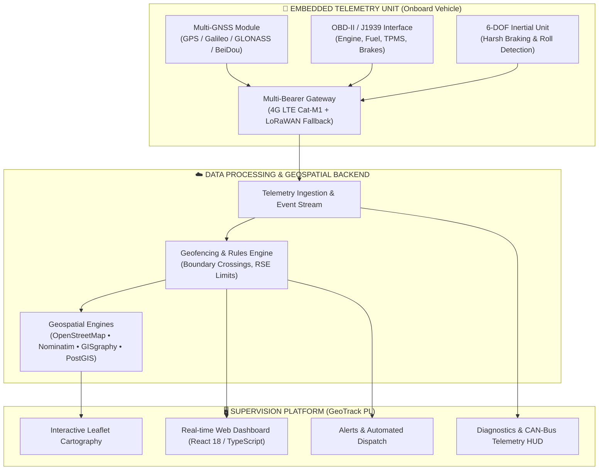

# 🚛 Système de Géolocalisation Poids Lourd (GeoTrack PL)

<p align="center">
  
  
  
  
  
  
</p>

An end-to-end, enterprise-grade **Heavy Goods Vehicle (Poids Lourd) Geolocation & Fleet Telemetry System**. Designed to unify embedded IoT telemetry hardware (multi-GNSS, 4G LTE, fallback LoRaWAN, and OBD-II / J1939 CAN-Bus vehicle diagnostics) with a modern supervisory web platform providing real-time tracking, interactive geofencing, regulatory driving-time compliance (RSE), and predictive fleet maintenance.

---

## 📸 Live Interface & Demonstration

### 1. Supervision Dashboard & Live Fleet Telemetry
High-level operational overview featuring active truck count, real-time speeds, fuel reserves, dynamic geofence alerts, and eco-driving performance indicators.

<p align="center">
  
</p>

---

### 2. High-Precision Cartography & Geofencing (OpenStreetMap / Leaflet)
Real-time GPS vehicle positioning with custom SVG truck indicators, live route traces, and secured geofence zones (e.g. industrial parks and logistics hubs) with automated perimeter breach detection.

<p align="center">
  
</p>

---

### 3. Fleet Vehicle Profiles & Heavy-Duty Configuration
Detailed management of heavy trucks (Volvo FH16, Mercedes Actros, Scania R730, Renault Trucks T, MAN TGX), including physical dimensions (length, height, width), gross combination weight rating (PTAC 44T), axle configurations, and assigned drivers.

<p align="center">
  
</p>

---

### 4. Vehicle Diagnostics & CAN-Bus Telemetry HUD
Live monitoring of critical mechanical parameters via onboard diagnostics (OBD-II / J1939): engine RPM, coolant temperature, oil pressure, 10-wheel TPMS tire pressures, alternator voltage, and instant fuel consumption.

<p align="center">
  
</p>

---

### 5. Security & Geofence Event Journal
Real-time chronological security log capturing boundary entries/exits, harsh braking, speed thresholds, fuel reserve warnings, and regulatory driver rest triggers.

<p align="center">
  
</p>

---

## 🏗️ System Architecture

The solution bridges physical onboard telemetry modules with open geospatial backends and an interactive web supervisor:



---

## 🔧 Hardware & Onboard Telemetry Architecture

The onboard hardware specification coordinates an array of sensors and dual communication links:

| Module | Interface / Standard | Operational Role |
|---|---|---|
| **GNSS Positioning** | GPS, Galileo, GLONASS, BeiDou | High-precision position, heading, altitude, and ground speed calculation |
| **Cellular Modem** | 4G / 5G / GPRS / LTE-M | Primary high-throughput telemetry and diagnostics transmission |
| **LoRaWAN Transceiver** | 868 MHz ISM band | Low-power redundant fallback channel for critical alerts and distress beaconing |
| **CAN-Bus / OBD-II** | J1939 / ISO 15765-4 | Direct ECU engine parameters, fuel levels, diagnostic trouble codes (DTC), odometer |
| **TPMS Unit** | Wireless RF tire sensors | Real-time pressure and temperature monitoring across all tractor and trailer axles |
| **6-DOF IMU** | 3-axis Accelerometer + Gyro | Aggressive acceleration, cornering, harsh braking, and rollover detection |
| **Visual Sensors** | 360° Exterior + Cabin Cameras | Blind spot detection, reversing safety, and driver fatigue monitoring |
| **Tachograph / Driver ID**| Digital Tachograph (VDO/Stoneridge) | Driver card authentication and legal driving-time compliance (RSE) |

---

## 💻 Web Platform & Software Stack

### Frontend Application
- **Core Framework**: React 18 with TypeScript.
- **Mapping & GIS**: Leaflet.js with OpenStreetMap vector/raster tile layers and custom SVG truck glyphs.
- **UI Architecture**: Glassmorphic theme built with modern CSS3 variables, typography powered by *Plus Jakarta Sans* and *JetBrains Mono*.
- **Telemetry Streaming**: Real-time mock simulator with reactive state handling.
- **Portability**: Includes both a full Vite development environment and an instant zero-dependency standalone bundle (`index.html` / `index-cdn.html`).

### Geospatial Components
- **Nominatim**: Open-source reverse geocoding for precise street address resolution.
- **GISgraphy**: Scalable geocoding and address searching.
- **OSGeo Integration**: Open-source geospatial consortium standards and tools reference.

---

## 📁 Repository Structure

```text
Systeme-de-Geolocalisation/
├── Plate forme Web/
│   ├── dev/
│   │   ├── index.html           # Full standalone web platform with live Leaflet map
│   │   ├── index-cdn.html       # Portable CDN demonstration bundle
│   │   ├── package.json         # React 18, Leaflet, and TypeScript configuration
│   │   ├── vite.config.ts       # Vite build configuration
│   │   └── README.md            # Frontend development guidelines
│   ├── assets/                  # Application graphic assets
│   ├── PLATEFORME_WEB_COMPLETE.md # Full architectural blueprint & API documentation
│   └── README.md                # Web module overview
├── Dispositif Materiel.txt       # Hardware & onboard sensor telemetry specification
├── Dossier references/
│   ├── BENCHMARK.md             # Benchmark analysis of Ground Control Stations & autopilots
│   ├── PRESENTATION_STRUCTURE.md# Presentation and architecture breakdown
│   ├── Autopilote drone/        # Autopilot and inertial navigation research papers
│   ├── Ground control station/  # GCS evaluation and application references
│   └── Lcoalisation poid lourd/ # Commercial telematics datasheets and doctoral research
├── docs/
│   └── screenshots/             # High-resolution platform demonstration screenshots
├── .gitignore                   # Excludes heavy external binaries and dependencies
├── LICENSE                      # MIT Open Source License
└── README.md                    # Primary repository documentation
```

---

## 🚀 Quick Start & Demonstration

### Option 1: Instant Browser Launch (No Build Required)

You can launch the complete interactive platform directly in any web browser:

1. Open `Plate forme Web/dev/index.html` in your favorite web browser (Chrome, Firefox, Safari, Edge):
   ```bash
   # On Windows
   start "" "Plate forme Web/dev/index.html"

   # On Linux
   xdg-open "Plate forme Web/dev/index.html"
   ```
2. Interact with the live OpenStreetMap tracking map, switch vehicle profiles, view real-time diagnostics, and examine geofencing alerts.

### Option 2: Vite Development Server

```bash
cd "Plate forme Web/dev"
npm install
npm run dev
```

---

## 📄 License

This project is open-source under the **[MIT License](LICENSE)**.

---

## 👥 Authors & Acknowledgments

Maintained and developed by **[LibrarianPoms](https://github.com/LibrarianPoms)** and contributors.
Built using OpenStreetMap, Leaflet, and standard automotive IoT telemetry protocols.
